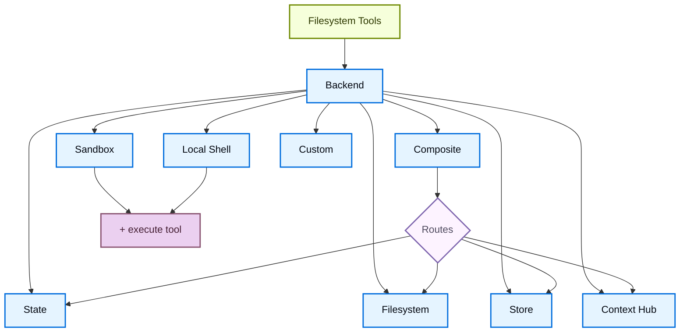

# 后端（Backends）

> 原文：Backends
> 来源：https://docs.langchain.com/oss/javascript/deepagents/backends

---

> 为 Deep Agents 选择并配置文件系统 backends。你可以指定到不同 backends 的路由、实现虚拟文件系统并强制执行策略。

Deep Agents 通过 `ls`、`read_file`、`write_file`、`edit_file`、`glob` 和 `grep` 等 tools 向 agent 暴露一个文件系统接口。这些 tools 通过一个可插拔的 backend 运作。`read_file` tool 在所有 backends 上都原生支持二进制文件（图像、PDF、音频、视频），会返回带有类型化 `content` 和 `mimeType` 的 `ReadResult`。

Sandboxes 和 [`LocalShellBackend`](https://reference.langchain.com/javascript/deepagents/backends/LocalShellBackend) 还提供一个 `execute` tool。
本页解释如何：

* [选择一个 backend](#specify-a-backend)

* [将不同路径路由到不同 backends](#route-to-different-backends)

* [实现自定义 backend](#custom-backends)

* 在文件系统访问上[设置 permissions](#permissions)

* [添加 policy hooks](#add-policy-hooks)

* [处理二进制和多模态文件](#multimodal-and-binary-files)

* [遵循 backend 协议](#protocol-reference)

* [将现有 backends 更新到 v2](#update-existing-backends-to-v2)

> **提示**：当你在 [LangSmith Deployment](/langsmith/deployment) 上部署时，会自动预置一个 store。使用 [LangSmith](/langsmith/observability) tracing 来调试文件路径、权限拒绝和跨 thread 存储。按照 [observability quickstart](/langsmith/observability-quickstart) 完成设置。

> 我们还建议你设置 [LangSmith Engine](/langsmith/engine)，它会监控你的 trace、检测问题并提出修复方案。

> **提示**：要生成一个 agent 可通过文件系统 tools 读取的持久化仓库 wiki，请参阅 [OpenWiki](/oss/openwiki/overview)。

## Quickstart

以下是一些预构建的文件系统 backends，你可以快速与你的 deep agent 一起使用：

| 内置 backend                                                 | 说明                                                                                                                                                                                                                                                                                                                                                                                                                                                                                                         |
| ---------------------------------------------------------------- | ------------------------------------------------------------------------------------------------------------------------------------------------------------------------------------------------------------------------------------------------------------------------------------------------------------------------------------------------------------------------------------------------------------------------------------------------------------------------------------------------------------------- |
| [Default](#statebackend)                                         | `agent = create_deep_agent(model="google_genai:gemini-3.6-flash")` <br /> Thread 作用域。Agent 的默认文件系统 backend 存储在 `langgraph` 状态中。文件在一个 thread 内跨轮次持久化（通过你的 checkpointer），不跨 threads 共享。                                                                                                                                                                                                                                          |
| [Local filesystem persistence](#filesystembackend-local-disk)    | `agent = create_deep_agent(model="google_genai:gemini-3.6-flash", backend=FilesystemBackend(root_dir="/Users/nh/Desktop/"))` <br />这使 deep agent 可以访问你本地机器的文件系统。你可以指定 agent 有权访问的根目录。注意所提供的任何 `root_dir` 都必须是绝对路径。通常，将其包裹在 [CompositeBackend](#compositebackend-router) 中以将 agent 内部数据（卸载的 tool 结果、对话历史）与你的项目文件分开。 |
| [Durable store (LangGraph store)](#storebackend-langgraph-store) | `agent = create_deep_agent(model="google_genai:gemini-3.6-flash", backend=StoreBackend())` <br />这使 agent 可以访问*跨 threads 持久化*的长期存储。非常适合存储适用于 agent 多次执行的更长期 memory 或指令。                                                                                                                                                                                                     |
| [Context Hub](#contexthubbackend)                                | `agent = create_deep_agent(model="google_genai:gemini-3.6-flash", backend=ContextHubBackend("my-agent"))` <br />将文件持久化存储在 LangSmith Hub repo 中，无需预置单独的 LangGraph store。                                                                                                                                                                                                                                                                                                      |
| [Sandbox](/oss/javascript/deepagents/sandboxes)                  | `agent = create_deep_agent(model="google_genai:gemini-3.6-flash", backend=sandbox)` <br />在隔离环境中执行代码。Sandboxes 提供文件系统 tools 以及用于运行 shell 命令的 `execute` tool。可从 LangSmith、AgentCore、Daytona 或其它 [sandbox integrations](/oss/javascript/integrations/sandboxes) 中选择。                                                                                                                                                                         |
| [Local shell](#localshellbackend-local-shell)                    | `agent = create_deep_agent(model="google_genai:gemini-3.6-flash", backend=LocalShellBackend(root_dir=".", env={"PATH": "/usr/bin:/bin"}))` <br />直接在宿主机上进行文件系统与 shell 执行。没有隔离——仅在受控的开发环境中使用。请参阅下方的[安全考量](#localshellbackend-local-shell)。                                                                                                                                                                            |
| [Composite](#compositebackend-router)                            | 默认 thread 作用域，`/memories/` 跨 threads 持久化。Composite backend 具有最大的灵活性。你可以在文件系统中指定不同的路由指向不同的 backends。关于可直接粘贴的示例，请参阅下文的 Composite routing。                                                                                                                                                                                                                                                     |



## 内置 backends

### StateBackend

```ts
import { createDeepAgent, StateBackend } from "deepagents";

// By default we provide a StateBackend
const agent = createDeepAgent();

// Under the hood, it looks like
const agent2 = createDeepAgent({
  backend: new StateBackend(),
});
```

**工作原理：**

* 通过 [`StateBackend`](https://reference.langchain.com/javascript/deepagents/backends/StateBackend) 将文件存储在 LangGraph agent state 中，服务于当前 thread。
* 通过 checkpoints 在同一 thread 上的多个 agent 轮次之间持久化。文件不跨 threads 共享。

> **警告**：设计为在 graph 内部使用。在 graph run 之外调用 backend 方法（例如 `state_backend.upload_files(...)`）在 graph 执行之前不会生效。

**最适合：**

* 作为 agent 写入中间结果的临时草稿空间。
* 自动淘汰大型 tool 输出，agent 随后可以逐段读回。

请注意，此 backend 在 supervisor agent 和 subagents 之间共享，subagent 写入的任何文件即使在该 subagent 执行完成后也会留在 LangGraph agent state 中。
这些文件会继续可供 supervisor agent 和其它 subagents 使用。

### FilesystemBackend（本地磁盘）

[`FilesystemBackend`](https://reference.langchain.com/javascript/deepagents/backends/FilesystemBackend) 在可配置的根目录下读写真实文件。

> **警告**：此 backend 授予 agents 直接的文件系统读写访问权限。
> 请谨慎使用，且仅在适当的环境中使用。
>
> **适当的用例：**
>
> * 本地开发 CLI（编码助手、开发工具）
> * CI/CD 流水线（见下方的安全考量）
>
> **不适当的用例：**
>
> * Web 服务器或 HTTP API —— 请改用 `StateBackend`、`StoreBackend` 或 [sandbox backend](/oss/javascript/deepagents/sandboxes)
>
> **安全风险：**
>
> * Agents 可以读取任何可访问的文件，包括 secrets（API keys、凭据、`.env` 文件）
> * 结合网络工具，secrets 可能通过 SSRF 攻击被泄露
> * 文件修改是永久且不可逆的
>
> **推荐的防护措施：**
>
> 1. 启用 [Human-in-the-Loop (HITL) middleware](/oss/javascript/deepagents/human-in-the-loop) 以审查敏感操作。
> 2. 将 secrets 排除在可访问的文件系统路径之外（尤其是在 CI/CD 中）。
> 3. 对需要文件系统交互的生产环境使用 [sandbox backend](/oss/javascript/deepagents/sandboxes)。
> 4. **始终**将 `virtual_mode=True` 与 `root_dir` 一起使用，以启用基于路径的访问限制（阻止 `..`、`~` 以及 root 之外的绝对路径）。
>
>    请注意，默认值（`virtual_mode=False`）即使设置了 `root_dir` 也不提供任何安全性。

#### Google

```ts
import { createDeepAgent, FilesystemBackend } from "deepagents";

const agent = createDeepAgent({
  model: "google:gemini-3.6-flash",
  backend: new FilesystemBackend({ rootDir: ".", virtualMode: true }),
});
```

#### OpenAI

```ts
import { createDeepAgent, FilesystemBackend } from "deepagents";

const agent = createDeepAgent({
  model: "openai:gpt-5.5",
  backend: new FilesystemBackend({ rootDir: ".", virtualMode: true }),
});
```

#### Anthropic

```ts
import { createDeepAgent, FilesystemBackend } from "deepagents";

const agent = createDeepAgent({
  model: "anthropic:claude-sonnet-5",
  backend: new FilesystemBackend({ rootDir: ".", virtualMode: true }),
});
```

#### OpenRouter

```ts
import { createDeepAgent, FilesystemBackend } from "deepagents";

const agent = createDeepAgent({
  model: "openrouter:z-ai/glm-5.2",
  backend: new FilesystemBackend({ rootDir: ".", virtualMode: true }),
});
```

#### Fireworks

```ts
import { createDeepAgent, FilesystemBackend } from "deepagents";

const agent = createDeepAgent({
  model: "fireworks:accounts/fireworks/models/glm-5p2",
  backend: new FilesystemBackend({ rootDir: ".", virtualMode: true }),
});
```

#### Baseten

```ts
import { createDeepAgent, FilesystemBackend } from "deepagents";

const agent = createDeepAgent({
  model: "baseten:zai-org/GLM-5.2",
  backend: new FilesystemBackend({ rootDir: ".", virtualMode: true }),
});
```

#### Ollama

```ts
import { createDeepAgent, FilesystemBackend } from "deepagents";

const agent = createDeepAgent({
  model: "ollama:north-mini-code-1.0",
  backend: new FilesystemBackend({ rootDir: ".", virtualMode: true }),
});
```

**工作原理：**

* 在可配置的 `root_dir` 下读写真实文件。
* 你可以选择设置 `virtual_mode=True`，将路径沙箱化并规范化到 `root_dir` 之下。
* 使用安全的路径解析，尽可能阻止不安全的符号链接穿越，并可使用 ripgrep 实现快速 `grep`。

**最适合：**

* 你机器上的本地项目
* CI sandboxes
* 挂载的持久化卷

要获得一个 agent 可用这些文件系统 tools 读取的持久化仓库 wiki（来自 `openwiki/`），请参阅 [OpenWiki](/oss/openwiki/overview)。

> **提示**：**在大多数用例中将 `FilesystemBackend` 包裹在 `CompositeBackend` 中**。Deep Agents 会自动将内部数据写入 backend，包括卸载的大型 tool 结果（位于 `/large_tool_results/` 之下）和对话历史（位于 `/conversation_history/` 之下）。当你单独使用 `FilesystemBackend` 时，这些内部文件会被写入 `root_dir` 下的真实磁盘，将 agent 产物与你的项目文件混在一起。
>
> 使用 `CompositeBackend` 将你的项目目录路由到 `FilesystemBackend`，同时将内部路径保留在临时的 `StateBackend` 存储中：
>
> ```typescript
> import { createDeepAgent, CompositeBackend, FilesystemBackend, StateBackend } from "deepagents";
>
> const agent = createDeepAgent({
>   backend: new CompositeBackend(
>     new StateBackend(),
>     {
>       "/workspace/": new FilesystemBackend({ rootDir: "/path/to/project", virtualMode: true }),
>     },
>   ),
> });
> ```
>
> 这样，agent 在 `/workspace/` 下的读写会落到真实磁盘，而卸载的 tool 结果和其它内部数据则留在临时状态中。更多路由模式请参阅[路由到不同 backends](#route-to-different-backends)。

### LocalShellBackend（本地 shell）

> **警告**：此 backend 授予 agents 直接的文件系统读写访问权限**以及**在你宿主机上不受限制的 shell 执行能力。
> 请极其谨慎地使用，且仅在适当的环境中使用。
>
> **适当的用例：**
>
> * 本地开发 CLI（编码助手、开发工具）
> * 你信任 agent 代码的个人开发环境
> * 具有适当 secret 管理的 CI/CD 流水线
>
> **不适当的用例：**
>
> * 生产环境（例如 Web 服务器、API、多租户系统）
> * 处理不受信任的用户输入或执行不受信任的代码
>
> **安全风险：**
>
> * Agents 可以以你的用户权限执行**任意 shell 命令**
> * Agents 可以读取任何可访问的文件，包括 secrets（API keys、凭据、`.env` 文件）
> * Secrets 可能被暴露
> * 文件修改和命令执行是**永久且不可逆的**
> * 命令直接在你的宿主机系统上运行
> * 命令可能消耗无限的 CPU、内存、磁盘
>
> **推荐的防护措施：**
>
> 1. 启用 [Human-in-the-Loop (HITL) middleware](/oss/javascript/deepagents/human-in-the-loop) 以在执行前审查并批准操作。**强烈推荐**这样做。
> 2. 仅在专用开发环境中运行。切勿在共享或生产系统上使用。
> 3. 对需要 shell 执行的生产环境使用 [sandbox backend](/oss/javascript/deepagents/sandboxes)。
>
> **注意：** 在启用 shell 访问的情况下，`virtual_mode=True` 不提供任何安全性，因为命令可以访问系统上的任何路径。

#### Google

```ts
import { createDeepAgent, LocalShellBackend } from "deepagents";

const backend = new LocalShellBackend({ workingDirectory: "." });

const agent = createDeepAgent({
  model: "google:gemini-3.6-flash",
  backend,
});
```

#### OpenAI

```ts
import { createDeepAgent, LocalShellBackend } from "deepagents";

const backend = new LocalShellBackend({ workingDirectory: "." });

const agent = createDeepAgent({
  model: "openai:gpt-5.5",
  backend,
});
```

#### Anthropic

```ts
import { createDeepAgent, LocalShellBackend } from "deepagents";

const backend = new LocalShellBackend({ workingDirectory: "." });

const agent = createDeepAgent({
  model: "anthropic:claude-sonnet-5",
  backend,
});
```

#### OpenRouter

```ts
import { createDeepAgent, LocalShellBackend } from "deepagents";

const backend = new LocalShellBackend({ workingDirectory: "." });

const agent = createDeepAgent({
  model: "openrouter:z-ai/glm-5.2",
  backend,
});
```

#### Fireworks

```ts
import { createDeepAgent, LocalShellBackend } from "deepagents";

const backend = new LocalShellBackend({ workingDirectory: "." });

const agent = createDeepAgent({
  model: "fireworks:accounts/fireworks/models/glm-5p2",
  backend,
});
```

#### Baseten

```ts
import { createDeepAgent, LocalShellBackend } from "deepagents";

const backend = new LocalShellBackend({ workingDirectory: "." });

const agent = createDeepAgent({
  model: "baseten:zai-org/GLM-5.2",
  backend,
});
```

#### Ollama

```ts
import { createDeepAgent, LocalShellBackend } from "deepagents";

const backend = new LocalShellBackend({ workingDirectory: "." });

const agent = createDeepAgent({
  model: "ollama:north-mini-code-1.0",
  backend,
});
```

**工作原理：**

* 扩展 `FilesystemBackend`，增加用于在宿主机上运行 shell 命令的 `execute` tool。
* 命令直接在你的机器上使用 `subprocess.run(shell=True)` 运行，没有沙箱隔离。
* 支持 `timeout`（默认 120s）、`max_output_bytes`（默认 100,000）、`env` 和 `inherit_env` 用于环境变量。
* Shell 命令以 `root_dir` 作为工作目录，但可以访问系统上的任何路径。

**最适合：**

* 本地编码助手和开发工具
* 当你信任 agent 时，开发过程中的快速迭代

### StoreBackend（LangGraph store）

#### Google

```ts
import { createDeepAgent, StoreBackend } from "deepagents";
import { InMemoryStore } from "@langchain/langgraph";

const store = new InMemoryStore(); // Good for local dev; omit for LangSmith Deployment

const agent = createDeepAgent({
  model: "google:gemini-3.6-flash",
  backend: new StoreBackend({
    namespace: (rt) => [rt.serverInfo.user.identity],
  }),
  store,
});
```

#### OpenAI

```ts
import { createDeepAgent, StoreBackend } from "deepagents";
import { InMemoryStore } from "@langchain/langgraph";

const store = new InMemoryStore(); // Good for local dev; omit for LangSmith Deployment

const agent = createDeepAgent({
  model: "openai:gpt-5.5",
  backend: new StoreBackend({
    namespace: (rt) => [rt.serverInfo.user.identity],
  }),
  store,
});
```

#### Anthropic

```ts
import { createDeepAgent, StoreBackend } from "deepagents";
import { InMemoryStore } from "@langchain/langgraph";

const store = new InMemoryStore(); // Good for local dev; omit for LangSmith Deployment

const agent = createDeepAgent({
  model: "anthropic:claude-sonnet-5",
  backend: new StoreBackend({
    namespace: (rt) => [rt.serverInfo.user.identity],
  }),
  store,
});
```

#### OpenRouter

```ts
import { createDeepAgent, StoreBackend } from "deepagents";
import { InMemoryStore } from "@langchain/langgraph";

const store = new InMemoryStore(); // Good for local dev; omit for LangSmith Deployment

const agent = createDeepAgent({
  model: "openrouter:z-ai/glm-5.2",
  backend: new StoreBackend({
    namespace: (rt) => [rt.serverInfo.user.identity],
  }),
  store,
});
```

#### Fireworks

```ts
import { createDeepAgent, StoreBackend } from "deepagents";
import { InMemoryStore } from "@langchain/langgraph";

const store = new InMemoryStore(); // Good for local dev; omit for LangSmith Deployment

const agent = createDeepAgent({
  model: "fireworks:accounts/fireworks/models/glm-5p2",
  backend: new StoreBackend({
    namespace: (rt) => [rt.serverInfo.user.identity],
  }),
  store,
});
```

#### Baseten

```ts
import { createDeepAgent, StoreBackend } from "deepagents";
import { InMemoryStore } from "@langchain/langgraph";

const store = new InMemoryStore(); // Good for local dev; omit for LangSmith Deployment

const agent = createDeepAgent({
  model: "baseten:zai-org/GLM-5.2",
  backend: new StoreBackend({
    namespace: (rt) => [rt.serverInfo.user.identity],
  }),
  store,
});
```

#### Ollama

```ts
import { createDeepAgent, StoreBackend } from "deepagents";
import { InMemoryStore } from "@langchain/langgraph";

const store = new InMemoryStore(); // Good for local dev; omit for LangSmith Deployment

const agent = createDeepAgent({
  model: "ollama:north-mini-code-1.0",
  backend: new StoreBackend({
    namespace: (rt) => [rt.serverInfo.user.identity],
  }),
  store,
});
```

> **注意**：部署到 [LangSmith Deployment](/langsmith/deployment) 时，请省略 `store` 参数。平台会自动为你的 agent 预置一个 store。

> **提示**：`namespace` 参数控制数据隔离。对于多用户部署，始终设置一个 [namespace factory](/oss/javascript/deepagents/backends#namespace-factories) 以按用户或租户隔离数据。

**工作原理：**

* [`StoreBackend`](https://reference.langchain.com/javascript/deepagents/backends/StoreBackend) 将文件存储在运行时提供的 LangGraph [`BaseStore`](https://reference.langchain.com/javascript/langchain-core/stores/BaseStore) 中，从而实现跨 thread 的持久化存储。

**最适合：**

* 当你已在运行一个已配置的 LangGraph store 时（例如 [`BaseStore`](https://reference.langchain.com/javascript/langchain-core/stores/BaseStore) 背后的 Redis、Postgres 或云端实现）。
* 当你通过 [LangSmith Deployment](/langsmith/deployment) 部署 agent 时（会为你的 agent 自动预置一个 store）。

#### Namespace factories

Namespace factory 控制 `StoreBackend` 读写数据的位置。它接收一个 LangGraph [`Runtime`](https://reference.langchain.com/javascript/langchain/index/Runtime)，并返回用作 store namespace 的字符串元组。使用 namespace factories 在用户、租户或 assistants 之间隔离数据。

构造 `StoreBackend` 时，将 namespace factory 传给 `namespace` 参数：

```python
NamespaceFactory = Callable[[Runtime], tuple[str, ...]]
```

`Runtime` 提供：

* `rt.context`——通过 LangGraph 的 [context schema](/oss/javascript/langgraph/graph-api#runtime-context) 传入的用户提供的上下文（例如 `user_id`）

* `rt.serverInfo`——在 LangGraph Server 上运行时特定于服务器的元数据（assistant ID、graph ID、已认证用户）

* `rt.executionInfo`——执行身份信息（thread ID、run ID、checkpoint ID）

> **注意**：`Runtime` 参数在 `deepagents>=1.9.1` 中可用。更早的 1.9.x 版本传入的是 `BackendContext`——请参阅下方的[从 `BackendContext` 迁移](#migrating-from-backendcontext)。`rt.serverInfo` 和 `rt.executionInfo` 需要 `deepagents>=1.9.0`。

**常见的 namespace 模式：**

```typescript
import { StoreBackend } from "deepagents";

// Per-user: each user gets their own isolated storage
const backend = new StoreBackend({
  namespace: (rt) => [rt.serverInfo.user.identity],  // [!code highlight]
});

// Per-assistant: all users of the same assistant share storage
const backend = new StoreBackend({
  namespace: (rt) => [rt.serverInfo.assistantId],  // [!code highlight]
});

// Per-thread: storage scoped to a single conversation
const backend = new StoreBackend({
  namespace: (rt) => [rt.executionInfo.threadId],  // [!code highlight]
});
```

你可以组合多个组件来创建更细粒度的作用域——例如 `(user_id, thread_id)` 用于按用户按会话隔离，或追加诸如 `"filesystem"` 的后缀，以在同一作用域使用多个 store namespaces 时加以区分。

Namespace 组件只能包含字母数字字符、连字符、下划线、点、`@`、`+`、冒号和波浪号。通配符（`*`、`?`）会被拒绝，以防止 glob 注入。

> **警告**：`namespace` 参数在 v1.9.0 中将成为**必需**的。对于新代码，始终显式设置它。

> **注意**：当未提供 namespace factory 时，旧的默认值使用来自 LangGraph config metadata 的 `assistant_id`。这意味着同一 [assistant](/langsmith/assistants) 的所有用户共享相同的存储。对于多用户[走向生产环境](/oss/javascript/deepagents/going-to-production)，始终提供 namespace factory。

### ContextHubBackend

> **注意**：**开始之前：** `ContextHubBackend` 需要在 LangSmith 中设置一个 Context Hub repo。如果你不熟悉 agent repos 和 skill repos，请先阅读 [Context Hub concepts](/langsmith/context-engineering-concepts) 页面。

`ContextHubBackend` 将你的 agent 文件系统存储在 LangSmith Context Hub repo 中。它可以使用一个独立 repo，也可以使用一个链接到 skill repos 的 agent repo。

**Repo 结构：** 在 Context Hub 中，一个 *agent repo* 保存 agent 的顶层指令和配置（例如 `AGENTS.md`、`tools.json`）。它可以链接到一个或多个 *skill repos*，每个都打包为一个可复用的能力（例如带有电子邮件格式化或代码审查指令的 `SKILL.md`）。当你传入 `ContextHubBackend("my-agent")` 时，backend 会将 agent repo 挂载到文件系统根目录；链接的 skill repos 会作为 `/skills/` 下的子目录出现。

这意味着你的 agent 上下文被有意地分散在多个 repos 中：每个 agent 一个 repo，每个 skill 单独的 repo。这种分离让 skills 能够独立地版本化、共享，并在多个 agents 之间复用。如果这让你觉得碎片化，请参阅 [Linked repos](/langsmith/context-engineering-concepts#linked-repos) 了解其理由。

使用 `owner/name` 或 `name` 格式的 repo 标识符来构造它。

> **注意**：在使用 `ContextHubBackend` 之前设置 `LANGSMITH_API_KEY`。

**工作原理：**

* 在首次使用时惰性拉取 Hub repo 树，之后从内存缓存中提供读取。
* 将写入和编辑作为 Hub commits 持久化，并在提交成功后更新缓存。
* 使用乐观的父提交写入（`parent_commit`）：每次推送都针对已知的最新 commit hash。

**行为与限制：**

* 如果 repo 不存在，首次拉取会被视为空；第一次成功写入可以创建该 repo。
* 如果另一个写入者先推进了该 repo，你过期的 parent-commit 写入可能失败。在冲突时重新拉取并重试。
* `upload_files()` 接受 UTF-8 文本。非 UTF-8 文件会按路径被拒绝，返回 `invalid_path`。

**最适合：**

* LangSmith 原生的持久化文件系统存储，无需单独接入 LangGraph `BaseStore`。
* 受益于 Hub commit 历史记录文件系统变更的工作流。

### CompositeBackend（router）

#### Google

```ts
import {
  createDeepAgent,
  CompositeBackend,
  StateBackend,
  StoreBackend,
} from "deepagents";
import { InMemoryStore } from "@langchain/langgraph";

const store = new InMemoryStore();

const agent = createDeepAgent({
  model: "google:gemini-3.6-flash",
  backend: new CompositeBackend(new StateBackend(), {
    "/memories/": new StoreBackend({
      namespace: () => ["memories"],
    }),
  }),
  store,
});
```

#### OpenAI

```ts
import {
  createDeepAgent,
  CompositeBackend,
  StateBackend,
  StoreBackend,
} from "deepagents";
import { InMemoryStore } from "@langchain/langgraph";

const store = new InMemoryStore();

const agent = createDeepAgent({
  model: "openai:gpt-5.5",
  backend: new CompositeBackend(new StateBackend(), {
    "/memories/": new StoreBackend({
      namespace: () => ["memories"],
    }),
  }),
  store,
});
```

#### Anthropic

```ts
import {
  createDeepAgent,
  CompositeBackend,
  StateBackend,
  StoreBackend,
} from "deepagents";
import { InMemoryStore } from "@langchain/langgraph";

const store = new InMemoryStore();

const agent = createDeepAgent({
  model: "anthropic:claude-sonnet-5",
  backend: new CompositeBackend(new StateBackend(), {
    "/memories/": new StoreBackend({
      namespace: () => ["memories"],
    }),
  }),
  store,
});
```

#### OpenRouter

```ts
import {
  createDeepAgent,
  CompositeBackend,
  StateBackend,
  StoreBackend,
} from "deepagents";
import { InMemoryStore } from "@langchain/langgraph";

const store = new InMemoryStore();

const agent = createDeepAgent({
  model: "openrouter:z-ai/glm-5.2",
  backend: new CompositeBackend(new StateBackend(), {
    "/memories/": new StoreBackend({
      namespace: () => ["memories"],
    }),
  }),
  store,
});
```

#### Fireworks

```ts
import {
  createDeepAgent,
  CompositeBackend,
  StateBackend,
  StoreBackend,
} from "deepagents";
import { InMemoryStore } from "@langchain/langgraph";

const store = new InMemoryStore();

const agent = createDeepAgent({
  model: "fireworks:accounts/fireworks/models/glm-5p2",
  backend: new CompositeBackend(new StateBackend(), {
    "/memories/": new StoreBackend({
      namespace: () => ["memories"],
    }),
  }),
  store,
});
```

#### Baseten

```ts
import {
  createDeepAgent,
  CompositeBackend,
  StateBackend,
  StoreBackend,
} from "deepagents";
import { InMemoryStore } from "@langchain/langgraph";

const store = new InMemoryStore();

const agent = createDeepAgent({
  model: "baseten:zai-org/GLM-5.2",
  backend: new CompositeBackend(new StateBackend(), {
    "/memories/": new StoreBackend({
      namespace: () => ["memories"],
    }),
  }),
  store,
});
```

#### Ollama

```ts
import {
  createDeepAgent,
  CompositeBackend,
  StateBackend,
  StoreBackend,
} from "deepagents";
import { InMemoryStore } from "@langchain/langgraph";

const store = new InMemoryStore();

const agent = createDeepAgent({
  model: "ollama:north-mini-code-1.0",
  backend: new CompositeBackend(new StateBackend(), {
    "/memories/": new StoreBackend({
      namespace: () => ["memories"],
    }),
  }),
  store,
});
```

**工作原理：**

* [`CompositeBackend`](https://reference.langchain.com/javascript/deepagents/backends/CompositeBackend) 根据路径前缀将文件操作路由到不同的 backends。
* 在列表和搜索结果中保留原始路径前缀。

**最适合：**

* 当你想让 agent 同时拥有 thread 作用域和跨 thread 存储时，`CompositeBackend` 允许你同时提供 `StateBackend` 和 `StoreBackend`
* 当你有多处信息来源，想作为单个文件系统提供给 agent 时。
  * 例如，你将长期 memories 存储在一个 Store 的 `/memories/` 下，同时又有一个自定义 backend，其文档可在 `/docs/` 处访问。

## 指定 backend

* 将一个 backend 实例传给 `createDeepAgent({ backend: ... })`。文件系统 middleware 会将其用于所有 tooling。
* Backend 必须实现 `AnyBackendProtocol`（`BackendProtocolV1` 或 `BackendProtocolV2`）——例如 `new StateBackend()`、`new FilesystemBackend({ rootDir: "." })`、`new StoreBackend()`。
* 如果省略，默认值为 `new StateBackend()`。

> **注意**：在 1.9.0 版本之前，仅支持 `BackendProtocol`（现在称为 `BackendProtocolV1`）。V1 backends 会在运行时通过 `adaptBackendProtocol()` 自动适配到 V2。继续使用现有 V1 backends 无需修改代码。要更新到 v2，请参阅[将现有 backends 更新到 v2](#update-existing-backends-to-v2)。

## 路由到不同 backends

将 namespace 的某些部分路由到不同的 backends。通常用于跨 threads 持久化 `/memories/*`，并让其它所有内容保持 thread 作用域。

```typescript
import { createDeepAgent, CompositeBackend, FilesystemBackend, StateBackend } from "deepagents";

const agent = createDeepAgent({
  backend: new CompositeBackend(
    new StateBackend(),
    {
      "/memories/": new FilesystemBackend({ rootDir: "/deepagents/myagent", virtualMode: true }),
    },
  ),
});
```

行为：

* `/workspace/plan.md` → `StateBackend`（thread 作用域）
* `/memories/agent.md` → `/deepagents/myagent` 下的 `FilesystemBackend`
* `ls`、`glob`、`grep` 聚合结果并显示原始路径前缀。

说明：

* 更长的前缀优先（例如路由 `"/memories/projects/"` 可以覆盖 `"/memories/"`）。
* 对于 StoreBackend 路由，确保通过 `create_deep_agent(model=..., store=...)` 提供了 store，或由平台预置。
* Deep Agents 将内部数据（卸载的 tool 结果、对话历史）写入默认 backend。使用 `StateBackend` 作为默认值，让这些产物保持临时性，避免将它们写入磁盘或持久化 store。完整示例请参阅 [FilesystemBackend 提示](#filesystembackend-local-disk)。

## 自定义 backends

实现一个自定义 backend，将 Deep Agents 连接到数据库、对象存储和远程文件系统等存储系统。示例请参阅[社区构建的 backends](/oss/javascript/integrations/backends)。

### 实现 backend 协议

实现 [`BackendProtocol`](https://reference.langchain.com/javascript/deepagents/backends/BackendProtocol)（`BackendProtocolV2`）并提供以下方法：

| 方法      | 签名                                                                                               | 作用说明                                                                                            |
| --------- | ------------------------------------------------------------------------------------------------------- | ------------------------------------------------------------------------------------------------------- |
| `ls`      | `(path: string) => Promise<LsResult>`                                                                   | 列出给定路径下的文件和目录。                                                           |
| `read`    | `(filePath: string, offset?, limit?) => Promise<ReadResult>`                                            | 返回文件内容，可选择分页。二进制文件返回带 `mimeType` 的 `Uint8Array` 内容。 |
| `readRaw` | `(filePath: string) => Promise<ReadRawResult>`                                                          | 返回原始 `FileData`（由框架内部使用）。                                               |
| `write`   | `(filePath: string, content: string) => Promise<WriteResult>`                                           | 创建或覆盖文件。                                                                             |
| `edit`    | `(filePath: string, oldString: string, newString: string, replaceAll?: boolean) => Promise<EditResult>` | 在现有文件内进行查找替换。                                                               |
| `glob`    | `(pattern: string, path?: string) => Promise<GlobResult>`                                               | 返回匹配 glob 模式的路径。                                                                   |
| `grep`    | `(pattern: string, path?, glob?) => Promise<GrepResult>`                                                | 在文件内容中搜索字面字符串。                                                              |

若要同时支持 `execute` tool（运行 shell 命令），请改为实现 [`SandboxBackendProtocol`](https://reference.langchain.com/javascript/deepagents/backends/SandboxBackendProtocol)，它在 `BackendProtocolV2` 基础上扩展了一个 `execute` 方法。

所有方法都必须返回带有可选 `error` 字段的结构化 Result 对象——对于缺失的文件或无效的模式不要抛出异常。

#### 示例：S3 风格的 backend 骨架

这个骨架将文件系统路径映射为对象键。用你存储客户端的 list、read、search、upload 和 read-modify-write 操作填充每个方法。

```typescript
import {
  type BackendProtocolV2,
  type EditResult,
  type GlobResult,
  type GrepResult,
  type LsResult,
  type ReadRawResult,
  type ReadResult,
  type WriteResult,
} from "deepagents";

class S3Backend implements BackendProtocolV2 {
  constructor(private bucket: string, private prefix: string = "") {
    this.prefix = prefix.replace(/\/$/, "");
  }

  private key(path: string): string {
    return `${this.prefix}${path}`;
  }

  async ls(path: string): Promise<LsResult> {
    ...
  }

  async read(filePath: string, offset?: number, limit?: number): Promise<ReadResult> {
    ...
  }

  async readRaw(filePath: string): Promise<ReadRawResult> {
    ...
  }

  async grep(pattern: string, path?: string | null, glob?: string | null): Promise<GrepResult> {
    ...
  }

  async glob(pattern: string, path = "/"): Promise<GlobResult> {
    ...
  }

  async write(filePath: string, content: string): Promise<WriteResult> {
    ...
  }

  async edit(filePath: string, oldString: string, newString: string, replaceAll?: boolean): Promise<EditResult> {
    ...
  }
}
```

## Permissions

使用 [permissions](/oss/javascript/deepagents/permissions) 以声明方式控制 agent 可以读取或写入哪些文件和目录。Permissions 适用于内置的文件系统 tools，并在调用 backend 之前求值。

关于包括规则顺序、subagent permissions 和 composite backend 交互在内的完整选项集合，请参阅 [permissions guide](/oss/javascript/deepagents/permissions)。

## 添加 policy hooks

对于超出基于路径的允许/拒绝规则的自定义校验逻辑（速率限制、审计日志、内容检查），通过继承或包裹 backend 来强制执行企业规则。

在选定的前缀下阻止写入/编辑（子类化）：

```typescript
import { FilesystemBackend, type WriteResult, type EditResult } from "deepagents";

class GuardedBackend extends FilesystemBackend {
  private denyPrefixes: string[];

  constructor({ denyPrefixes, ...options }: { denyPrefixes: string[]; rootDir?: string }) {
    super(options);
    this.denyPrefixes = denyPrefixes.map(p => p.endsWith("/") ? p : p + "/");
  }

  async write(filePath: string, content: string): Promise<WriteResult> {
    if (this.denyPrefixes.some(p => filePath.startsWith(p))) {
      return { error: `Writes are not allowed under ${filePath}` };
    }
    return super.write(filePath, content);
  }

  async edit(filePath: string, oldString: string, newString: string, replaceAll = false): Promise<EditResult> {
    if (this.denyPrefixes.some(p => filePath.startsWith(p))) {
      return { error: `Edits are not allowed under ${filePath}` };
    }
    return super.edit(filePath, oldString, newString, replaceAll);
  }
}
```

通用包裹器（适用于任何 backend）：

```typescript
import {
  type BackendProtocolV2,
  type LsResult,
  type ReadResult,
  type ReadRawResult,
  type GrepResult,
  type GlobResult,
  type WriteResult,
  type EditResult,
} from "deepagents";

class PolicyWrapper implements BackendProtocolV2 {
  private denyPrefixes: string[];

  constructor(private inner: BackendProtocolV2, denyPrefixes: string[] = []) {
    this.denyPrefixes = denyPrefixes.map(p => p.endsWith("/") ? p : p + "/");
  }

  private isDenied(path: string): boolean {
    return this.denyPrefixes.some(p => path.startsWith(p));
  }

  ls(path: string): Promise<LsResult> { return this.inner.ls(path); }
  read(filePath: string, offset?: number, limit?: number): Promise<ReadResult> { return this.inner.read(filePath, offset, limit); }
  readRaw(filePath: string): Promise<ReadRawResult> { return this.inner.readRaw(filePath); }
  grep(pattern: string, path?: string | null, glob?: string | null): Promise<GrepResult> { return this.inner.grep(pattern, path, glob); }
  glob(pattern: string, path?: string): Promise<GlobResult> { return this.inner.glob(pattern, path); }

  async write(filePath: string, content: string): Promise<WriteResult> {
    if (this.isDenied(filePath)) return { error: `Writes are not allowed under ${filePath}` };
    return this.inner.write(filePath, content);
  }

  async edit(filePath: string, oldString: string, newString: string, replaceAll = false): Promise<EditResult> {
    if (this.isDenied(filePath)) return { error: `Edits are not allowed under ${filePath}` };
    return this.inner.edit(filePath, oldString, newString, replaceAll);
  }
}
```

## 多模态与二进制文件

> **注意**：多模态文件支持（PDFs、音频、视频）需要 `deepagents>=1.9.0`。

V2 backends 原生支持二进制文件。当 `read()` 遇到二进制文件（由文件扩展名对应的 MIME 类型确定）时，它会返回一个 `ReadResult`，其内容为 `Uint8Array` 并带有相应的 `mimeType`。文本文件返回 `string` 内容。

### 支持的 MIME 类型

| 分类      | 扩展名                                                               | MIME 类型                                                                                                                      |
| --------- | ------------------------------------------------------------------------ | ------------------------------------------------------------------------------------------------------------------------------- |
| 图像      | `.png`, `.jpg`/`.jpeg`, `.gif`, `.webp`, `.svg`, `.heic`, `.heif`        | `image/png`, `image/jpeg`, `image/gif`, `image/webp`, `image/svg+xml`, `image/heic`, `image/heif`                               |
| 音频      | `.mp3`, `.wav`, `.aiff`, `.aac`, `.ogg`, `.flac`                         | `audio/mpeg`, `audio/wav`, `audio/aiff`, `audio/aac`, `audio/ogg`, `audio/flac`                                                 |
| 视频      | `.mp4`, `.webm`, `.mpeg`/`.mpg`, `.mov`, `.avi`, `.flv`, `.wmv`, `.3gpp` | `video/mp4`, `video/webm`, `video/mpeg`, `video/quicktime`, `video/x-msvideo`, `video/x-flv`, `video/x-ms-wmv`, `video/3gpp`    |
| 文档      | `.pdf`, `.ppt`, `.pptx`                                                  | `application/pdf`, `application/vnd.ms-powerpoint`, `application/vnd.openxmlformats-officedocument.presentationml.presentation` |
| 文本      | `.txt`, `.html`, `.json`, `.js`, `.ts`, `.py` 等                      | `text/plain`, `text/html`, `application/json` 等                                                                             |

### 读取二进制文件

```typescript
const result = await backend.read("/workspace/screenshot.png");

if (result.error) {
  console.error(result.error);
} else if (result.content instanceof Uint8Array) {
  // Binary file — content is Uint8Array, mimeType is set
  console.log(`Binary file: ${result.mimeType}`); // "image/png"
} else {
  // Text file — content is string
  console.log(`Text file: ${result.mimeType}`); // "text/plain"
}
```

### FileData 格式

`FileData` 是用于在 state 和 store backends 中存储文件内容的类型。

```typescript
type FileData =
  // Current format (v2)
  | {
      content: string | Uint8Array; // string for text, Uint8Array for binary
      mimeType: string;             // e.g. "text/plain", "image/png"
      created_at: string;           // ISO 8601 timestamp
      modified_at: string;          // ISO 8601 timestamp
    }
  // Legacy format (v1)
  | {
      content: string[];            // array of lines
      created_at: string;           // ISO 8601 timestamp
      modified_at: string;          // ISO 8601 timestamp
    };
```

Backends 在从 state 或 store 读取时可能会遇到任一格式。框架会透明地处理两者。新的写入默认使用 v2 格式。在滚动部署期间，当较旧的读取者需要旧格式时，向 backend 构造函数传入 `fileFormat: "v1"`（例如 `new StoreBackend({ fileFormat: "v1" })`）。

## 从 backend factories 迁移

> **警告**：自 `deepagents` 1.9.0 起，backend factory 模式已**弃用**。请直接传入预构造的 backend 实例，而非 factory 函数。

此前，像 `StateBackend` 和 `StoreBackend` 这样的 backends 需要一个接收 runtime 对象的 factory 函数，因为它们需要运行时上下文（state、store）才能运作。现在 backends 通过 LangGraph 的 `get_config()`、`get_store()` 和 `get_runtime()` 辅助函数在内部解析此上下文，因此你可以直接传入实例。

### 有什么变化

| 之前（已弃用）                                                        | 之后                                                   |
| -------------------------------------------------------------------- | ------------------------------------------------------- |
| `backend=lambda rt: StateBackend(rt)`                                | `backend=StateBackend()`                                |
| `backend=lambda rt: StoreBackend(rt)`                                | `backend=StoreBackend()`                                |
| `backend=lambda rt: CompositeBackend(default=StateBackend(rt), ...)` | `backend=CompositeBackend(default=StateBackend(), ...)` |
| `backend: (config) => new StateBackend(config)`                      | `backend: new StateBackend()`                           |
| `backend: (config) => new StoreBackend(config)`                      | `backend: new StoreBackend()`                           |

### 已弃用的 APIs

| 已弃用                                                       | 替代方案                                            |
| ------------------------------------------------------------ | ------------------------------------------------------ |
| `BackendFactory` 类型                                        | 直接传入 backend 实例                       |
| `BackendRuntime` 接口                                   | Backends 在内部解析上下文                    |
| `StateBackend(runtime, options?)` 构造函数重载       | `new StateBackend(options?)`                           |
| `StoreBackend(stateAndStore, options?)` 构造函数重载 | `new StoreBackend(options?)`                           |
| `WriteResult` 和 `EditResult` 上的 `filesUpdate` 字段        | State 写入现在由 backend 内部处理 |

> **注意**：Factory 模式在运行时仍然可用，并会发出弃用警告。请在下个主版本之前将你的代码更新为使用直接实例。

### 迁移示例

```typescript
// Before (deprecated)
import { createDeepAgent, CompositeBackend, StateBackend, StoreBackend } from "deepagents";

const agent = createDeepAgent({
  backend: (config) => new CompositeBackend(
    new StateBackend(config),
    { "/memories/": new StoreBackend(config, {
      namespace: (rt) => [rt.serverInfo.user.identity],
    }) },
  ),
});

// After
const agent = createDeepAgent({
  backend: new CompositeBackend(
    new StateBackend(),
    { "/memories/": new StoreBackend({
      namespace: (rt) => [rt.serverInfo.user.identity],
    }) },
  ),
});
```

### 从 `BackendContext` 迁移

在 `deepagents>=0.5.2`（Python）和 `deepagents>=1.9.1`（TypeScript）中，namespace factories 直接接收 LangGraph [`Runtime`](https://reference.langchain.com/javascript/langchain/index/Runtime)，而非 `BackendContext` 包裹器。旧的 `BackendContext` 形式仍可通过向后兼容的 `.runtime` 和 `.state` 访问器工作，但这些访问器会发出弃用警告，并将在 `deepagents>=0.7` 中移除。

**有什么变化：**

* factory 参数现在是 `Runtime`，而非 `BackendContext`。
* 去掉 `.runtime` 访问器——例如 `ctx.runtime.context.user_id` 变为 `rt.server_info.user.identity`。
* `ctx.state` 没有直接替代品。Namespace 信息应在一个 run 的生命周期内保持只读且稳定，而 state 是可变的且逐步变化——由它派生 namespace 会有数据落入不一致键下的风险。如果你有需要读取 agent state 的用例，请[提交 issue](https://github.com/langchain-ai/deepagents/issues)。

```typescript
// Before (deprecated, removed in v0.7)
new StoreBackend({
  namespace: (ctx) => [ctx.runtime.context.userId],  // [!code --]
});

// After
new StoreBackend({
  namespace: (rt) => [rt.serverInfo.user.identity],  // [!code ++]
});
```

## 协议参考

Backends 必须实现 [`BackendProtocol`](https://reference.langchain.com/javascript/deepagents/backends/BackendProtocol)。

必需方法：

* `ls(path: str) -> LsResult`
  * 返回至少带有 `path` 的条目。在可用时包含 `is_dir`、`size`、`modified_at`。按 `path` 排序以获得确定性输出。
* `read(file_path: str, offset: int = 0, limit: int = 2000) -> ReadResult`
  * 成功时返回文件数据。文件缺失时，返回 `ReadResult(error="Error: File '/x' not found")`。
* `grep(pattern: str, path: Optional[str] = None, glob: Optional[str] = None) -> GrepResult`
  * 返回结构化匹配。出错时，返回 `GrepResult(error="...")`（不要抛出）。
* `glob(pattern: str, path: Optional[str] = None) -> GlobResult`
  * 以 `FileInfo` 条目返回匹配的文件（没有则为空列表）。
* `write(file_path: str, content: str) -> WriteResult`
  * 仅创建。冲突时，返回 `WriteResult(error=...)`。成功时设置 `path`，对于 state backends 设置 `files_update={...}`；外部 backends 应使用 `files_update=None`。
* `edit(file_path: str, old_string: str, new_string: str, replace_all: bool = False) -> EditResult`
  * 除非 `replace_all=True`，否则强制 `old_string` 的唯一性。如果未找到，返回错误。成功时包含 `occurrences`。

支持类型：

* `LsResult(error, entries)`——成功时 `entries` 是 `list[FileInfo]`，失败时为 `None`。
* `ReadResult(error, file_data)`——成功时 `file_data` 是一个 `FileData` dict，失败时为 `None`。
* `GrepResult(error, matches)`——成功时 `matches` 是 `list[GrepMatch]`，失败时为 `None`。
* `GlobResult(error, matches)`——成功时 `matches` 是 `list[FileInfo]`，失败时为 `None`。
* `WriteResult(error, path, files_update)`
* `EditResult(error, path, files_update, occurrences)`
* `FileInfo` 字段：`path`（必需），可选的 `is_dir`、`size`、`modified_at`。
* `GrepMatch` 字段：`path`、`line`、`text`。
* `FileData` 字段：`content`（str）、`encoding`（`"utf-8"` 或 `"base64"`）、`created_at`、`modified_at`。
  :::

Backends 实现 `BackendProtocolV2`。所有查询方法都返回带有 `{ error?: string, ...data }` 的结构化 Result 对象。

### 必需方法

* **`ls(path: string) → LsResult`**
  * 列出指定目录中的文件和目录（非递归）。目录在其路径中带有尾随 `/` 且 `is_dir=true`。在可用时包含 `is_dir`、`size`、`modified_at`。

* **`read(filePath: string, offset?: number, limit?: number) → ReadResult`**
  * 读取文件内容。对于文本文件，内容按行 offset/limit 分页（默认 offset 0、limit 500）。对于二进制文件，返回完整的原始 `Uint8Array` 内容并设置 `mimeType` 字段。文件缺失时，返回 `{ error: "File '/x' not found" }`。

* **`readRaw(filePath: string) → ReadRawResult`**
  * 将文件内容作为原始 `FileData` 读取。返回包括时间戳在内的完整文件数据。

* **`grep(pattern: string, path?: string | null, glob?: string | null) → GrepResult`**
  * 在文件内容中搜索字面文本模式。二进制文件（由 MIME 类型确定）会被跳过。失败时返回 `{ error: "..." }`。

* **`glob(pattern: string, path?: string) → GlobResult`**
  * 以 `FileInfo` 条目返回匹配 glob 模式的文件。

* **`write(filePath: string, content: string) → WriteResult`**
  * 仅创建语义。冲突时返回 `{ error: "..." }`。成功时设置 `path`，对于 state backends 设置 `filesUpdate={...}`；外部 backends 应使用 `filesUpdate=null`。

* **`edit(filePath: string, oldString: string, newString: string, replaceAll?: boolean) → EditResult`**
  * 除非 `replaceAll=true`，否则强制 `oldString` 的唯一性。如果未找到，返回错误。成功时包含 `occurrences`。

### 可选方法

* **`uploadFiles(files: Array<[string, Uint8Array]>) → FileUploadResponse[]`**——上传多个文件（用于 sandbox backends）。
* **`downloadFiles(paths: string[]) → FileDownloadResponse[]`**——下载多个文件（用于 sandbox backends）。

### 结果类型

| 类型            | 成功字段                                        | 错误字段    |
| --------------- | ----------------------------------------------------- | ----------- |
| `ReadResult`    | `content?: string \| Uint8Array`, `mimeType?: string` | `error`     |
| `ReadRawResult` | `data?: FileData`                                     | `error`     |
| `LsResult`      | `files?: FileInfo[]`                                  | `error`     |
| `GlobResult`    | `files?: FileInfo[]`                                  | `error`     |
| `GrepResult`    | `matches?: GrepMatch[]`                               | `error`     |
| `WriteResult`   | `path?: string`                                       | `error`     |
| `EditResult`    | `path?: string`, `occurrences?: number`               | `error`     |

### 支持类型

* **`FileInfo`**——`path`（必需），可选的 `is_dir`、`size`、`modified_at`。
* **`GrepMatch`**——`path`、`line`（从 1 开始计数）、`text`。
* **`FileData`**——带时间戳的文件内容。请参阅 [FileData 格式](#filedata-format)。

### Sandbox 扩展

`SandboxBackendProtocolV2` 在 `BackendProtocolV2` 基础上扩展了：

* **`execute(command: string) → ExecuteResponse`**——在 sandbox 中运行 shell 命令。
* **`readonly id: string`**——sandbox 实例的唯一标识符。

## 将现有 backends 更新到 V2

### 迁移指南

#### 方法重命名

| V1 方法                         | V2 方法                         | 返回类型变化                           |
| ------------------------------- | ------------------------------- | -------------------------------------- |
| `lsInfo(path)`                  | `ls(path)`                      | `FileInfo[]` → `LsResult`              |
| `read(filePath, offset, limit)` | `read(filePath, offset, limit)` | `string` → `ReadResult`                |
| `readRaw(filePath)`             | `readRaw(filePath)`             | `FileData` → `ReadRawResult`           |
| `grepRaw(pattern, path, glob)`  | `grep(pattern, path, glob)`     | `GrepMatch[] \| string` → `GrepResult` |
| `globInfo(pattern, path)`       | `glob(pattern, path)`           | `FileInfo[]` → `GlobResult`            |
| `write(...)`                    | `write(...)`                    | 不变（`WriteResult`）              |
| `edit(...)`                     | `edit(...)`                     | 不变（`EditResult`）               |

#### 类型重命名

| V1 类型                  | V2 类型                    |
| ------------------------ | -------------------------- |
| `BackendProtocol`        | `BackendProtocolV2`        |
| `SandboxBackendProtocol` | `SandboxBackendProtocolV2` |

#### 适配工具

如果你有现有的 V1 backends 需要与仅支持 V2 的代码一起使用，请使用适配函数：

```typescript
import { adaptBackendProtocol, adaptSandboxProtocol } from "deepagents";

// Adapt a V1 backend to V2
const v2Backend = adaptBackendProtocol(v1Backend);

// Adapt a V1 sandbox to V2
const v2Sandbox = adaptSandboxProtocol(v1Sandbox);
```

> **注意**：框架会自动适配传入 `createDeepAgent()` 的 V1 backends。仅在直接调用协议方法时才需要手动适配。

## 另请参阅

* [OpenWiki](/oss/openwiki/overview)：生成 agent 可通过文件系统 tools 读取的持久化仓库 Markdown
* [Memory](/oss/javascript/deepagents/memory)：基于文件系统的长期 memory
* [Sandboxes](/oss/javascript/deepagents/sandboxes)：隔离的文件系统与 shell 执行

***
