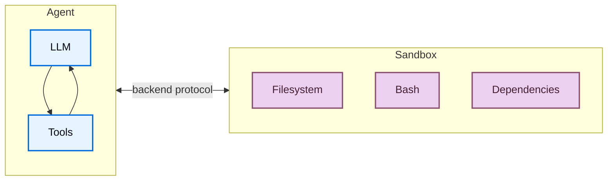
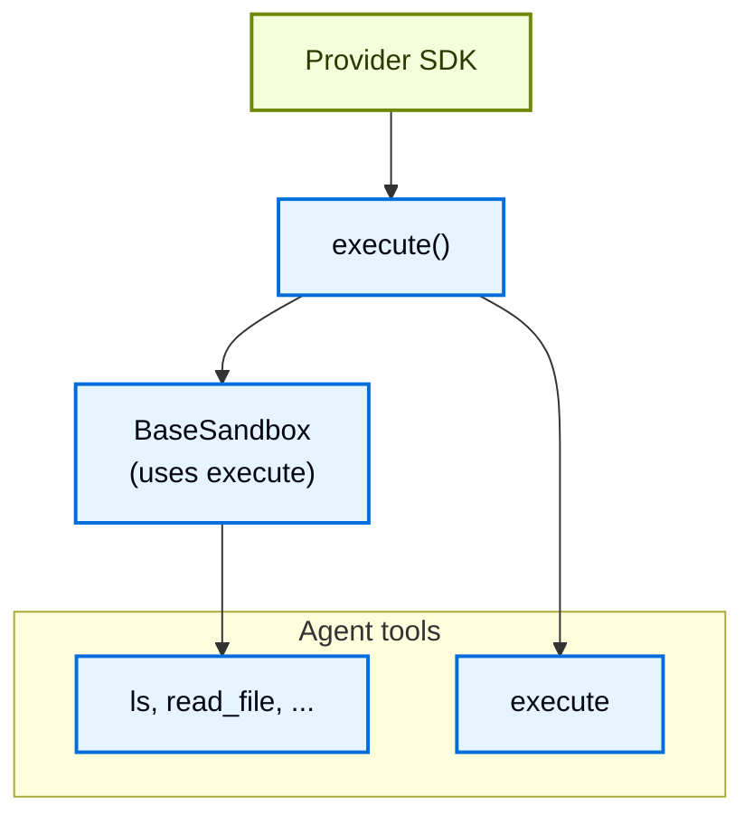
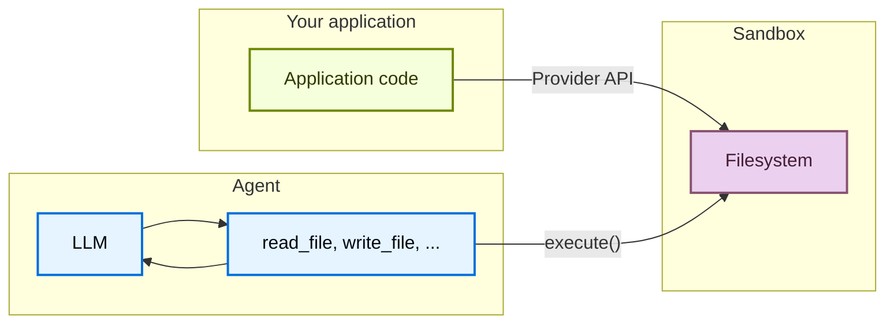

# 沙箱（Sandboxes）

> 原文：Sandboxes
> 来源：https://docs.langchain.com/oss/javascript/deepagents/sandboxes

---

> 使用 sandbox backends 在隔离环境中执行代码。

Agents 会生成代码、与文件系统交互并运行 shell 命令。由于你无法预测 agent 可能做什么，因此让它的环境处于隔离状态非常重要，这样它就无法访问凭证、文件或网络。Sandboxes 通过在 agent 的执行环境与你的宿主系统之间创建边界来提供这种隔离。

在 Deep Agents 中，**sandboxes 是 [backends](/oss/javascript/deepagents/backends)**，它们定义了 agent 运行的环境。与其他仅暴露文件操作的 backends（State、Filesystem、Store）不同，sandbox backends 还会给 agent 一个用于运行 shell 命令的 `execute` 工具。当你配置 sandbox backend 时，agent 会获得：

* 所有标准的文件系统工具（`ls`、`read_file`、`write_file`、`edit_file`、`glob`、`grep`）

* 用于在 sandbox 中运行任意 shell 命令的 `execute` 工具

* 保护你宿主系统的安全边界



## 为什么使用 sandboxes？

Sandboxes 用于安全。
它们让 agents 可以执行任意代码、访问文件并使用网络，而不会危及你的凭证、本地文件或宿主系统。
当 agents 自主运行时，这种隔离至关重要。

Sandboxes 在以下场景尤其有用：

* Coding agents：可自主运行的 agents 可以使用 shell、git、克隆仓库（许多提供方提供原生 git API，例如 [Daytona's git operations](https://www.daytona.io/docs/en/git-operations/)），并运行 Docker-in-Docker 以进行构建和测试流水线
* Data analysis agents：在安全、隔离的环境中加载文件、安装数据分析库（pandas、numpy 等）、运行统计计算，并创建诸如 PowerPoint 演示文稿之类的输出

> **提示**：**使用 Deep Agents Code？** Deep Agents Code 通过 `--sandbox` 标志内置了对 sandbox 的支持。关于 Deep Agents Code 特有的设置、标志（`--sandbox-id`、`--sandbox-setup`）和示例，请参阅[使用远程 sandboxes](/oss/deepagents/code/remote-sandboxes)。

> **说明**：**如果你在寻找 LangSmith sandboxes：** LangSmith 提供第一方托管的 sandboxes，你可以直接从 LangSmith UI 或 SDK 使用，无需第三方账号。关于托管的 sandbox 资源、快照、服务 URL 和认证代理，请参阅 [LangSmith Sandboxes](/langsmith/sandboxes)。

## 基本用法

这些示例假设你已经使用提供方的 SDK 创建了 sandbox/devbox，并已设置好凭证。关于注册、认证和提供方特定的生命周期细节，请参阅[可用的提供方](#available-providers)。

```ts
import { createDeepAgent, LangSmithSandbox } from "deepagents";
import { ChatAnthropic } from "@langchain/anthropic";
import { SandboxClient } from "langsmith/sandbox";

const client = new SandboxClient();
const lsSandbox = await client.createSandbox();

try {
  const agent = createDeepAgent({
    model: new ChatAnthropic({ model: "claude-opus-4-8" }),
    systemPrompt: "You are a coding assistant with sandbox access.",
    backend: new LangSmithSandbox({ sandbox: lsSandbox }),
  });

  const result = await agent.invoke({
    messages: [
      {
        role: "user",
        content: "Create a hello world Python script and run it",
      },
    ],
  });
  void result;
} finally {
  await client.deleteSandbox(lsSandbox.name);
}
```

> **View example trace**（[链接](https://smith.langchain.com/public/736ab6fc-a61c-4ee8-bfbc-dde6bd19382c/r)）：Open a public LangSmith run for this example.

> **提示**：[LangSmith](https://smith.langchain.com?utm_source=docs&utm_medium=cta&utm_campaign=langsmith-signup&utm_content=oss-deepagents-sandboxes) traces 会展示 sandbox 内运行了哪些 shell 命令，以及 agent 如何使用文件系统工具。按照[可观测性快速开始](/langsmith/observability-quickstart)进行设置。关于托管的 sandbox 托管服务，请参阅 [LangSmith Sandboxes](/langsmith/sandboxes)。
>
> 我们还建议你设置 [LangSmith Engine](/langsmith/engine)，它会监控你的 traces、检测问题并提出修复建议。

## 可用的提供方

关于提供方特定的设置、认证和生命周期细节，请参阅 [sandbox integrations](/oss/javascript/integrations/sandboxes)。

## 生命周期与作用域

大多数应用选择要么每个 [thread](/langsmith/use-threads) 一个 sandbox（线程作用域），要么同一 [assistant](/langsmith/assistants) 上的每个线程共享一个 sandbox（assistant 作用域）。

Sandboxes 在被关闭之前会消耗资源并花费金钱。请确保在不再使用时关闭 sandboxes。

关于完整的生命周期表、异步 [graph factory](/langsmith/graph-rebuild) 说明、TTL 行为、LangGraph Deployment 接线以及客户端示例，请参阅 Going to production 中的 [Sandbox lifecycle](/oss/javascript/deepagents/going-to-production#lifecycle)。

### 线程作用域（默认）

每个对话都有自己的 sandbox。首次运行会创建它；同一线程上的后续回合会复用它。当线程结束或 sandbox TTL 过期时，环境就会消失。像下面示例那样用 sandbox 名称或元数据存储映射，以便每次运行都解析到同一个 sandbox。

> **提示**：当用户可能在空闲时间后回来时，请在 sandbox 上配置 TTL，以便提供方自动删除或归档空闲环境。

#### Google

```ts
import { createDeepAgent, LangSmithSandbox } from "deepagents";
import { SandboxClient } from "langsmith/sandbox";
import type { LangGraphRunnableConfig } from "@langchain/langgraph";

const client = new SandboxClient();

export async function agent(config: LangGraphRunnableConfig) {
  const threadId = config.configurable?.thread_id as string; // [!code highlight]
  const sandboxName = `thread-${threadId}`;
  const existing = (await client.listSandboxes()).filter(
    (sb) => sb.name === sandboxName,
  );
  const lsSandbox =
    existing[0] ??
    (await client.createSandbox({
      name: sandboxName,
      idleTtlSeconds: 3600, // TTL: clean up when idle
    }));
  return createDeepAgent({
    model: "google:gemini-3.6-flash",
    backend: new LangSmithSandbox({ sandbox: lsSandbox }),
  });
}
```

#### OpenAI

```ts
import { createDeepAgent, LangSmithSandbox } from "deepagents";
import { SandboxClient } from "langsmith/sandbox";
import type { LangGraphRunnableConfig } from "@langchain/langgraph";

const client = new SandboxClient();

export async function agent(config: LangGraphRunnableConfig) {
  const threadId = config.configurable?.thread_id as string; // [!code highlight]
  const sandboxName = `thread-${threadId}`;
  const existing = (await client.listSandboxes()).filter(
    (sb) => sb.name === sandboxName,
  );
  const lsSandbox =
    existing[0] ??
    (await client.createSandbox({
      name: sandboxName,
      idleTtlSeconds: 3600, // TTL: clean up when idle
    }));
  return createDeepAgent({
    model: "openai:gpt-5.5",
    backend: new LangSmithSandbox({ sandbox: lsSandbox }),
  });
}
```

#### Anthropic

```ts
import { createDeepAgent, LangSmithSandbox } from "deepagents";
import { SandboxClient } from "langsmith/sandbox";
import type { LangGraphRunnableConfig } from "@langchain/langgraph";

const client = new SandboxClient();

export async function agent(config: LangGraphRunnableConfig) {
  const threadId = config.configurable?.thread_id as string; // [!code highlight]
  const sandboxName = `thread-${threadId}`;
  const existing = (await client.listSandboxes()).filter(
    (sb) => sb.name === sandboxName,
  );
  const lsSandbox =
    existing[0] ??
    (await client.createSandbox({
      name: sandboxName,
      idleTtlSeconds: 3600, // TTL: clean up when idle
    }));
  return createDeepAgent({
    model: "anthropic:claude-sonnet-5",
    backend: new LangSmithSandbox({ sandbox: lsSandbox }),
  });
}
```

#### OpenRouter

```ts
import { createDeepAgent, LangSmithSandbox } from "deepagents";
import { SandboxClient } from "langsmith/sandbox";
import type { LangGraphRunnableConfig } from "@langchain/langgraph";

const client = new SandboxClient();

export async function agent(config: LangGraphRunnableConfig) {
  const threadId = config.configurable?.thread_id as string; // [!code highlight]
  const sandboxName = `thread-${threadId}`;
  const existing = (await client.listSandboxes()).filter(
    (sb) => sb.name === sandboxName,
  );
  const lsSandbox =
    existing[0] ??
    (await client.createSandbox({
      name: sandboxName,
      idleTtlSeconds: 3600, // TTL: clean up when idle
    }));
  return createDeepAgent({
    model: "openrouter:z-ai/glm-5.2",
    backend: new LangSmithSandbox({ sandbox: lsSandbox }),
  });
}
```

#### Fireworks

```ts
import { createDeepAgent, LangSmithSandbox } from "deepagents";
import { SandboxClient } from "langsmith/sandbox";
import type { LangGraphRunnableConfig } from "@langchain/langgraph";

const client = new SandboxClient();

export async function agent(config: LangGraphRunnableConfig) {
  const threadId = config.configurable?.thread_id as string; // [!code highlight]
  const sandboxName = `thread-${threadId}`;
  const existing = (await client.listSandboxes()).filter(
    (sb) => sb.name === sandboxName,
  );
  const lsSandbox =
    existing[0] ??
    (await client.createSandbox({
      name: sandboxName,
      idleTtlSeconds: 3600, // TTL: clean up when idle
    }));
  return createDeepAgent({
    model: "fireworks:accounts/fireworks/models/glm-5p2",
    backend: new LangSmithSandbox({ sandbox: lsSandbox }),
  });
}
```

#### Baseten

```ts
import { createDeepAgent, LangSmithSandbox } from "deepagents";
import { SandboxClient } from "langsmith/sandbox";
import type { LangGraphRunnableConfig } from "@langchain/langgraph";

const client = new SandboxClient();

export async function agent(config: LangGraphRunnableConfig) {
  const threadId = config.configurable?.thread_id as string; // [!code highlight]
  const sandboxName = `thread-${threadId}`;
  const existing = (await client.listSandboxes()).filter(
    (sb) => sb.name === sandboxName,
  );
  const lsSandbox =
    existing[0] ??
    (await client.createSandbox({
      name: sandboxName,
      idleTtlSeconds: 3600, // TTL: clean up when idle
    }));
  return createDeepAgent({
    model: "baseten:zai-org/GLM-5.2",
    backend: new LangSmithSandbox({ sandbox: lsSandbox }),
  });
}
```

#### Ollama

```ts
import { createDeepAgent, LangSmithSandbox } from "deepagents";
import { SandboxClient } from "langsmith/sandbox";
import type { LangGraphRunnableConfig } from "@langchain/langgraph";

const client = new SandboxClient();

export async function agent(config: LangGraphRunnableConfig) {
  const threadId = config.configurable?.thread_id as string; // [!code highlight]
  const sandboxName = `thread-${threadId}`;
  const existing = (await client.listSandboxes()).filter(
    (sb) => sb.name === sandboxName,
  );
  const lsSandbox =
    existing[0] ??
    (await client.createSandbox({
      name: sandboxName,
      idleTtlSeconds: 3600, // TTL: clean up when idle
    }));
  return createDeepAgent({
    model: "ollama:north-mini-code-1.0",
    backend: new LangSmithSandbox({ sandbox: lsSandbox }),
  });
}
```

### Assistant 作用域

同一 assistant 上的每个线程都复用同一个 sandbox。文件、已安装的软件包和已克隆的仓库会跨对话持久保留。

> **警告**：Assistant 作用域的 sandboxes 会随着时间累积 sandbox 内的状态。请在你的 sandbox 提供方处配置 TTL，使用快照定期重置，或实现清理逻辑，以免磁盘和内存无限制增长。

#### Google

```ts
import { createDeepAgent, LangSmithSandbox } from "deepagents";
import { SandboxClient } from "langsmith/sandbox";
import type { LangGraphRunnableConfig } from "@langchain/langgraph";

const client = new SandboxClient();

export async function agent(config: LangGraphRunnableConfig) {
  const assistantId = config.configurable?.assistant_id as string; // [!code highlight]
  const sandboxName = `assistant-${assistantId}`;
  const existing = (await client.listSandboxes()).filter(
    (sb) => sb.name === sandboxName,
  );
  const lsSandbox =
    existing[0] ??
    (await client.createSandbox({
      name: sandboxName,
    }));
  return createDeepAgent({
    model: "google:gemini-3.6-flash",
    backend: new LangSmithSandbox({ sandbox: lsSandbox }),
  });
}
```

#### OpenAI

```ts
import { createDeepAgent, LangSmithSandbox } from "deepagents";
import { SandboxClient } from "langsmith/sandbox";
import type { LangGraphRunnableConfig } from "@langchain/langgraph";

const client = new SandboxClient();

export async function agent(config: LangGraphRunnableConfig) {
  const assistantId = config.configurable?.assistant_id as string; // [!code highlight]
  const sandboxName = `assistant-${assistantId}`;
  const existing = (await client.listSandboxes()).filter(
    (sb) => sb.name === sandboxName,
  );
  const lsSandbox =
    existing[0] ??
    (await client.createSandbox({
      name: sandboxName,
    }));
  return createDeepAgent({
    model: "openai:gpt-5.5",
    backend: new LangSmithSandbox({ sandbox: lsSandbox }),
  });
}
```

#### Anthropic

```ts
import { createDeepAgent, LangSmithSandbox } from "deepagents";
import { SandboxClient } from "langsmith/sandbox";
import type { LangGraphRunnableConfig } from "@langchain/langgraph";

const client = new SandboxClient();

export async function agent(config: LangGraphRunnableConfig) {
  const assistantId = config.configurable?.assistant_id as string; // [!code highlight]
  const sandboxName = `assistant-${assistantId}`;
  const existing = (await client.listSandboxes()).filter(
    (sb) => sb.name === sandboxName,
  );
  const lsSandbox =
    existing[0] ??
    (await client.createSandbox({
      name: sandboxName,
    }));
  return createDeepAgent({
    model: "anthropic:claude-sonnet-5",
    backend: new LangSmithSandbox({ sandbox: lsSandbox }),
  });
}
```

#### OpenRouter

```ts
import { createDeepAgent, LangSmithSandbox } from "deepagents";
import { SandboxClient } from "langsmith/sandbox";
import type { LangGraphRunnableConfig } from "@langchain/langgraph";

const client = new SandboxClient();

export async function agent(config: LangGraphRunnableConfig) {
  const assistantId = config.configurable?.assistant_id as string; // [!code highlight]
  const sandboxName = `assistant-${assistantId}`;
  const existing = (await client.listSandboxes()).filter(
    (sb) => sb.name === sandboxName,
  );
  const lsSandbox =
    existing[0] ??
    (await client.createSandbox({
      name: sandboxName,
    }));
  return createDeepAgent({
    model: "openrouter:z-ai/glm-5.2",
    backend: new LangSmithSandbox({ sandbox: lsSandbox }),
  });
}
```

#### Fireworks

```ts
import { createDeepAgent, LangSmithSandbox } from "deepagents";
import { SandboxClient } from "langsmith/sandbox";
import type { LangGraphRunnableConfig } from "@langchain/langgraph";

const client = new SandboxClient();

export async function agent(config: LangGraphRunnableConfig) {
  const assistantId = config.configurable?.assistant_id as string; // [!code highlight]
  const sandboxName = `assistant-${assistantId}`;
  const existing = (await client.listSandboxes()).filter(
    (sb) => sb.name === sandboxName,
  );
  const lsSandbox =
    existing[0] ??
    (await client.createSandbox({
      name: sandboxName,
    }));
  return createDeepAgent({
    model: "fireworks:accounts/fireworks/models/glm-5p2",
    backend: new LangSmithSandbox({ sandbox: lsSandbox }),
  });
}
```

#### Baseten

```ts
import { createDeepAgent, LangSmithSandbox } from "deepagents";
import { SandboxClient } from "langsmith/sandbox";
import type { LangGraphRunnableConfig } from "@langchain/langgraph";

const client = new SandboxClient();

export async function agent(config: LangGraphRunnableConfig) {
  const assistantId = config.configurable?.assistant_id as string; // [!code highlight]
  const sandboxName = `assistant-${assistantId}`;
  const existing = (await client.listSandboxes()).filter(
    (sb) => sb.name === sandboxName,
  );
  const lsSandbox =
    existing[0] ??
    (await client.createSandbox({
      name: sandboxName,
    }));
  return createDeepAgent({
    model: "baseten:zai-org/GLM-5.2",
    backend: new LangSmithSandbox({ sandbox: lsSandbox }),
  });
}
```

#### Ollama

```ts
import { createDeepAgent, LangSmithSandbox } from "deepagents";
import { SandboxClient } from "langsmith/sandbox";
import type { LangGraphRunnableConfig } from "@langchain/langgraph";

const client = new SandboxClient();

export async function agent(config: LangGraphRunnableConfig) {
  const assistantId = config.configurable?.assistant_id as string; // [!code highlight]
  const sandboxName = `assistant-${assistantId}`;
  const existing = (await client.listSandboxes()).filter(
    (sb) => sb.name === sandboxName,
  );
  const lsSandbox =
    existing[0] ??
    (await client.createSandbox({
      name: sandboxName,
    }));
  return createDeepAgent({
    model: "ollama:north-mini-code-1.0",
    backend: new LangSmithSandbox({ sandbox: lsSandbox }),
  });
}
```

关于在 graph factory 之外手动创建、执行和拆除，请参阅[基本用法](#basic-usage)，以及各提供方特定 API 的 [sandbox integrations](/oss/javascript/integrations/sandboxes)。

## 集成模式

根据 agent 运行的位置，将 agents 与 sandboxes 集成有两种架构模式。

### Agent 在 sandbox 模式

agent 运行在 sandbox 内部，你通过网络与它通信。你构建一个预装了 agent 框架的 Docker 或 VM 镜像，在 sandbox 内运行它，并从外部连接以发送消息。

优点：

* ✅ 与本地开发高度一致。
* ✅ agent 与环境之间紧密耦合。

权衡：

* 🔴 API keys 必须存放在 sandbox 内（安全风险）。
* 🔴 更新需要重建镜像。
* 🔴 需要用于通信的基础设施（WebSocket 或 HTTP 层）。

要在 sandbox 中运行 agent，请构建镜像并在其上安装 deepagents。

```dockerfile
FROM python:3.11
RUN pip install deepagents-code
```

然后在 sandbox 内运行 agent。
要在 sandbox 内使用 agent，你必须添加额外的基础设施来处理你的应用与 sandbox 内 agent 之间的通信。

### Sandbox 作为工具模式

agent 运行在你的机器或服务器上。当它需要执行代码时，它会调用 sandbox 工具（例如 `execute`、`read_file` 或 `write_file`），这些工具会调用提供方的 API 在远程 sandbox 中运行操作。

优点：

* ✅ 即时更新 agent 代码，而无需重建镜像。
* ✅ agent 状态与执行之间更清晰的分离。
  * API keys 保持在 sandbox 之外。
  * Sandbox 故障不会丢失 agent 状态。
  * 可以选择在多个 sandboxes 中并行运行任务。
* ✅ 只为执行时间付费。

权衡：

* 🔴 每次执行调用都会有网络延迟。

```ts
import "dotenv/config";
import { createDeepAgent, LangSmithSandbox } from "deepagents";
import { SandboxClient } from "langsmith/sandbox";

// Can also do this with Deno, Daytona, E2B, Modal, or Runloop
const client = new SandboxClient();
const lsSandbox = await client.createSandbox();

const agent = createDeepAgent({
  backend: new LangSmithSandbox({ sandbox: lsSandbox }),
  systemPrompt:
    "You are a coding assistant with sandbox access. You can create and run code in the sandbox.",
});

try {
  const result = await agent.invoke({
    messages: [
      {
        role: "user",
        content: "Create a hello world Python script and run it",
      },
    ],
  });
  const lastMessage = result.messages[result.messages.length - 1];
  console.log(
    typeof lastMessage.content === "string"
      ? lastMessage.content
      : String(lastMessage.content),
  );
} finally {
  await client.deleteSandbox(lsSandbox.name);
}
```

> **View example trace**（[链接](https://smith.langchain.com/public/8542aece-b18a-4f24-8ff1-3bc1a0737104/r)）：Open a public LangSmith run for this example.

本文档中的示例使用 sandbox 作为工具模式。
当你的提供方 SDK 处理通信层，且你希望生产环境与本地开发保持一致时，请选择 agent 在 sandbox 模式。
当你需要快速迭代 agent 逻辑、将 API keys 保持在 sandbox 之外，或更偏好清晰的关注点分离时，请选择 sandbox 作为工具模式。

## Sandboxes 如何工作

### 隔离边界

所有 sandbox 提供方都会保护你的宿主系统免受 agent 的文件系统和 shell 操作影响。agent 无法读取你的本地文件、访问你机器上的环境变量，或干扰其他进程。然而，仅靠 sandboxes **并不能**防御：

* **Context injection**：控制 agent 部分输入的攻击者可以指示它在 sandbox 内运行任意命令。sandbox 是隔离的，但 agent 在其中拥有完全控制权。
* **Network exfiltration**：除非网络访问被阻止，否则被上下文注入的 agent 可以通过 HTTP 或 DNS 将数据发送出 sandbox。一些提供方支持阻止网络访问（例如 Modal 上的 `blockNetwork: true`）。

关于如何处理密钥并缓解这些风险，请参阅[安全考虑](#security-considerations)。

### `execute` 方法

Sandbox backends 具有简单的架构：提供方唯一必须实现的方法是 `execute()`，它运行一个 shell 命令并返回其输出。

其他所有文件系统操作（`read`、`write`、`edit`、`ls`、`glob`、`grep`）都由 [`BaseSandbox`](https://reference.langchain.com/javascript/deepagents/backends/BaseSandbox) 基类构建在 `execute()` 之上，该基类构造脚本并通过 `execute()` 在 sandbox 内运行它们。



这种设计意味着：

* **添加新的提供方很直接。** 实现 `execute()`——基类会处理其他所有事情。
* **`execute` 工具是有条件可用的。** 在每次模型调用时，harness 都会检查 backend 是否实现了 [`SandboxBackendProtocol`](https://reference.langchain.com/javascript/deepagents/backends/SandboxBackendProtocol)。如果没有实现，该工具会被过滤掉，agent 永远不会看到它。

当 agent 调用 `execute` 工具时，它提供一个 `command` 字符串，并返回合并后的 stdout/stderr、退出码，以及当输出过大时的截断提示。

你也可以在应用代码中直接调用 backend 的 `execute()` 方法。

例如：

```
4
[Command succeeded with exit code 0]
```

```
bash: foobar: command not found
[Command failed with exit code 127]
```

如果某个命令产生了非常大的输出，结果会被自动保存到文件，并指示 agent 使用 `read_file` 增量访问它。这可以防止上下文窗口溢出。

### 文件访问的两个平面

文件进出 sandbox 有两种不同的方式，理解何时使用每种方式很重要：

**Agent 文件系统工具**：`read_file`、`write_file`、`edit_file`、`ls`、`glob`、`grep`、`execute` 是 LLM 在执行期间调用的工具。它们通过 sandbox 内的 `execute()` 进行。agent 使用它们作为其任务的一部分来读取代码、写入文件和运行命令。

**文件传输 API**：你的应用代码调用的 `uploadFiles()` 和 `downloadFiles()` 方法。它们使用提供方的原生文件传输 API（而非 shell 命令），专为在你的宿主环境与 sandbox 之间移动文件而设计。使用它们来：

* **为 sandbox 填充初始内容**（在 agent 运行之前放入源代码、配置或数据）
* **获取产物**（agent 完成后获取生成的代码、构建输出、报告）
* **预填充依赖**（agent 将需要的依赖）



## 处理文件

### 填充 sandbox

在 agent 运行之前使用 `uploadFiles()` 填充 sandbox。文件内容以 `Uint8Array` 提供：

```ts
const encoder = new TextEncoder();
const responses = await sandbox.uploadFiles([
  ["src/index.js", encoder.encode("console.log('Hello')")],
  ["package.json", encoder.encode('{"name": "my-app"}')],
]);

// Each response indicates success or failure
for (const res of responses) {
  if (res.error) {
    console.error(`Failed to upload ${res.path}: ${res.error}`);
  }
}
```

### 获取产物

使用 `downloadFiles()` 在 agent 完成后从 sandbox 中获取文件：

```ts
const results = await sandbox.downloadFiles(["src/index.js", "output.txt"]);

const decoder = new TextDecoder();
for (const result of results) {
  if (result.content) {
    console.log(`${result.path}: ${decoder.decode(result.content)}`);
  } else {
    console.error(`Failed to download ${result.path}: ${result.error}`);
  }
}
```

> **说明**：在 sandbox 内部，agent 使用它自己的文件系统工具（`read_file`、`write_file`）：而不是 `uploadFiles` 或 `downloadFiles`。这些方法是供你的应用代码在你的宿主与 sandbox 之间的边界上移动文件的。

## 安全考虑

Sandboxes 将代码执行与你的宿主系统隔离开，但它们不能防御 **context injection**。控制 agent 部分输入的攻击者可以指示它从 sandbox 内部读取文件、运行命令或窃取数据。这使得 sandbox 内的凭证尤其危险。

> **警告**：**永远不要把密钥放进 sandbox。** API keys、tokens、数据库凭证以及其他被注入到 sandbox 中的密钥（通过环境变量、挂载文件或 `secrets` 选项）都可能被上下文注入的 agent 读取并窃取。这甚至适用于短期或限定范围的凭证——如果 agent 能访问它们，攻击者也能。

### 安全地处理密钥

如果你的 agent 需要调用经过身份验证的 API 或访问受保护的资源，你有两个选择：

1. **将密钥保留在 sandbox 之外的 tools 中。** 定义在你的宿主环境（而非 sandbox 内）中运行并在那里处理认证的 tools。agent 按名称调用这些 tools，但永远不会看到凭证。这是推荐的方法。

2. **使用注入凭证的网络代理。** 一些 sandbox 提供方支持代理，它们拦截来自 sandbox 的出站 HTTP 请求，并在转发前附加凭证（例如 `Authorization` 头）。agent 永远不会看到密钥——它只是向某个 URL 发出普通请求。这种方法在各提供方之间尚未广泛可用。

> **警告**：如果你必须将密钥注入 sandbox（不推荐），请采取以下预防措施：
>
> * 对**所有**工具调用启用 [human-in-the-loop](/oss/javascript/deepagents/human-in-the-loop) 审批，而不仅仅是敏感调用
> * 阻止或限制从 sandbox 的网络访问，以限制窃取路径
> * 使用尽可能窄的凭证范围和尽可能短的生命周期
> * 监控 sandbox 网络流量中的意外出站请求
>
> 即使有这些防护措施，这仍然是一种不安全的变通方法。一个足够有创意的 context injection 攻击可以绕过输出过滤和 HITL 审查。

### 通用最佳实践

* 在你的应用中根据 sandbox 输出采取行动之前先审查它们
* 在不需要时阻止 sandbox 网络访问
* 使用 [middleware](/oss/javascript/langchain/middleware) 过滤或脱敏工具输出中的敏感模式
* 将 sandbox 内产生的一切都视为不受信任的输入
