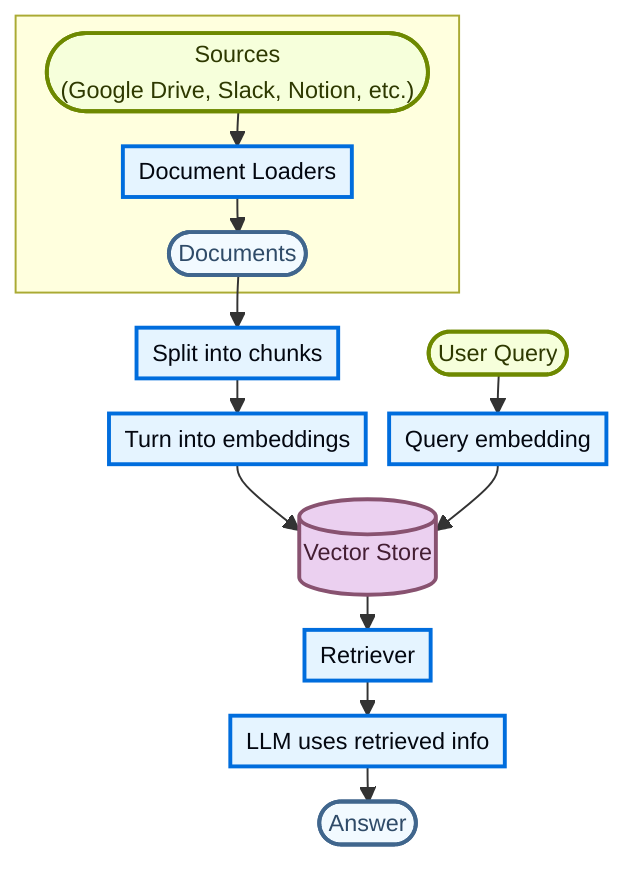
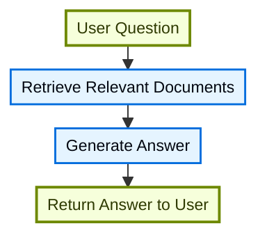
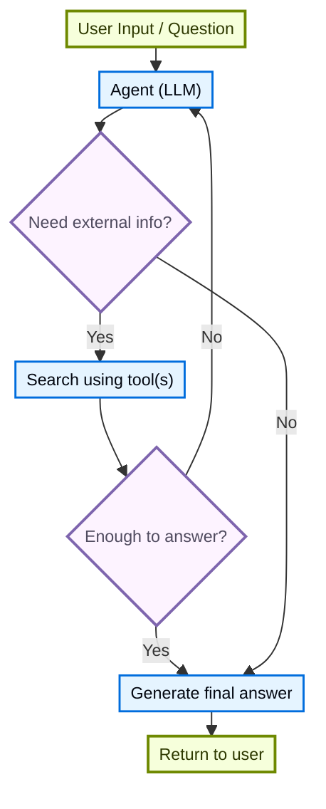
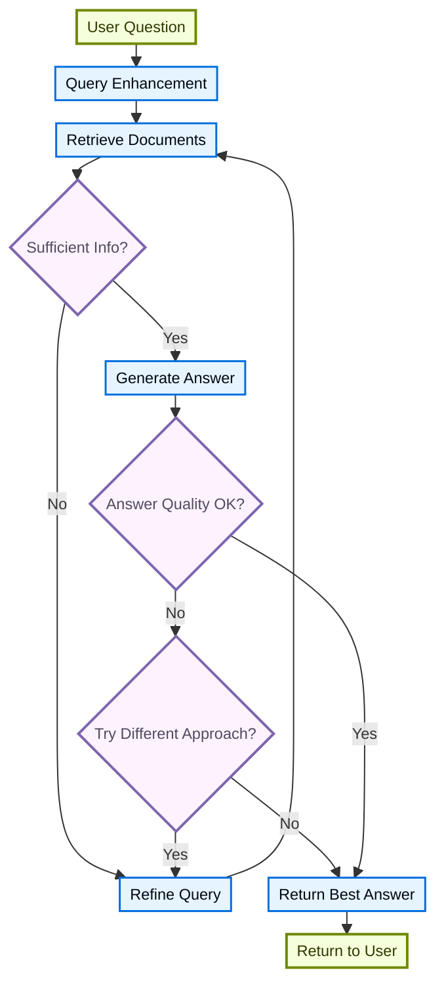

# 检索（Retrieval）

> 原文：Retrieval
> 来源：https://docs.langchain.com/oss/javascript/deepagents/retrieval

---

Large Language Models (LLMs) 功能强大，但存在两个关键局限：

* **有限的上下文**：它们无法一次性摄取整个语料库。
* **静态的知识**：它们的训练数据在某一时间点被冻结。

Retrieval 通过在查询时获取相关的外部知识来解决这些问题。这是 **Retrieval-Augmented Generation (RAG)** 的基础，它用特定于上下文的信息来增强 LLM 的回答。

## 构建知识库

**知识库（knowledge base）** 是检索期间使用的文档或结构化数据的存储库。

如果你需要自定义知识库，可以使用 LangChain 的 document loaders 和 vector stores 从你自己的数据构建一个。

> **注意**：如果你已经拥有一个知识库（例如 SQL 数据库、文档数据库、CRM 或内部文档系统），你**无需**重建它。你可以：
>
> * 在 Agentic RAG 中将其连接为 agent 的**工具（tool）**。
> * 查询它并将检索到的内容作为上下文提供给 LLM [（2-Step RAG）](#2-step-rag)。

关于更多信息，请参阅以下教程，构建可搜索的知识库与最小化的 RAG 工作流：

> **Tutorial: Semantic search**（[链接](/oss/javascript/langchain/knowledge-base)）：学习如何使用 LangChain 的 document loaders、embeddings 和 vector stores 从你自己的数据创建一个可搜索的知识库。
> 在本教程中，你将构建一个基于 PDF 的搜索引擎，从而能够检索与查询相关的段落。你还将在此引擎之上实现一个最小化的 RAG 工作流，以了解如何将外部知识集成到 LLM 推理中。

### 从检索到 RAG

Retrieval 允许 LLM 在运行时访问相关上下文。但大多数真实世界的应用更进一步：它们**将检索与生成集成**，以产生有依据的、上下文感知的回答。

这就是 **Retrieval-Augmented Generation (RAG)** 的核心思想。检索 pipeline 成为将搜索与生成相结合的更广泛系统的基础。

### 检索 pipeline

一个典型的检索工作流如下所示：



每个组件都是模块化的：你可以在不重写应用逻辑的情况下替换 loaders、splitters、embeddings 或 vector stores。

### 构建模块

> **Document loaders**（[链接](/oss/javascript/integrations/document_loaders)）：从外部来源（Google Drive、Slack、Notion 等）摄取数据，返回标准化的 [`Document`](https://reference.langchain.com/javascript/langchain-core/documents/Document) 对象。

> **Embedding models**（[链接](/oss/javascript/integrations/embeddings)）：embedding model 将文本转换为数字向量，使含义相似的文本在该向量空间中彼此靠近。

> **Vector stores**（[链接](/oss/javascript/integrations/vectorstores/)）：用于存储和搜索 embeddings 的专用数据库。

> **Retrievers**（[链接](/oss/javascript/integrations/retrievers/)）：retriever 是一个接口，给定非结构化查询后返回文档。

## RAG 架构

RAG 可以根据系统的需求以多种方式实现。我们在下面各节中逐一概述每种类型。

| 架构            | 描述                                                    | 控制      | 灵活性    | 延迟      | 示例用例                                          |
| --------------- | ------------------------------------------------------- | --------- | --------- | --------- | ------------------------------------------------- |
| **2-Step RAG**  | 检索始终发生在生成之前。简单且可预测                    | ✅ 高     | ❌ 低     | ⚡ 快     | FAQ、文档机器人                                   |
| **Agentic RAG** | 由 LLM 驱动的 agent 决定推理过程中*何时*以及*如何*检索  | ❌ 低     | ✅ 高     | ⏳ 可变   | 可访问多种工具的研究助手                          |
| **Hybrid**      | 结合两种方法的特性，并加入验证步骤                      | ⚖️ 中     | ⚖️ 中     | ⏳ 可变   | 带质量验证的领域特定 Q\&A                         |

> **说明**：**延迟**：在 **2-Step RAG** 中，延迟通常**更可预测**，因为 LLM 调用的最大次数是已知且有限的。这种可预测性假设 LLM 推理时间是主导因素。然而，真实世界的延迟也可能受到检索步骤性能的影响，例如 API 响应时间、网络延迟或数据库查询，这些会因所使用的工具和基础设施而异。

### 2-step RAG

在 **2-Step RAG** 中，检索步骤始终在生成步骤之前执行。这种架构简单且可预测，适用于许多将相关文档的检索作为生成答案的明确前提的应用。



<br />

> **Tutorial: Semantic search**（[链接](/oss/javascript/langchain/knowledge-base)）：使用 document loaders、embeddings 和 vector stores 构建可搜索的知识库，然后在其之上运行一个最小化的 retrieve-then-generate RAG 工作流。

> **Tutorial: Evaluate a RAG application**（[链接](/langsmith/evaluate-rag-tutorial)）：构建一个简单的 retrieve-then-generate RAG 应用，并使用 LangSmith 衡量答案正确性、相关性、有依据性（groundedness）和检索质量。

### Agentic RAG

**Agentic Retrieval-Augmented Generation (RAG)** 将 Retrieval-Augmented Generation 的优势与基于 agent 的推理相结合。不是在回答之前检索文档，而是由（由 LLM 驱动的）agent 逐步推理，并在交互过程中决定**何时**以及**如何**检索信息。

> **提示**：agent 启用 RAG 行为所需的唯一条件，就是能够访问一个或多个可以获取外部知识的**工具（tools）**，例如 documentation loaders、web APIs 或数据库查询。



```typescript
import { tool, createAgent } from "langchain";

const fetchUrl = tool(
    (url: string) => {
        return `Fetched content from ${url}`;
    },
    { name: "fetch_url", description: "Fetch text content from a URL" }
);

const agent = createAgent({
    model: "claude-sonnet-4-6",
    tools: [fetchUrl],
    systemPrompt,
});
```

#### 扩展示例：面向 LangGraph 的 llms.txt 的 Agentic RAG

此示例实现了一个 **Agentic RAG 系统**，用于帮助用户查询 LangGraph 文档。agent 首先加载 [llms.txt](https://llmstxt.org/)，其中列出了可用的文档 URL，然后可以动态使用 `fetch_documentation` tool，根据用户的问题检索并处理相关内容。

```typescript
import { tool, createAgent, HumanMessage } from "langchain";
import * as z from "zod";

const ALLOWED_DOMAINS = ["https://langchain-ai.github.io/"];
const LLMS_TXT = "https://langchain-ai.github.io/langgraph/llms.txt";

const fetchDocumentation = tool(
  async (input) => {  // [!code highlight]
    if (!ALLOWED_DOMAINS.some((domain) => input.url.startsWith(domain))) {
      return `Error: URL not allowed. Must start with one of: ${ALLOWED_DOMAINS.join(", ")}`;
    }
    const response = await fetch(input.url);
    if (!response.ok) {
      throw new Error(`HTTP error! status: ${response.status}`);
    }
    return response.text();
  },
  {
    name: "fetch_documentation",
    description: "Fetch and convert documentation from a URL",
    schema: z.object({
      url: z.string().describe("The URL of the documentation to fetch"),
    }),
  }
);

const llmsTxtResponse = await fetch(LLMS_TXT);
const llmsTxtContent = await llmsTxtResponse.text();

const systemPrompt = `
You are an expert TypeScript developer and technical assistant.
Your primary role is to help users with questions about LangGraph and related tools.

Instructions:

1. If a user asks a question you're unsure about—or one that likely involves API usage,
   behavior, or configuration—you MUST use the \`fetch_documentation\` tool to consult the relevant docs.
2. When citing documentation, summarize clearly and include relevant context from the content.
3. Do not use any URLs outside of the allowed domain.
4. If a documentation fetch fails, tell the user and proceed with your best expert understanding.

You can access official documentation from the following approved sources:

${llmsTxtContent}

You MUST consult the documentation to get up to date documentation
before answering a user's question about LangGraph.

Your answers should be clear, concise, and technically accurate.
`;

const tools = [fetchDocumentation];

const agent = createAgent({
  model: "claude-sonnet-4-6"
  tools,  // [!code highlight]
  systemPrompt,  // [!code highlight]
  name: "Agentic RAG",
});

const response = await agent.invoke({
  messages: [
    new HumanMessage(
      "Write a short example of a langgraph agent using the " +
      "prebuilt create react agent. the agent should be able " +
      "to look up stock pricing information."
    ),
  ],
});

console.log(response.messages.at(-1)?.content);
```

> **Tutorial: RAG with Deep Agents**（[链接](/oss/javascript/deepagents/rag)）：构建一个文档 Q\&A agent，在查询时检索相关 chunks，将它们卸载到文件系统，并将分析委派给 subagents。

### Hybrid RAG

Hybrid RAG 结合了 2-Step RAG 和 Agentic RAG 两者的特性。它引入了中间步骤，例如查询预处理、检索验证以及生成后检查。这类系统比固定 pipeline 提供更大的灵活性，同时仍保持对执行的一定控制。

典型组件包括：

* **查询增强（Query enhancement）**：修改输入问题以提高检索质量。这可能涉及重写不清晰的查询、生成多个变体，或用额外上下文扩展查询。
* **检索验证（Retrieval validation）**：评估检索到的文档是否相关且充分。如果不充分，系统可以优化查询并重新检索。
* **答案验证（Answer validation）**：检查生成的答案是否准确、完整并与源内容一致。如有需要，系统可以重新生成或修订答案。

这种架构通常支持这些步骤之间的多次迭代：



这种架构适用于：

* 查询模糊或描述不充分的应用
* 需要验证或质量控制步骤的系统
* 涉及多个来源或迭代细化的工作流

> **Tutorial: Agentic RAG with Self-Correction**（[链接](/oss/javascript/langgraph/agentic-rag)）：一个 **Hybrid RAG** 的示例，将 agentic 推理与检索和自我纠错相结合。
