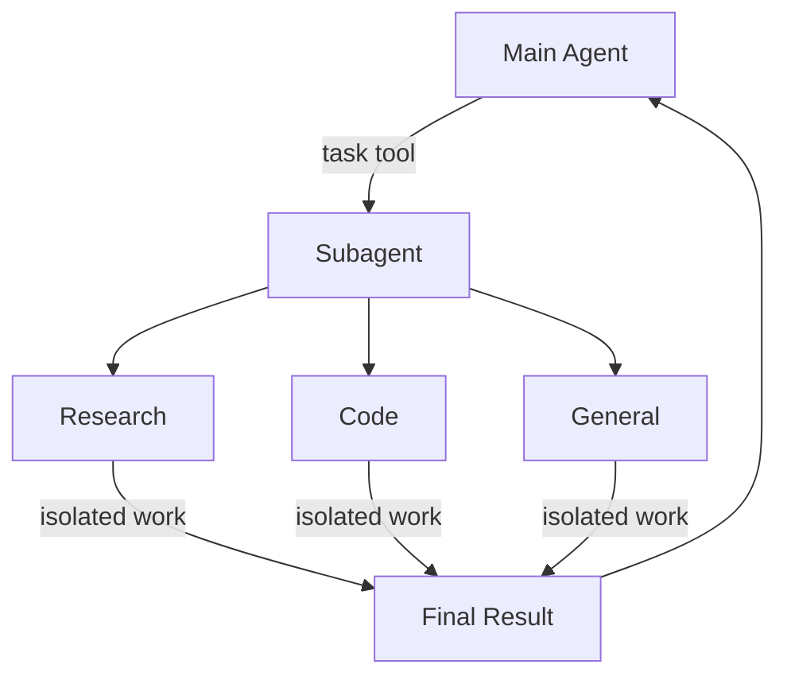
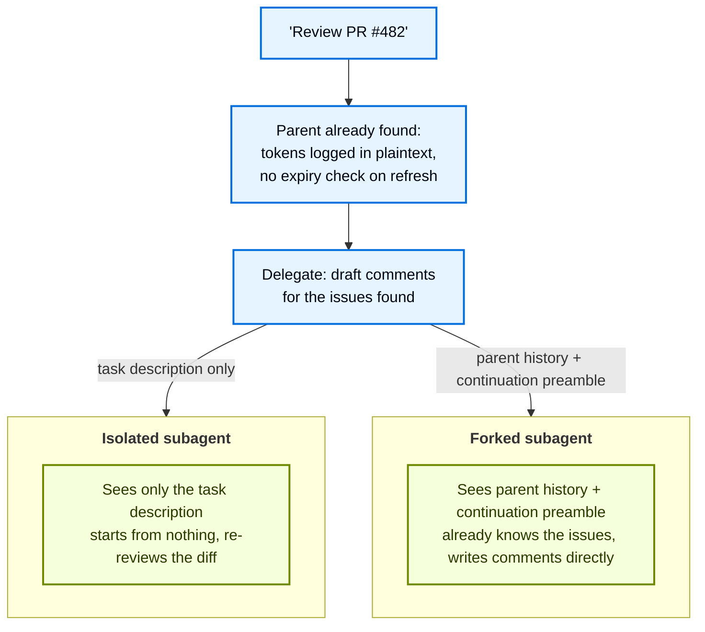

# 子代理（Subagents）

> 原文：Subagents
> 来源：https://docs.langchain.com/oss/javascript/deepagents/subagents

---

一个 deep agent 可以创建 subagents 来委派工作。你可以在 `subagents` 参数中指定自定义 subagents。Subagents 适用于 [context quarantine](https://www.dbreunig.com/2025/06/26/how-to-fix-your-context.html#context-quarantine)（保持主代理的上下文干净），也适用于提供专门的指令。

本页介绍**同步** subagents，即 supervisor 会阻塞直到 subagent 完成。对于长时间运行的任务、并行工作流，或者需要中途引导（mid-flight steering）和取消的场景，请参见 [Async subagents](/oss/javascript/deepagents/async-subagents)。



## 为什么使用 subagents？

Subagents 解决了**上下文膨胀问题（context bloat problem）**。当代理使用输出很大的工具（网页搜索、文件读取、数据库查询）时，上下文窗口会迅速被中间结果填满。Subagents 将这些详细工作隔离——主代理只收到最终结果，而不是产生该结果的数十次工具调用。

**何时使用 subagents：**

* ✅ 会使主代理上下文变得杂乱的多步骤任务
* ✅ 需要自定义指令或工具的专门领域
* ✅ 需要不同模型能力的任务
* ✅ 当你希望让主代理专注于高层协调时

**何时不使用 subagents：**

* ❌ 简单的单步任务
* ❌ 当你需要保留中间上下文时
* ❌ 当开销大于收益时

## 配置

`subagents` 应当是一个字典列表或 [`CompiledSubAgent`](https://reference.langchain.com/javascript/deepagents/middleware/CompiledSubAgent) 对象列表。共有两种类型：

### 默认 subagent

除非你已经提供了一个同名的同步 subagent，否则 Deep Agents 会自动添加一个同步的 `general-purpose` subagent。

`general-purpose` subagent 默认拥有文件系统工具，并可通过额外的 tools/middleware 进行自定义。

* 要替换它，请传入你自己的名为 `general-purpose` 的 subagent。
* 要重命名或重写自动添加版本的 prompt，请在激活的 [harness profile](/oss/javascript/deepagents/profiles#harness-profiles) 上设置 `general_purpose_subagent=GeneralPurposeSubagentProfile(...)`。
* 要禁用它，请参见下方的 [不使用 subagents 运行](#running-without-subagents)。

### 不使用 subagents 运行

要在没有 `task` 工具的情况下运行代理，需要做两件事：

1. 在激活的 [harness profile](/oss/javascript/deepagents/profiles#harness-profiles) 上设置 `general_purpose_subagent=GeneralPurposeSubagentProfile(enabled=False)`。
2. 在 `create_deep_agent` 上通过 `subagents=` 不传入任何同步 subagents。

Deep Agents 仅当至少存在一个同步 subagent 时才会附加 [`SubAgentMiddleware`](https://reference.langchain.com/javascript/deepagents/middleware/createSubAgentMiddleware)（以及 `task` 工具）。既没有默认的也没有调用方提供的 subagent 时，代理将在没有委派的情况下运行。

Async subagents 不受影响——它们通过自己的 middleware 和 tools 流转，详见 [Async subagents](/oss/javascript/deepagents/async-subagents)。

> **提示**：这里不要使用 `excluded_middleware`——`SubAgentMiddleware` 是必需的脚手架，把它列出来会抛出 `ValueError`。受支持的路径是 `general_purpose_subagent.enabled = False` 这个开关。

## 自定义 subagents

你可以使用 `subagents` 参数来定义具有特定工具的专门 subagents。例如用作 code reviewer、web researcher 或 test runner。

对于大多数用例，请将 subagents 定义为字典，参见 [SubAgent 字典](#subagent-dictionary-based)。对于复杂工作流，请使用 [`CompiledSubAgent`](#compiledsubagent)：

### SubAgent（基于字典）

将 subagents 定义为符合 [`SubAgent`](https://reference.langchain.com/javascript/deepagents/middleware/SubAgent) 规范的字典，包含以下字段：

| 字段             | 类型                                           | 说明                                                                                                                                                                                                                                                                                                                                                                                                                                                                                                                                                                                                                                                                 |
| ---------------- | ---------------------------------------------- | --------------------------------------------------------------------------------------------------------------------------------------------------------------------------------------------------------------------------------------------------------------------------------------------------------------------------------------------------------------------------------------------------------------------------------------------------------------------------------------------------------------------------------------------------------------------------------------------------------------------------------------------------------------------------- |
| `name`           | `string`                                       | 必填。subagent 的唯一标识符。主代理在调用 `task()` 工具时使用该名称。subagent 名称会成为 `AIMessage` 和流式传输的元数据，有助于区分各个代理。                                                                                                                                                                                                                                                                                                                                                                                                                                                                                                                       |
| `description`    | `string`                                       | 必填。描述该 subagent 的用途。请具体且以行动为导向。主代理据此决定何时委派。                                                                                                                                                                                                                                                                                                                                                                                                                                                                                                                       |
| `systemPrompt`   | `string`                                       | 对于 `mode: "isolated"`（默认值）为必填。subagent 的指令。自定义的 isolated subagent 必须自行定义。请包含工具使用指南和输出格式要求。<br />不从主代理继承。对于 `mode: "fork"`，除非你需要仅用于 fork 的补充说明，否则请省略此字段。参见 [Forked subagents](#forked-subagents)。                                                                                                                                                                                                                                                                                                                                                                                      |
| `mode`           | `"isolated"` \| `"fork"`                       | 可选。上下文模式。默认为 `"isolated"`，此时 subagent 只能看到被委派的任务。设为 `"fork"` 则改为继承父代理的对话和 system prompt。参见 [Forked subagents](#forked-subagents)。                                                                                                                                                                                                                                                                                                                                                                                                                                               |
| `tools`          | `StructuredTool[]`                             | 可选。subagent 可以使用的工具。请保持最小化，只包含所需内容。<br />默认从主代理继承。指定后会完全覆盖继承的工具。                                                                                                                                                                                                                                                                                                                                                                                                                                                                                   |
| `model`          | `LanguageModelLike \| string`                  | 可选。覆盖主代理的模型。省略则使用主代理的模型。<br />默认从主代理继承。你可以传入模型标识符字符串，如 `'openai:gpt-5.5'`（使用 `'provider:model'` 格式），或一个 LangChain chat model 对象（`await initChatModel("gpt-5.5")` 或 `new ChatOpenAI({ model: "gpt-5.5" })`）。                                                                                                                                                                                                                                                                                                                                                                                        |
| `middleware`     | `AgentMiddleware[]`                            | 可选。用于自定义行为、日志记录或速率限制的额外 middleware。<br />不从主代理继承。会追加到 [synchronous subagent stack](/oss/javascript/deepagents/customization#synchronous-subagent-stack)。                                                                                                                                                                                                                                                                                                                                                                                                                               |
| `interruptOn`    | `Record<string, boolean \| InterruptOnConfig>` | 可选。为特定工具配置 [human-in-the-loop](/oss/javascript/deepagents/human-in-the-loop)。选项：`True`、`False`，或带 `allowed_decisions` 的 `InterruptOnConfig`。需要 checkpointer。<br />默认从主代理继承。subagent 的值会覆盖默认值。                                                                                                                                                                                                                                                                                                                                                                                                                                              |
| `skills`         | `string[]`                                     | 可选。[Skills](/oss/javascript/deepagents/skills) 源路径。指定后，subagent 会从这些目录加载 skills（例如 `["/skills/research/", "/skills/web-search/"]`）。这允许 subagents 拥有不同于主代理的 skill 集合。<br />不从主代理继承。只有 general-purpose subagent 会继承主代理的 skills。当 subagent 拥有 skills 时，它会运行自己独立的 [`SkillsMiddleware`](https://reference.langchain.com/javascript/deepagents/middleware/createSkillsMiddleware) 实例。skill 状态完全隔离——subagent 已加载的 skills 对父代理不可见，反之亦然。 |
| `responseFormat` | `ResponseFormat`                               | 可选。subagent 的 [Structured output](/oss/javascript/langchain/structured-output) schema。设置后，父代理会以 JSON 而非自由文本的形式接收 subagent 的结果。接受 Zod schema、JSON schema 对象、`toolStrategy(...)` 或 `providerStrategy(...)`。参见 [Structured output](#structured-output)。                                                                                                                                                                                                                                                                                                                                          |
| `permissions`    | `FilesystemPermission[]`                       | 可选。subagent 的 [Filesystem permission rules](/oss/javascript/deepagents/permissions)。设置后会完全**替换**父代理的权限。<br />默认从主代理继承。                                                                                                                                                                                                                                                                                                                                                                                                                                                                 |

### CompiledSubAgent

对于复杂工作流，请使用预构建的 LangGraph graph 作为 [`CompiledSubAgent`](https://reference.langchain.com/javascript/deepagents/middleware/CompiledSubAgent)：

| 字段          | 类型                     | 说明                                                                                                                                                                                        |
| ------------- | ------------------------ | -------------------------------------------------------------------------------------------------------------------------------------------------------------------------------------------------- |
| `name`        | `str`                    | 必填。subagent 的唯一标识符。subagent 名称会成为 `AIMessage` 和流式传输的元数据，有助于区分各个代理。                                  |
| `description` | `str`                    | 必填。该 subagent 的用途。                                                                                                                                                                 |
| `runnable`    | `Runnable`               | 必填。一个已编译的 LangGraph graph（必须先调用 `.compile()`）。                                                                                                                               |
| `mode`        | `"isolated"` \| `"fork"` | 可选。默认为 `"isolated"`。设为 `"fork"` 以继承父代理的消息历史。无论哪种模式，已编译的 graph 都保留自己的 system prompt。参见 [Forked subagents](#forked-subagents)。 |


## 使用 SubAgent

#### Google

```ts
import { tool } from "langchain";
import { TavilySearch } from "@langchain/tavily";
import { createDeepAgent, type SubAgent } from "deepagents";
import { z } from "zod";

const internetSearch = tool(
  async ({
    query,
    maxResults = 5,
    topic = "general",
    includeRawContent = false,
  }: {
    query: string;
    maxResults?: number;
    topic?: "general" | "news" | "finance";
    includeRawContent?: boolean;
  }) => {
    const tavilySearch = new TavilySearch({
      maxResults,
      tavilyApiKey: process.env.TAVILY_API_KEY,
      includeRawContent,
      topic,
    });
    return await tavilySearch._call({ query });
  },
  {
    name: "internet_search",
    description: "Run a web search",
    schema: z.object({
      query: z.string().describe("The search query"),
      maxResults: z.number().optional().default(5),
      topic: z
        .enum(["general", "news", "finance"])
        .optional()
        .default("general"),
      includeRawContent: z.boolean().optional().default(false),
    }),
  },
);

const researchSubagent: SubAgent = {
  name: "research-agent",
  description: "Used to research more in depth questions",
  systemPrompt: "You are a great researcher",
  tools: [internetSearch],
  model: "google:gemini-3.6-flash", // Optional override, defaults to main agent model
};
const subagents = [researchSubagent];

const agent = createDeepAgent({
  model: "google:gemini-3.6-flash",
  subagents,
});
```

#### OpenAI

```ts
import { tool } from "langchain";
import { TavilySearch } from "@langchain/tavily";
import { createDeepAgent, type SubAgent } from "deepagents";
import { z } from "zod";

const internetSearch = tool(
  async ({
    query,
    maxResults = 5,
    topic = "general",
    includeRawContent = false,
  }: {
    query: string;
    maxResults?: number;
    topic?: "general" | "news" | "finance";
    includeRawContent?: boolean;
  }) => {
    const tavilySearch = new TavilySearch({
      maxResults,
      tavilyApiKey: process.env.TAVILY_API_KEY,
      includeRawContent,
      topic,
    });
    return await tavilySearch._call({ query });
  },
  {
    name: "internet_search",
    description: "Run a web search",
    schema: z.object({
      query: z.string().describe("The search query"),
      maxResults: z.number().optional().default(5),
      topic: z
        .enum(["general", "news", "finance"])
        .optional()
        .default("general"),
      includeRawContent: z.boolean().optional().default(false),
    }),
  },
);

const researchSubagent: SubAgent = {
  name: "research-agent",
  description: "Used to research more in depth questions",
  systemPrompt: "You are a great researcher",
  tools: [internetSearch],
  model: "openai:gpt-5.5", // Optional override, defaults to main agent model
};
const subagents = [researchSubagent];

const agent = createDeepAgent({
  model: "google:gemini-3.6-flash",
  subagents,
});
```

#### Anthropic

```ts
import { tool } from "langchain";
import { TavilySearch } from "@langchain/tavily";
import { createDeepAgent, type SubAgent } from "deepagents";
import { z } from "zod";

const internetSearch = tool(
  async ({
    query,
    maxResults = 5,
    topic = "general",
    includeRawContent = false,
  }: {
    query: string;
    maxResults?: number;
    topic?: "general" | "news" | "finance";
    includeRawContent?: boolean;
  }) => {
    const tavilySearch = new TavilySearch({
      maxResults,
      tavilyApiKey: process.env.TAVILY_API_KEY,
      includeRawContent,
      topic,
    });
    return await tavilySearch._call({ query });
  },
  {
    name: "internet_search",
    description: "Run a web search",
    schema: z.object({
      query: z.string().describe("The search query"),
      maxResults: z.number().optional().default(5),
      topic: z
        .enum(["general", "news", "finance"])
        .optional()
        .default("general"),
      includeRawContent: z.boolean().optional().default(false),
    }),
  },
);

const researchSubagent: SubAgent = {
  name: "research-agent",
  description: "Used to research more in depth questions",
  systemPrompt: "You are a great researcher",
  tools: [internetSearch],
  model: "anthropic:claude-sonnet-5", // Optional override, defaults to main agent model
};
const subagents = [researchSubagent];

const agent = createDeepAgent({
  model: "google:gemini-3.6-flash",
  subagents,
});
```

#### OpenRouter

```ts
import { tool } from "langchain";
import { TavilySearch } from "@langchain/tavily";
import { createDeepAgent, type SubAgent } from "deepagents";
import { z } from "zod";

const internetSearch = tool(
  async ({
    query,
    maxResults = 5,
    topic = "general",
    includeRawContent = false,
  }: {
    query: string;
    maxResults?: number;
    topic?: "general" | "news" | "finance";
    includeRawContent?: boolean;
  }) => {
    const tavilySearch = new TavilySearch({
      maxResults,
      tavilyApiKey: process.env.TAVILY_API_KEY,
      includeRawContent,
      topic,
    });
    return await tavilySearch._call({ query });
  },
  {
    name: "internet_search",
    description: "Run a web search",
    schema: z.object({
      query: z.string().describe("The search query"),
      maxResults: z.number().optional().default(5),
      topic: z
        .enum(["general", "news", "finance"])
        .optional()
        .default("general"),
      includeRawContent: z.boolean().optional().default(false),
    }),
  },
);

const researchSubagent: SubAgent = {
  name: "research-agent",
  description: "Used to research more in depth questions",
  systemPrompt: "You are a great researcher",
  tools: [internetSearch],
  model: "openrouter:z-ai/glm-5.2", // Optional override, defaults to main agent model
};
const subagents = [researchSubagent];

const agent = createDeepAgent({
  model: "google:gemini-3.6-flash",
  subagents,
});
```

#### Fireworks

```ts
import { tool } from "langchain";
import { TavilySearch } from "@langchain/tavily";
import { createDeepAgent, type SubAgent } from "deepagents";
import { z } from "zod";

const internetSearch = tool(
  async ({
    query,
    maxResults = 5,
    topic = "general",
    includeRawContent = false,
  }: {
    query: string;
    maxResults?: number;
    topic?: "general" | "news" | "finance";
    includeRawContent?: boolean;
  }) => {
    const tavilySearch = new TavilySearch({
      maxResults,
      tavilyApiKey: process.env.TAVILY_API_KEY,
      includeRawContent,
      topic,
    });
    return await tavilySearch._call({ query });
  },
  {
    name: "internet_search",
    description: "Run a web search",
    schema: z.object({
      query: z.string().describe("The search query"),
      maxResults: z.number().optional().default(5),
      topic: z
        .enum(["general", "news", "finance"])
        .optional()
        .default("general"),
      includeRawContent: z.boolean().optional().default(false),
    }),
  },
);

const researchSubagent: SubAgent = {
  name: "research-agent",
  description: "Used to research more in depth questions",
  systemPrompt: "You are a great researcher",
  tools: [internetSearch],
  model: "fireworks:accounts/fireworks/models/glm-5p2", // Optional override, defaults to main agent model
};
const subagents = [researchSubagent];

const agent = createDeepAgent({
  model: "google:gemini-3.6-flash",
  subagents,
});
```

#### Baseten

```ts
import { tool } from "langchain";
import { TavilySearch } from "@langchain/tavily";
import { createDeepAgent, type SubAgent } from "deepagents";
import { z } from "zod";

const internetSearch = tool(
  async ({
    query,
    maxResults = 5,
    topic = "general",
    includeRawContent = false,
  }: {
    query: string;
    maxResults?: number;
    topic?: "general" | "news" | "finance";
    includeRawContent?: boolean;
  }) => {
    const tavilySearch = new TavilySearch({
      maxResults,
      tavilyApiKey: process.env.TAVILY_API_KEY,
      includeRawContent,
      topic,
    });
    return await tavilySearch._call({ query });
  },
  {
    name: "internet_search",
    description: "Run a web search",
    schema: z.object({
      query: z.string().describe("The search query"),
      maxResults: z.number().optional().default(5),
      topic: z
        .enum(["general", "news", "finance"])
        .optional()
        .default("general"),
      includeRawContent: z.boolean().optional().default(false),
    }),
  },
);

const researchSubagent: SubAgent = {
  name: "research-agent",
  description: "Used to research more in depth questions",
  systemPrompt: "You are a great researcher",
  tools: [internetSearch],
  model: "baseten:zai-org/GLM-5.2", // Optional override, defaults to main agent model
};
const subagents = [researchSubagent];

const agent = createDeepAgent({
  model: "google:gemini-3.6-flash",
  subagents,
});
```

#### Ollama

```ts
import { tool } from "langchain";
import { TavilySearch } from "@langchain/tavily";
import { createDeepAgent, type SubAgent } from "deepagents";
import { z } from "zod";

const internetSearch = tool(
  async ({
    query,
    maxResults = 5,
    topic = "general",
    includeRawContent = false,
  }: {
    query: string;
    maxResults?: number;
    topic?: "general" | "news" | "finance";
    includeRawContent?: boolean;
  }) => {
    const tavilySearch = new TavilySearch({
      maxResults,
      tavilyApiKey: process.env.TAVILY_API_KEY,
      includeRawContent,
      topic,
    });
    return await tavilySearch._call({ query });
  },
  {
    name: "internet_search",
    description: "Run a web search",
    schema: z.object({
      query: z.string().describe("The search query"),
      maxResults: z.number().optional().default(5),
      topic: z
        .enum(["general", "news", "finance"])
        .optional()
        .default("general"),
      includeRawContent: z.boolean().optional().default(false),
    }),
  },
);

const researchSubagent: SubAgent = {
  name: "research-agent",
  description: "Used to research more in depth questions",
  systemPrompt: "You are a great researcher",
  tools: [internetSearch],
  model: "ollama:north-mini-code-1.0", // Optional override, defaults to main agent model
};
const subagents = [researchSubagent];

const agent = createDeepAgent({
  model: "google:gemini-3.6-flash",
  subagents,
});
```


## 使用 CompiledSubAgent

对于更复杂的用例，你可以使用 [`CompiledSubAgent`](https://reference.langchain.com/javascript/deepagents/middleware/CompiledSubAgent) 提供自定义 subagents。
你可以使用 LangChain 的 [`create_agent`](https://reference.langchain.com/javascript/langchain/index/createAgent) 来创建自定义 subagent，或使用 [graph API](/oss/javascript/langgraph/graph-api) 创建自定义 LangGraph graph。

如果你要创建自定义 LangGraph graph，请确保该 graph 有一个 [`"messages"` 状态键](/oss/javascript/langgraph/quickstart#2-define-state)：

#### Google

```ts
import { CompiledSubAgent, createDeepAgent } from "deepagents";
import { createAgent } from "langchain";
import { tool } from "langchain";
import { z } from "zod";

const internetSearch = tool(
  async ({ query }: { query: string }) => `search results for ${query}`,
  {
    name: "internet_search",
    description: "Run a web search",
    schema: z.object({ query: z.string() }),
  },
);

const researchInstructions = "You are a research coordinator.";
const yourModel = "google:gemini-3.6-flash";
const specializedTools: never[] = [];

// Create a custom agent graph
const customGraph = createAgent({
  model: yourModel,
  tools: specializedTools,
  prompt: "You are a specialized agent for data analysis...",
});

// Use it as a custom subagent
const customSubagent: CompiledSubAgent = {
  name: "data-analyzer",
  description: "Specialized agent for complex data analysis tasks",
  runnable: customGraph,
};

const subagents = [customSubagent];

const agent = createDeepAgent({
  model: "google:gemini-3.6-flash",
  tools: [internetSearch],
  systemPrompt: researchInstructions,
  subagents: subagents,
});
```

#### OpenAI

```ts
import { CompiledSubAgent, createDeepAgent } from "deepagents";
import { createAgent } from "langchain";
import { tool } from "langchain";
import { z } from "zod";

const internetSearch = tool(
  async ({ query }: { query: string }) => `search results for ${query}`,
  {
    name: "internet_search",
    description: "Run a web search",
    schema: z.object({ query: z.string() }),
  },
);

const researchInstructions = "You are a research coordinator.";
const yourModel = "google:gemini-3.6-flash";
const specializedTools: never[] = [];

// Create a custom agent graph
const customGraph = createAgent({
  model: yourModel,
  tools: specializedTools,
  prompt: "You are a specialized agent for data analysis...",
});

// Use it as a custom subagent
const customSubagent: CompiledSubAgent = {
  name: "data-analyzer",
  description: "Specialized agent for complex data analysis tasks",
  runnable: customGraph,
};

const subagents = [customSubagent];

const agent = createDeepAgent({
  model: "openai:gpt-5.5",
  tools: [internetSearch],
  systemPrompt: researchInstructions,
  subagents: subagents,
});
```

#### Anthropic

```ts
import { CompiledSubAgent, createDeepAgent } from "deepagents";
import { createAgent } from "langchain";
import { tool } from "langchain";
import { z } from "zod";

const internetSearch = tool(
  async ({ query }: { query: string }) => `search results for ${query}`,
  {
    name: "internet_search",
    description: "Run a web search",
    schema: z.object({ query: z.string() }),
  },
);

const researchInstructions = "You are a research coordinator.";
const yourModel = "google:gemini-3.6-flash";
const specializedTools: never[] = [];

// Create a custom agent graph
const customGraph = createAgent({
  model: yourModel,
  tools: specializedTools,
  prompt: "You are a specialized agent for data analysis...",
});

// Use it as a custom subagent
const customSubagent: CompiledSubAgent = {
  name: "data-analyzer",
  description: "Specialized agent for complex data analysis tasks",
  runnable: customGraph,
};

const subagents = [customSubagent];

const agent = createDeepAgent({
  model: "anthropic:claude-sonnet-5",
  tools: [internetSearch],
  systemPrompt: researchInstructions,
  subagents: subagents,
});
```

#### OpenRouter

```ts
import { CompiledSubAgent, createDeepAgent } from "deepagents";
import { createAgent } from "langchain";
import { tool } from "langchain";
import { z } from "zod";

const internetSearch = tool(
  async ({ query }: { query: string }) => `search results for ${query}`,
  {
    name: "internet_search",
    description: "Run a web search",
    schema: z.object({ query: z.string() }),
  },
);

const researchInstructions = "You are a research coordinator.";
const yourModel = "google:gemini-3.6-flash";
const specializedTools: never[] = [];

// Create a custom agent graph
const customGraph = createAgent({
  model: yourModel,
  tools: specializedTools,
  prompt: "You are a specialized agent for data analysis...",
});

// Use it as a custom subagent
const customSubagent: CompiledSubAgent = {
  name: "data-analyzer",
  description: "Specialized agent for complex data analysis tasks",
  runnable: customGraph,
};

const subagents = [customSubagent];

const agent = createDeepAgent({
  model: "openrouter:z-ai/glm-5.2",
  tools: [internetSearch],
  systemPrompt: researchInstructions,
  subagents: subagents,
});
```

#### Fireworks

```ts
import { CompiledSubAgent, createDeepAgent } from "deepagents";
import { createAgent } from "langchain";
import { tool } from "langchain";
import { z } from "zod";

const internetSearch = tool(
  async ({ query }: { query: string }) => `search results for ${query}`,
  {
    name: "internet_search",
    description: "Run a web search",
    schema: z.object({ query: z.string() }),
  },
);

const researchInstructions = "You are a research coordinator.";
const yourModel = "google:gemini-3.6-flash";
const specializedTools: never[] = [];

// Create a custom agent graph
const customGraph = createAgent({
  model: yourModel,
  tools: specializedTools,
  prompt: "You are a specialized agent for data analysis...",
});

// Use it as a custom subagent
const customSubagent: CompiledSubAgent = {
  name: "data-analyzer",
  description: "Specialized agent for complex data analysis tasks",
  runnable: customGraph,
};

const subagents = [customSubagent];

const agent = createDeepAgent({
  model: "fireworks:accounts/fireworks/models/glm-5p2",
  tools: [internetSearch],
  systemPrompt: researchInstructions,
  subagents: subagents,
});
```

#### Baseten

```ts
import { CompiledSubAgent, createDeepAgent } from "deepagents";
import { createAgent } from "langchain";
import { tool } from "langchain";
import { z } from "zod";

const internetSearch = tool(
  async ({ query }: { query: string }) => `search results for ${query}`,
  {
    name: "internet_search",
    description: "Run a web search",
    schema: z.object({ query: z.string() }),
  },
);

const researchInstructions = "You are a research coordinator.";
const yourModel = "google:gemini-3.6-flash";
const specializedTools: never[] = [];

// Create a custom agent graph
const customGraph = createAgent({
  model: yourModel,
  tools: specializedTools,
  prompt: "You are a specialized agent for data analysis...",
});

// Use it as a custom subagent
const customSubagent: CompiledSubAgent = {
  name: "data-analyzer",
  description: "Specialized agent for complex data analysis tasks",
  runnable: customGraph,
};

const subagents = [customSubagent];

const agent = createDeepAgent({
  model: "baseten:zai-org/GLM-5.2",
  tools: [internetSearch],
  systemPrompt: researchInstructions,
  subagents: subagents,
});
```

#### Ollama

```ts
import { CompiledSubAgent, createDeepAgent } from "deepagents";
import { createAgent } from "langchain";
import { tool } from "langchain";
import { z } from "zod";

const internetSearch = tool(
  async ({ query }: { query: string }) => `search results for ${query}`,
  {
    name: "internet_search",
    description: "Run a web search",
    schema: z.object({ query: z.string() }),
  },
);

const researchInstructions = "You are a research coordinator.";
const yourModel = "google:gemini-3.6-flash";
const specializedTools: never[] = [];

// Create a custom agent graph
const customGraph = createAgent({
  model: yourModel,
  tools: specializedTools,
  prompt: "You are a specialized agent for data analysis...",
});

// Use it as a custom subagent
const customSubagent: CompiledSubAgent = {
  name: "data-analyzer",
  description: "Specialized agent for complex data analysis tasks",
  runnable: customGraph,
};

const subagents = [customSubagent];

const agent = createDeepAgent({
  model: "ollama:north-mini-code-1.0",
  tools: [internetSearch],
  systemPrompt: researchInstructions,
  subagents: subagents,
});
```

## Forked subagents（分叉子代理）

默认情况下，subagent 以 `mode: "isolated"` 运行：它只能看到你给它的任务描述，对导致此次委派的对话没有任何记忆。**Forked subagent**（`mode: "fork"`）则会改为继承父代理的完整对话历史和完全相同的 system prompt。

当 subagent 的任务是延续父代理已经开始的工作时，请使用 forked subagents，比如一个接手父代理已经诊断出的修复的 worker agent，或者一个为事故调查起草 postmortem 的 subagent。由于 forking 是你在 subagent 本身上设置的一种模式，因此它是在你定义 subagent 时做出的决定。



> **注意**：Subagent forking 需要 `deepagents>=1.13.3`。它处于 [**beta**](/oss/javascript/versioning) 阶段；API 和行为可能在不同版本之间发生变化。

### 配置 forked subagent

在 [`SubAgent`](https://reference.langchain.com/javascript/deepagents/middleware/SubAgent) 上设置 `mode: "fork"`（默认是 `mode: "isolated"`）。所有 [`SubAgent`](https://reference.langchain.com/javascript/deepagents/middleware/SubAgent) 字段都可用：
`name`、`description`、`tools`、`model`、`middleware`、`interruptOn`、`permissions` 和 `responseFormat`。

如果提供了 `skills`，它会被拒绝。`systemPrompt` 是允许的，会作为补充说明追加到父代理继承的 prompt 后面，但这样做通常会破坏 prompt cache，因此除非你确实需要仅用于 fork 的指令，否则请保持不设置。

```ts
import { createDeepAgent } from "deepagents";
import { tool } from "langchain";
import { z } from "zod";

const readDiff = tool(
  async ({ path }: { path: string }) => `diff for ${path}`,
  {
    name: "read_diff",
    description: "Read a file's diff",
    schema: z.object({ path: z.string() }),
  },
);

const commentWriter = {
  name: "comment-writer",
  description: "Continues an in-progress PR review and drafts review comments",
  mode: "fork" as const,
  tools: [readDiff],
};

const agent = await createDeepAgent({
  model: "anthropic:claude-sonnet-4-6",
  tools: [readDiff],
  subagents: [commentWriter],
});

const result = await agent.invoke({
  messages: [
    {
      role: "user",
      content:
        "Review PR #482 and hand it off to comment-writer to draft comments for the issues found",
    },
  ],
});
```

### 工作原理

fork 不会得到全新的任务描述。它得到的是父代理自己的对话，只有一处改动：最后那次委派给它调用的调用会被丢弃，并替换为一段简短的前言，标记上面的消息是延续而非新的请求。当 fork 完成时，它的答案会作为普通的工具结果返回，父代理会从停下的地方继续。

```javascript
// What the parent has, right before delegating
[
  new HumanMessage("Review the changes in PR #482"),
  new AIMessage({ content: "", tool_calls: [{ name: "read_diff", args: { path: "src/auth/session.py" } }] }),
  new ToolMessage({ content: "- session tokens are logged in plaintext\n- no expiry check on refresh", tool_call_id: "1" }),
  new AIMessage("Found two issues: session tokens are logged in plaintext, and there's no expiry check on refresh."),
  new HumanMessage("Good catch. Draft review comments for those."),
  new AIMessage({ content: "", tool_calls: [{ name: "task", args: { subagentType: "comment-writer", description: "Draft review comments for the two issues found above." } }] }),
]

// What the fork actually sees
[
  new HumanMessage("Review the changes in PR #482"),
  new AIMessage({ content: "", tool_calls: [{ name: "read_diff", args: { path: "src/auth/session.py" } }] }),
  new ToolMessage({ content: "- session tokens are logged in plaintext\n- no expiry check on refresh", tool_call_id: "1" }),
  new AIMessage("Found two issues: session tokens are logged in plaintext, and there's no expiry check on refresh."),
  new HumanMessage("Good catch. Draft review comments for those."),
  new HumanMessage("Continuing as the subagent that was just invoked. Draft review comments for the two issues found above."),
]
```

复用父代理完全相同的前缀也意味着 fork 可以复用父代理的 prompt cache，而不是从头开始，不过与父代理不同的工具使用仍然会 miss。

[`CompiledSubAgent`](https://reference.langchain.com/javascript/deepagents/middleware/CompiledSubAgent) 也支持 `mode: "fork"`，不过由于 graph 已经构建好，它会保留自己的 system prompt。

### 何时使用 forking

从以下维度比较 isolated 和 forked 模式：

| 维度                         | Isolated（默认）                             | Forked                                                                                             |
| ---------------------------- | -------------------------------------------- | -------------------------------------------------------------------------------------------------- |
| **Context**                  | 只包含你传入的任务描述        | 父代理的完整对话历史和 system prompt                                           |
| **System prompt and skills** | 由你在 subagent 上设置                 | Skills 不可设置；system prompt 会追加到父代理的（破坏缓存，因此通常不设置） |
| **Calling other subagents**  | 可以使用 `task` 工具                      | 不能使用 `task`；必须自己完成工作                                                     |
| **Best for**                 | 需要少量先前上下文的聚焦工作 | 延续父代理已经开始的调查                                         |


## Dynamic subagents（动态子代理）

默认情况下，主代理通过 `task` 工具调用委派给 subagents（它可以在单轮中发出多个调用以并行运行它们）。附加 [interpreter](/oss/javascript/deepagents/interpreters) 后，代理可以改为**从代码中**派发 subagents——使用循环、分支和并行批次将工作分散到许多条目上，并以编程方式汇总结果。这称为 [dynamic subagents](/oss/javascript/deepagents/dynamic-subagents)。

当工作跨越许多独立单元（审查某个目录中的每个文件、对一批工单进行分类）、需要多个视角，或受益于递归分析时，请使用 dynamic subagents。

> **警告**：Dynamic subagents 使用 interpreter runtime，它处于 [**beta**](/oss/javascript/versioning) 阶段。API 和生命周期行为可能在不同版本之间发生变化。

### 启用 dynamic subagents

一旦代理同时拥有 subagents 和 interpreter middleware，dynamic subagents 就可用。安装 QuickJS interpreter 包，然后向你的代理添加 `CodeInterpreterMiddleware`。

#### npm

```bash
npm install deepagents @langchain/quickjs
```

#### pnpm

```bash
pnpm add deepagents @langchain/quickjs
```

#### yarn

```bash
yarn add deepagents @langchain/quickjs
```

#### Google

```ts
import { createDeepAgent } from "deepagents";
import { createCodeInterpreterMiddleware } from "@langchain/quickjs";

const agent = createDeepAgent({
  model: "google:gemini-3.6-flash",
  subagents: [{
    name: "reviewer",
    description: "Reviews code for security issues, citing lines and severity",
    systemPrompt: "You are a security-focused code reviewer. Report issues with line numbers and severity.",
  }],
  middleware: [createCodeInterpreterMiddleware()],
});
```

#### OpenAI

```ts
import { createDeepAgent } from "deepagents";
import { createCodeInterpreterMiddleware } from "@langchain/quickjs";

const agent = createDeepAgent({
  model: "openai:gpt-5.5",
  subagents: [{
    name: "reviewer",
    description: "Reviews code for security issues, citing lines and severity",
    systemPrompt: "You are a security-focused code reviewer. Report issues with line numbers and severity.",
  }],
  middleware: [createCodeInterpreterMiddleware()],
});
```

#### Anthropic

```ts
import { createDeepAgent } from "deepagents";
import { createCodeInterpreterMiddleware } from "@langchain/quickjs";

const agent = createDeepAgent({
  model: "anthropic:claude-sonnet-5",
  subagents: [{
    name: "reviewer",
    description: "Reviews code for security issues, citing lines and severity",
    systemPrompt: "You are a security-focused code reviewer. Report issues with line numbers and severity.",
  }],
  middleware: [createCodeInterpreterMiddleware()],
});
```

#### OpenRouter

```ts
import { createDeepAgent } from "deepagents";
import { createCodeInterpreterMiddleware } from "@langchain/quickjs";

const agent = createDeepAgent({
  model: "openrouter:z-ai/glm-5.2",
  subagents: [{
    name: "reviewer",
    description: "Reviews code for security issues, citing lines and severity",
    systemPrompt: "You are a security-focused code reviewer. Report issues with line numbers and severity.",
  }],
  middleware: [createCodeInterpreterMiddleware()],
});
```

#### Fireworks

```ts
import { createDeepAgent } from "deepagents";
import { createCodeInterpreterMiddleware } from "@langchain/quickjs";

const agent = createDeepAgent({
  model: "fireworks:accounts/fireworks/models/glm-5p2",
  subagents: [{
    name: "reviewer",
    description: "Reviews code for security issues, citing lines and severity",
    systemPrompt: "You are a security-focused code reviewer. Report issues with line numbers and severity.",
  }],
  middleware: [createCodeInterpreterMiddleware()],
});
```

#### Baseten

```ts
import { createDeepAgent } from "deepagents";
import { createCodeInterpreterMiddleware } from "@langchain/quickjs";

const agent = createDeepAgent({
  model: "baseten:zai-org/GLM-5.2",
  subagents: [{
    name: "reviewer",
    description: "Reviews code for security issues, citing lines and severity",
    systemPrompt: "You are a security-focused code reviewer. Report issues with line numbers and severity.",
  }],
  middleware: [createCodeInterpreterMiddleware()],
});
```

#### Ollama

```ts
import { createDeepAgent } from "deepagents";
import { createCodeInterpreterMiddleware } from "@langchain/quickjs";

const agent = createDeepAgent({
  model: "ollama:north-mini-code-1.0",
  subagents: [{
    name: "reviewer",
    description: "Reviews code for security issues, citing lines and severity",
    systemPrompt: "You are a security-focused code reviewer. Report issues with line numbers and severity.",
  }],
  middleware: [createCodeInterpreterMiddleware()],
});
```

> **注意**：只要代理拥有 subagents 和 interpreter middleware，dynamic subagent 派发就默认开启。传入 `createCodeInterpreterMiddleware({ subagents: false })` 可要求必须通过常规的 `task` 工具路径进行派发。

### 触发动态编排

动态派发是隐式的：代理根据任务的形态决定是否从代码中分散工作，而不是依靠每次调用的标志。

> **提示**：**"workflow" 这个词是一个有用的触发器。** 内置的 interpreter system prompt 会将 "workflow" 视为通过 interpreter 组织工作的信号——从代码中用 `task()` 派发 subagents。将请求表述为 "workflow" 是你可以主动拉动的杠杆，用来选择启用动态编排：当你希望代理从代码中分散工作时就包含它。对于单个、直接的委派，请改为平实地表述请求。

例如，将请求表述为 "workflow" 就选择了从代码中进行 fan-out：

```ts
const result = await agent.invoke({
  messages: [{ role: "user", content: "Run a workflow that reviews every file in src/routes/ and summarizes the top risks." }],
});
```

关于配置、高级编排模式和安全注意事项，请参见 [Dynamic subagents](/oss/javascript/deepagents/dynamic-subagents)。

### 与 coding agent 一起使用

尝试 dynamic subagents 最快的方式是使用 `dcode`，这是基于 Deep Agent 构建的 LangChain 终端 coding agent。它内置启用了 code interpreter，因此 dynamic subagents 开箱即用，无需任何接线。

安装 `dcode`：

```bash
curl -LsSf https://langch.in/dcode | bash
```

运行它：

```bash
dcode
```

要触发 dynamic subagents，请要求一个 "workflow"。代理不会自己埋头处理工作，也不会通过其原生 `task` 工具管理 fan-out，而是编写一个编排脚本，调用内置的 `task()` 全局函数并在 code interpreter 中运行它。例如："Run a workflow to review every file in src/ for SQL injection."

随着 subagents 生成，`dcode` 会在 dynamic subagents 面板中实时显示它们，并按派发阶段分组。


`dcode` 是尝试它的最快方式，但你也可以在你选择的 coding agent 中通过 [ACP](/oss/javascript/deepagents/acp) 使用 dynamic subagents（例如 Zed）。

## 流式传输

Deep Agents 支持从 coordinator 和每个被委派的 subagent 流式传输更新。

使用 [`streamEvents`](/oss/javascript/deepagents/event-streaming) 获取类型化投影（typed projections）——针对 subagents、messages、tool calls 和 values 的独立迭代器——这样你就可以各自独立地消费。

### 流式传输 subagent 进度

最简单的模式是迭代 `stream.subagents`，跟踪每个被委派任务从开始、运行到完成的过程。每个 subagent 句柄都暴露 `.name`、`.messages`、`.tool_calls` 和 `.output`。

#### Google

```ts
import { createDeepAgent } from "deepagents";

const agent = createDeepAgent({
  model: "google:gemini-3.6-flash",
  name: "main-agent",
  systemPrompt:
    "You are a project coordinator with no research knowledge. " +
    "For every user request, you must call the task() tool with " +
    "subagent_type set to research-agent. Never answer research " +
    "questions yourself.",
  subagents: [
    {
      name: "research-agent",
      description:
        "Delegate research to this subagent. Give one topic at a time.",
      systemPrompt: "You are a great researcher. Return a brief summary.",
    },
  ],
});

async function streamSubagentProgress() {
  const stream = await agent.streamEvents(
    {
      messages: [
        {
          role: "user",
          content: "Research one recent advance in quantum computing.",
        },
      ],
    },
    { version: "v3" },
  );

  const coordinatorMessages: string[] = [];
  const subagentHandles: { name: string }[] = [];

  await Promise.all([
    (async () => {
      for await (const message of stream.messages) {
        const text = await message.text;
        console.log("[coordinator]", text);
        coordinatorMessages.push(text);
      }
    })(),
    (async () => {
      for await (const subagent of stream.subagents) {
        console.log(`[${subagent.name}] started`);
        subagentHandles.push({ name: subagent.name });
        for await (const message of subagent.messages) {
          console.log(`[${subagent.name}]`, await message.text);
        }
      }
    })(),
    stream.output,
  ]);

  return { coordinatorMessages, subagentHandles };
}
```

#### OpenAI

```ts
import { createDeepAgent } from "deepagents";

const agent = createDeepAgent({
  model: "openai:gpt-5.5",
  name: "main-agent",
  systemPrompt:
    "You are a project coordinator with no research knowledge. " +
    "For every user request, you must call the task() tool with " +
    "subagent_type set to research-agent. Never answer research " +
    "questions yourself.",
  subagents: [
    {
      name: "research-agent",
      description:
        "Delegate research to this subagent. Give one topic at a time.",
      systemPrompt: "You are a great researcher. Return a brief summary.",
    },
  ],
});

async function streamSubagentProgress() {
  const stream = await agent.streamEvents(
    {
      messages: [
        {
          role: "user",
          content: "Research one recent advance in quantum computing.",
        },
      ],
    },
    { version: "v3" },
  );

  const coordinatorMessages: string[] = [];
  const subagentHandles: { name: string }[] = [];

  await Promise.all([
    (async () => {
      for await (const message of stream.messages) {
        const text = await message.text;
        console.log("[coordinator]", text);
        coordinatorMessages.push(text);
      }
    })(),
    (async () => {
      for await (const subagent of stream.subagents) {
        console.log(`[${subagent.name}] started`);
        subagentHandles.push({ name: subagent.name });
        for await (const message of subagent.messages) {
          console.log(`[${subagent.name}]`, await message.text);
        }
      }
    })(),
    stream.output,
  ]);

  return { coordinatorMessages, subagentHandles };
}
```

#### Anthropic

```ts
import { createDeepAgent } from "deepagents";

const agent = createDeepAgent({
  model: "anthropic:claude-sonnet-5",
  name: "main-agent",
  systemPrompt:
    "You are a project coordinator with no research knowledge. " +
    "For every user request, you must call the task() tool with " +
    "subagent_type set to research-agent. Never answer research " +
    "questions yourself.",
  subagents: [
    {
      name: "research-agent",
      description:
        "Delegate research to this subagent. Give one topic at a time.",
      systemPrompt: "You are a great researcher. Return a brief summary.",
    },
  ],
});

async function streamSubagentProgress() {
  const stream = await agent.streamEvents(
    {
      messages: [
        {
          role: "user",
          content: "Research one recent advance in quantum computing.",
        },
      ],
    },
    { version: "v3" },
  );

  const coordinatorMessages: string[] = [];
  const subagentHandles: { name: string }[] = [];

  await Promise.all([
    (async () => {
      for await (const message of stream.messages) {
        const text = await message.text;
        console.log("[coordinator]", text);
        coordinatorMessages.push(text);
      }
    })(),
    (async () => {
      for await (const subagent of stream.subagents) {
        console.log(`[${subagent.name}] started`);
        subagentHandles.push({ name: subagent.name });
        for await (const message of subagent.messages) {
          console.log(`[${subagent.name}]`, await message.text);
        }
      }
    })(),
    stream.output,
  ]);

  return { coordinatorMessages, subagentHandles };
}
```

#### OpenRouter

```ts
import { createDeepAgent } from "deepagents";

const agent = createDeepAgent({
  model: "openrouter:z-ai/glm-5.2",
  name: "main-agent",
  systemPrompt:
    "You are a project coordinator with no research knowledge. " +
    "For every user request, you must call the task() tool with " +
    "subagent_type set to research-agent. Never answer research " +
    "questions yourself.",
  subagents: [
    {
      name: "research-agent",
      description:
        "Delegate research to this subagent. Give one topic at a time.",
      systemPrompt: "You are a great researcher. Return a brief summary.",
    },
  ],
});

async function streamSubagentProgress() {
  const stream = await agent.streamEvents(
    {
      messages: [
        {
          role: "user",
          content: "Research one recent advance in quantum computing.",
        },
      ],
    },
    { version: "v3" },
  );

  const coordinatorMessages: string[] = [];
  const subagentHandles: { name: string }[] = [];

  await Promise.all([
    (async () => {
      for await (const message of stream.messages) {
        const text = await message.text;
        console.log("[coordinator]", text);
        coordinatorMessages.push(text);
      }
    })(),
    (async () => {
      for await (const subagent of stream.subagents) {
        console.log(`[${subagent.name}] started`);
        subagentHandles.push({ name: subagent.name });
        for await (const message of subagent.messages) {
          console.log(`[${subagent.name}]`, await message.text);
        }
      }
    })(),
    stream.output,
  ]);

  return { coordinatorMessages, subagentHandles };
}
```

#### Fireworks

```ts
import { createDeepAgent } from "deepagents";

const agent = createDeepAgent({
  model: "fireworks:accounts/fireworks/models/glm-5p2",
  name: "main-agent",
  systemPrompt:
    "You are a project coordinator with no research knowledge. " +
    "For every user request, you must call the task() tool with " +
    "subagent_type set to research-agent. Never answer research " +
    "questions yourself.",
  subagents: [
    {
      name: "research-agent",
      description:
        "Delegate research to this subagent. Give one topic at a time.",
      systemPrompt: "You are a great researcher. Return a brief summary.",
    },
  ],
});

async function streamSubagentProgress() {
  const stream = await agent.streamEvents(
    {
      messages: [
        {
          role: "user",
          content: "Research one recent advance in quantum computing.",
        },
      ],
    },
    { version: "v3" },
  );

  const coordinatorMessages: string[] = [];
  const subagentHandles: { name: string }[] = [];

  await Promise.all([
    (async () => {
      for await (const message of stream.messages) {
        const text = await message.text;
        console.log("[coordinator]", text);
        coordinatorMessages.push(text);
      }
    })(),
    (async () => {
      for await (const subagent of stream.subagents) {
        console.log(`[${subagent.name}] started`);
        subagentHandles.push({ name: subagent.name });
        for await (const message of subagent.messages) {
          console.log(`[${subagent.name}]`, await message.text);
        }
      }
    })(),
    stream.output,
  ]);

  return { coordinatorMessages, subagentHandles };
}
```

#### Baseten

```ts
import { createDeepAgent } from "deepagents";

const agent = createDeepAgent({
  model: "baseten:zai-org/GLM-5.2",
  name: "main-agent",
  systemPrompt:
    "You are a project coordinator with no research knowledge. " +
    "For every user request, you must call the task() tool with " +
    "subagent_type set to research-agent. Never answer research " +
    "questions yourself.",
  subagents: [
    {
      name: "research-agent",
      description:
        "Delegate research to this subagent. Give one topic at a time.",
      systemPrompt: "You are a great researcher. Return a brief summary.",
    },
  ],
});

async function streamSubagentProgress() {
  const stream = await agent.streamEvents(
    {
      messages: [
        {
          role: "user",
          content: "Research one recent advance in quantum computing.",
        },
      ],
    },
    { version: "v3" },
  );

  const coordinatorMessages: string[] = [];
  const subagentHandles: { name: string }[] = [];

  await Promise.all([
    (async () => {
      for await (const message of stream.messages) {
        const text = await message.text;
        console.log("[coordinator]", text);
        coordinatorMessages.push(text);
      }
    })(),
    (async () => {
      for await (const subagent of stream.subagents) {
        console.log(`[${subagent.name}] started`);
        subagentHandles.push({ name: subagent.name });
        for await (const message of subagent.messages) {
          console.log(`[${subagent.name}]`, await message.text);
        }
      }
    })(),
    stream.output,
  ]);

  return { coordinatorMessages, subagentHandles };
}
```

#### Ollama

```ts
import { createDeepAgent } from "deepagents";

const agent = createDeepAgent({
  model: "ollama:north-mini-code-1.0",
  name: "main-agent",
  systemPrompt:
    "You are a project coordinator with no research knowledge. " +
    "For every user request, you must call the task() tool with " +
    "subagent_type set to research-agent. Never answer research " +
    "questions yourself.",
  subagents: [
    {
      name: "research-agent",
      description:
        "Delegate research to this subagent. Give one topic at a time.",
      systemPrompt: "You are a great researcher. Return a brief summary.",
    },
  ],
});

async function streamSubagentProgress() {
  const stream = await agent.streamEvents(
    {
      messages: [
        {
          role: "user",
          content: "Research one recent advance in quantum computing.",
        },
      ],
    },
    { version: "v3" },
  );

  const coordinatorMessages: string[] = [];
  const subagentHandles: { name: string }[] = [];

  await Promise.all([
    (async () => {
      for await (const message of stream.messages) {
        const text = await message.text;
        console.log("[coordinator]", text);
        coordinatorMessages.push(text);
      }
    })(),
    (async () => {
      for await (const subagent of stream.subagents) {
        console.log(`[${subagent.name}] started`);
        subagentHandles.push({ name: subagent.name });
        for await (const message of subagent.messages) {
          console.log(`[${subagent.name}]`, await message.text);
        }
      }
    })(),
    stream.output,
  ]);

  return { coordinatorMessages, subagentHandles };
}
```


### LangSmith tracing

当你的 deep agent 运行时，subagent 或 coordinator 执行的所有 run 都会在 metadata 的 `lc_agent_name` 键下带有 agent 名称——例如 `{'lc_agent_name': 'research-agent'}`。这让你可以在 LangSmith 中按 subagent 识别和过滤 run。


> **提示**：在 [LangSmith](https://smith.langchain.com?utm_source=docs\&utm_medium=cta\&utm_campaign=langsmith-signup\&utm_content=oss-deepagents-subagents) 中打开该 run，以比较 coordinator trace 与每个 subagent run。按照 [observability quickstart](/langsmith/observability-quickstart) 进行设置。我们还建议你设置 [LangSmith Engine](/langsmith/engine)，它会监控你的 traces、检测问题并提出修复建议。

## 在 LangSmith 中按 subagent 过滤

由于每个 subagent 的 `name` 都会写入它产生的每个 run 的 `lc_agent_name` metadata 键，你可以使用 LangSmith 的 metadata 过滤来隔离来自特定 subagent 的所有 run——这对于调试、监控或随时间比较 subagent 行为非常有用。

### 在 LangSmith UI 中过滤

1. 在 [LangSmith](https://smith.langchain.com?utm_source=docs\&utm_medium=cta\&utm_campaign=langsmith-signup\&utm_content=oss-deepagents-subagents) 中打开你的 tracing project。
2. 在 Tracing project 页面上将视图切换为 **Runs**，以查看各个 spans。
3. 点击 **Add filter** 并选择 **Metadata**。
4. 将 **Key** 设为 `lc_agent_name`，将 **Value** 设为 subagent 名称，例如 `coordinator`。


这样只会显示该 subagent 产生的 run。你可以将该过滤器保存为命名视图以便复用。有关过滤选项的完整参考，请参见 [Filter traces](/langsmith/filter-traces)。

### 使用 SDK 以编程方式过滤

使用 LangSmith filter 查询语言中的 `has` 比较器，按 metadata 键值对匹配 run：

```python
from langsmith import Client

client = Client()

runs = client.list_runs(
    project_name="<your-project>",
    filter='has(metadata, \'{"lc_agent_name": "research-agent"}\')',
)

for run in runs:
    print(run.name, run.start_time, run.status)
```

要从*任何*命名 subagent（排除主代理）获取 run，请过滤出所有拥有 `lc_agent_name` 键的 run：

```python
runs = client.list_runs(
    project_name="<your-project>",
    filter="has(metadata, 'lc_agent_name')",
)
```

有关完整的 filter 查询语言参考，请参见 [Trace query syntax](/langsmith/trace-query-syntax)。

## 结构化输出

Subagents 支持 [structured output](/oss/javascript/langchain/structured-output)，因此父代理会收到可预测、可解析的 JSON，而不是自由文本。

> **注意**：Subagents 的 structured output 需要 `deepagents>=1.8.4`。

在 subagent 配置上传入 `responseFormat`。当 subagent 完成时，它的结构化响应会被 JSON 序列化，并作为 `ToolMessage` 内容返回给父代理。该 schema 接受 `createAgent` 支持的任何内容：Zod schema、JSON schema 对象、`toolStrategy(...)` 或 `providerStrategy(...)`。

#### Google

```ts
import { z } from "zod";
import { createDeepAgent } from "deepagents";
import { tool } from "langchain";

const webSearch = tool(
  async ({ query }: { query: string }) => `web results for ${query}`,
  {
    name: "web_search",
    description: "Search the web",
    schema: z.object({ query: z.string() }),
  },
);

const ResearchFindings = z.object({
  summary: z.string().describe("Summary of findings"),
  confidence: z.number().describe("Confidence score from 0 to 1"),
  sources: z.array(z.string()).describe("List of source URLs"),
});

const researchSubagent = {
  name: "researcher",
  description: "Researches topics and returns structured findings",
  systemPrompt: "Research the given topic thoroughly. Return your findings.",
  tools: [webSearch],
  responseFormat: ResearchFindings,
};

const agent = createDeepAgent({
  model: "google:gemini-3.6-flash",
  subagents: [researchSubagent],
});

const result = await agent.invoke({
  messages: [
    { role: "user", content: "Research recent advances in quantum computing" },
  ],
});

// The parent's ToolMessage contains JSON-serialized structured data:
// '{"summary": "...", "confidence": 0.87, "sources": ["https://..."]}'
```

#### OpenAI

```ts
import { z } from "zod";
import { createDeepAgent } from "deepagents";
import { tool } from "langchain";

const webSearch = tool(
  async ({ query }: { query: string }) => `web results for ${query}`,
  {
    name: "web_search",
    description: "Search the web",
    schema: z.object({ query: z.string() }),
  },
);

const ResearchFindings = z.object({
  summary: z.string().describe("Summary of findings"),
  confidence: z.number().describe("Confidence score from 0 to 1"),
  sources: z.array(z.string()).describe("List of source URLs"),
});

const researchSubagent = {
  name: "researcher",
  description: "Researches topics and returns structured findings",
  systemPrompt: "Research the given topic thoroughly. Return your findings.",
  tools: [webSearch],
  responseFormat: ResearchFindings,
};

const agent = createDeepAgent({
  model: "openai:gpt-5.5",
  subagents: [researchSubagent],
});

const result = await agent.invoke({
  messages: [
    { role: "user", content: "Research recent advances in quantum computing" },
  ],
});

// The parent's ToolMessage contains JSON-serialized structured data:
// '{"summary": "...", "confidence": 0.87, "sources": ["https://..."]}'
```

#### Anthropic

```ts
import { z } from "zod";
import { createDeepAgent } from "deepagents";
import { tool } from "langchain";

const webSearch = tool(
  async ({ query }: { query: string }) => `web results for ${query}`,
  {
    name: "web_search",
    description: "Search the web",
    schema: z.object({ query: z.string() }),
  },
);

const ResearchFindings = z.object({
  summary: z.string().describe("Summary of findings"),
  confidence: z.number().describe("Confidence score from 0 to 1"),
  sources: z.array(z.string()).describe("List of source URLs"),
});

const researchSubagent = {
  name: "researcher",
  description: "Researches topics and returns structured findings",
  systemPrompt: "Research the given topic thoroughly. Return your findings.",
  tools: [webSearch],
  responseFormat: ResearchFindings,
};

const agent = createDeepAgent({
  model: "anthropic:claude-sonnet-5",
  subagents: [researchSubagent],
});

const result = await agent.invoke({
  messages: [
    { role: "user", content: "Research recent advances in quantum computing" },
  ],
});

// The parent's ToolMessage contains JSON-serialized structured data:
// '{"summary": "...", "confidence": 0.87, "sources": ["https://..."]}'
```

#### OpenRouter

```ts
import { z } from "zod";
import { createDeepAgent } from "deepagents";
import { tool } from "langchain";

const webSearch = tool(
  async ({ query }: { query: string }) => `web results for ${query}`,
  {
    name: "web_search",
    description: "Search the web",
    schema: z.object({ query: z.string() }),
  },
);

const ResearchFindings = z.object({
  summary: z.string().describe("Summary of findings"),
  confidence: z.number().describe("Confidence score from 0 to 1"),
  sources: z.array(z.string()).describe("List of source URLs"),
});

const researchSubagent = {
  name: "researcher",
  description: "Researches topics and returns structured findings",
  systemPrompt: "Research the given topic thoroughly. Return your findings.",
  tools: [webSearch],
  responseFormat: ResearchFindings,
};

const agent = createDeepAgent({
  model: "openrouter:z-ai/glm-5.2",
  subagents: [researchSubagent],
});

const result = await agent.invoke({
  messages: [
    { role: "user", content: "Research recent advances in quantum computing" },
  ],
});

// The parent's ToolMessage contains JSON-serialized structured data:
// '{"summary": "...", "confidence": 0.87, "sources": ["https://..."]}'
```

#### Fireworks

```ts
import { z } from "zod";
import { createDeepAgent } from "deepagents";
import { tool } from "langchain";

const webSearch = tool(
  async ({ query }: { query: string }) => `web results for ${query}`,
  {
    name: "web_search",
    description: "Search the web",
    schema: z.object({ query: z.string() }),
  },
);

const ResearchFindings = z.object({
  summary: z.string().describe("Summary of findings"),
  confidence: z.number().describe("Confidence score from 0 to 1"),
  sources: z.array(z.string()).describe("List of source URLs"),
});

const researchSubagent = {
  name: "researcher",
  description: "Researches topics and returns structured findings",
  systemPrompt: "Research the given topic thoroughly. Return your findings.",
  tools: [webSearch],
  responseFormat: ResearchFindings,
};

const agent = createDeepAgent({
  model: "fireworks:accounts/fireworks/models/glm-5p2",
  subagents: [researchSubagent],
});

const result = await agent.invoke({
  messages: [
    { role: "user", content: "Research recent advances in quantum computing" },
  ],
});

// The parent's ToolMessage contains JSON-serialized structured data:
// '{"summary": "...", "confidence": 0.87, "sources": ["https://..."]}'
```

#### Baseten

```ts
import { z } from "zod";
import { createDeepAgent } from "deepagents";
import { tool } from "langchain";

const webSearch = tool(
  async ({ query }: { query: string }) => `web results for ${query}`,
  {
    name: "web_search",
    description: "Search the web",
    schema: z.object({ query: z.string() }),
  },
);

const ResearchFindings = z.object({
  summary: z.string().describe("Summary of findings"),
  confidence: z.number().describe("Confidence score from 0 to 1"),
  sources: z.array(z.string()).describe("List of source URLs"),
});

const researchSubagent = {
  name: "researcher",
  description: "Researches topics and returns structured findings",
  systemPrompt: "Research the given topic thoroughly. Return your findings.",
  tools: [webSearch],
  responseFormat: ResearchFindings,
};

const agent = createDeepAgent({
  model: "baseten:zai-org/GLM-5.2",
  subagents: [researchSubagent],
});

const result = await agent.invoke({
  messages: [
    { role: "user", content: "Research recent advances in quantum computing" },
  ],
});

// The parent's ToolMessage contains JSON-serialized structured data:
// '{"summary": "...", "confidence": 0.87, "sources": ["https://..."]}'
```

#### Ollama

```ts
import { z } from "zod";
import { createDeepAgent } from "deepagents";
import { tool } from "langchain";

const webSearch = tool(
  async ({ query }: { query: string }) => `web results for ${query}`,
  {
    name: "web_search",
    description: "Search the web",
    schema: z.object({ query: z.string() }),
  },
);

const ResearchFindings = z.object({
  summary: z.string().describe("Summary of findings"),
  confidence: z.number().describe("Confidence score from 0 to 1"),
  sources: z.array(z.string()).describe("List of source URLs"),
});

const researchSubagent = {
  name: "researcher",
  description: "Researches topics and returns structured findings",
  systemPrompt: "Research the given topic thoroughly. Return your findings.",
  tools: [webSearch],
  responseFormat: ResearchFindings,
};

const agent = createDeepAgent({
  model: "ollama:north-mini-code-1.0",
  subagents: [researchSubagent],
});

const result = await agent.invoke({
  messages: [
    { role: "user", content: "Research recent advances in quantum computing" },
  ],
});

// The parent's ToolMessage contains JSON-serialized structured data:
// '{"summary": "...", "confidence": 0.87, "sources": ["https://..."]}'
```

> **View example trace**（[链接](https://smith.langchain.com/public/6df55bfb-81cc-4272-a5b3-415569581188/r)）：打开此示例的公开 LangSmith run。

如果没有 `response_format`，父代理会原样收到 subagent 的最后一条消息文本。有了它，父代理总是会收到符合 schema 的有效 JSON，这在父代理需要以编程方式处理结果或将其传给下游工具时很有用。

有关 schema 类型和策略（tool calling 与 provider-native）的完整细节，请参见 [Structured output](/oss/javascript/langchain/structured-output)。


## general-purpose subagent

除了任何用户定义的 subagents 之外，每个 deep agent 在任何时候都可以访问一个 `general-purpose` subagent。该 subagent：

* 使用它自己的[已应用 profile overlays 的默认 system prompt](/oss/javascript/deepagents/customization#system-prompt)
* 可以访问所有相同的工具
* 使用相同的模型（除非被覆盖）
* 从主代理继承 skills（当配置了 skills 时）

### 覆盖 general-purpose subagent

在你的 `subagents` 列表中包含一个 `name: "general-purpose"` 的 subagent 即可替换默认的。可用它为 general-purpose subagent 配置不同的模型、工具或 system prompt：

#### Google

```ts
import { createDeepAgent } from "deepagents";
import { tool } from "langchain";
import { z } from "zod";

const internetSearch = tool(
  async ({ query }: { query: string }) => `search results for ${query}`,
  {
    name: "internet_search",
    description: "Run a web search",
    schema: z.object({ query: z.string() }),
  },
);

// Main agent uses Gemini; general-purpose subagent uses GPT
const agent = await createDeepAgent({
  model: "google:gemini-3.6-flash",
  tools: [internetSearch],
  subagents: [
    {
      name: "general-purpose",
      description: "General-purpose agent for research and multi-step tasks",
      systemPrompt: "You are a general-purpose assistant.",
      tools: [internetSearch],
      model: "openai:gpt-5.5", // Different model for delegated tasks
    },
  ],
});
```

#### OpenAI

```ts
import { createDeepAgent } from "deepagents";
import { tool } from "langchain";
import { z } from "zod";

const internetSearch = tool(
  async ({ query }: { query: string }) => `search results for ${query}`,
  {
    name: "internet_search",
    description: "Run a web search",
    schema: z.object({ query: z.string() }),
  },
);

// Main agent uses Gemini; general-purpose subagent uses GPT
const agent = await createDeepAgent({
  model: "openai:gpt-5.5",
  tools: [internetSearch],
  subagents: [
    {
      name: "general-purpose",
      description: "General-purpose agent for research and multi-step tasks",
      systemPrompt: "You are a general-purpose assistant.",
      tools: [internetSearch],
      model: "openai:gpt-5.5", // Different model for delegated tasks
    },
  ],
});
```

#### Anthropic

```ts
import { createDeepAgent } from "deepagents";
import { tool } from "langchain";
import { z } from "zod";

const internetSearch = tool(
  async ({ query }: { query: string }) => `search results for ${query}`,
  {
    name: "internet_search",
    description: "Run a web search",
    schema: z.object({ query: z.string() }),
  },
);

// Main agent uses Gemini; general-purpose subagent uses GPT
const agent = await createDeepAgent({
  model: "anthropic:claude-sonnet-5",
  tools: [internetSearch],
  subagents: [
    {
      name: "general-purpose",
      description: "General-purpose agent for research and multi-step tasks",
      systemPrompt: "You are a general-purpose assistant.",
      tools: [internetSearch],
      model: "openai:gpt-5.5", // Different model for delegated tasks
    },
  ],
});
```

#### OpenRouter

```ts
import { createDeepAgent } from "deepagents";
import { tool } from "langchain";
import { z } from "zod";

const internetSearch = tool(
  async ({ query }: { query: string }) => `search results for ${query}`,
  {
    name: "internet_search",
    description: "Run a web search",
    schema: z.object({ query: z.string() }),
  },
);

// Main agent uses Gemini; general-purpose subagent uses GPT
const agent = await createDeepAgent({
  model: "openrouter:z-ai/glm-5.2",
  tools: [internetSearch],
  subagents: [
    {
      name: "general-purpose",
      description: "General-purpose agent for research and multi-step tasks",
      systemPrompt: "You are a general-purpose assistant.",
      tools: [internetSearch],
      model: "openai:gpt-5.5", // Different model for delegated tasks
    },
  ],
});
```

#### Fireworks

```ts
import { createDeepAgent } from "deepagents";
import { tool } from "langchain";
import { z } from "zod";

const internetSearch = tool(
  async ({ query }: { query: string }) => `search results for ${query}`,
  {
    name: "internet_search",
    description: "Run a web search",
    schema: z.object({ query: z.string() }),
  },
);

// Main agent uses Gemini; general-purpose subagent uses GPT
const agent = await createDeepAgent({
  model: "fireworks:accounts/fireworks/models/glm-5p2",
  tools: [internetSearch],
  subagents: [
    {
      name: "general-purpose",
      description: "General-purpose agent for research and multi-step tasks",
      systemPrompt: "You are a general-purpose assistant.",
      tools: [internetSearch],
      model: "openai:gpt-5.5", // Different model for delegated tasks
    },
  ],
});
```

#### Baseten

```ts
import { createDeepAgent } from "deepagents";
import { tool } from "langchain";
import { z } from "zod";

const internetSearch = tool(
  async ({ query }: { query: string }) => `search results for ${query}`,
  {
    name: "internet_search",
    description: "Run a web search",
    schema: z.object({ query: z.string() }),
  },
);

// Main agent uses Gemini; general-purpose subagent uses GPT
const agent = await createDeepAgent({
  model: "baseten:zai-org/GLM-5.2",
  tools: [internetSearch],
  subagents: [
    {
      name: "general-purpose",
      description: "General-purpose agent for research and multi-step tasks",
      systemPrompt: "You are a general-purpose assistant.",
      tools: [internetSearch],
      model: "openai:gpt-5.5", // Different model for delegated tasks
    },
  ],
});
```

#### Ollama

```ts
import { createDeepAgent } from "deepagents";
import { tool } from "langchain";
import { z } from "zod";

const internetSearch = tool(
  async ({ query }: { query: string }) => `search results for ${query}`,
  {
    name: "internet_search",
    description: "Run a web search",
    schema: z.object({ query: z.string() }),
  },
);

// Main agent uses Gemini; general-purpose subagent uses GPT
const agent = await createDeepAgent({
  model: "ollama:north-mini-code-1.0",
  tools: [internetSearch],
  subagents: [
    {
      name: "general-purpose",
      description: "General-purpose agent for research and multi-step tasks",
      systemPrompt: "You are a general-purpose assistant.",
      tools: [internetSearch],
      model: "openai:gpt-5.5", // Different model for delegated tasks
    },
  ],
});
```

当你提供一个使用 general-purpose 名称的 subagent 时，默认的 general-purpose subagent 不会被添加。你的规格会完全替换它。

要完全移除内置的 general-purpose subagent 而不是替换它，请将激活的 harness profile 的 general-purpose subagent `enabled` 标志设为 `False`。

### 何时使用它

general-purpose subagent 非常适合在没有专门行为的情况下实现上下文隔离。主代理可以将复杂的多步骤任务委派给该 subagent，并在没有中间工具调用带来的膨胀的情况下拿回简洁的结果。

> **Example**：主代理不再自己进行 10 次网页搜索并用结果填满其上下文，而是委派给 general-purpose subagent：`task(name="general-purpose", task="Research quantum computing trends")`。该 subagent 在内部执行所有搜索，只返回摘要。

### Skills 继承

当使用 `create_deep_agent` 配置 [skills](/oss/javascript/deepagents/skills) 时：

* **General-purpose subagent**：自动从主代理继承 skills
* **自定义 subagents**：默认不继承 skills——使用 `skills` 参数给它们自己的 skills

> **注意**：只有配置了 skills 的 subagents 才会获得 `SkillsMiddleware` 实例——没有 `skills` 参数的自定义 subagents 不会获得。当存在时，skill 状态在两个方向上完全隔离：父代理的 skills 对子代理不可见，子代理的 skills 也不会传播回父代理。

```ts
import { createDeepAgent } from "deepagents";

const researchSubagent = {
  name: "researcher",
  description: "Research assistant with specialized skills",
  systemPrompt: "You are a researcher.",
  tools: [webSearch],
  skills: ["/skills/research/", "/skills/web-search/"], // Subagent-specific skills
};

const agent = await createDeepAgent({
  model: "google:gemini-3.6-flash",
  skills: ["/skills/main/"], // Main agent and GP subagent get these
  subagents: [researchSubagent], // Researcher gets only its own skills
});
```

## 最佳实践

### 编写清晰的描述

主代理使用描述来决定调用哪个 subagent。请具体：

✅ **好：** `"Analyzes financial data and generates investment insights with confidence scores"`

❌ **差：** `"Does finance stuff"`

### 保持 system prompts 详细

包含关于如何使用工具和格式化输出的具体指导：

```ts
const researchSubagent = {
  name: "research-agent",
  description:
    "Conducts in-depth research using web search and synthesizes findings",
  systemPrompt: `You are a thorough researcher. Your job is to:

  1. Break down the research question into searchable queries
  2. Use internet_search to find relevant information
  3. Synthesize findings into a comprehensive but concise summary
  4. Cite sources when making claims

  Output format:
  - Summary (2-3 paragraphs)
  - Key findings (bullet points)
  - Sources (with URLs)

  Keep your response under 500 words to maintain clean context.`,
  tools: [internetSearch],
};
```

### 最小化工具集

只给 subagents 它们需要的工具。这会提高专注度和安全性：

```ts
// ✅ Good: Focused tool set
const emailAgent = {
  name: "email-sender",
  tools: [sendEmail, validateEmail], // Only email-related
};
```

```ts
// ❌ Bad: Too many tools
const emailAgentBad = {
  name: "email-sender",
  tools: [sendEmail, webSearch, databaseQuery, fileUpload], // Unfocused
};
```

### 按任务选择模型

不同的模型擅长不同的任务：

#### Google

```ts
const subagents = [
  {
    name: "contract-reviewer",
    description: "Reviews legal documents and contracts",
    systemPrompt: "You are an expert legal reviewer...",
    tools: [readDocument, analyzeContract],
    model: "google:gemini-3.6-flash", // Large context for long documents
  },
  {
    name: "financial-analyst",
    description: "Analyzes financial data and market trends",
    systemPrompt: "You are an expert financial analyst...",
    tools: [getStockPrice, analyzeFundamentals],
    model: "openai:gpt-5.5", // Better for numerical analysis
  },
];
```

#### OpenAI

```ts
const subagents = [
  {
    name: "contract-reviewer",
    description: "Reviews legal documents and contracts",
    systemPrompt: "You are an expert legal reviewer...",
    tools: [readDocument, analyzeContract],
    model: "openai:gpt-5.5", // Large context for long documents
  },
  {
    name: "financial-analyst",
    description: "Analyzes financial data and market trends",
    systemPrompt: "You are an expert financial analyst...",
    tools: [getStockPrice, analyzeFundamentals],
    model: "openai:gpt-5.5", // Better for numerical analysis
  },
];
```

#### Anthropic

```ts
const subagents = [
  {
    name: "contract-reviewer",
    description: "Reviews legal documents and contracts",
    systemPrompt: "You are an expert legal reviewer...",
    tools: [readDocument, analyzeContract],
    model: "anthropic:claude-sonnet-5", // Large context for long documents
  },
  {
    name: "financial-analyst",
    description: "Analyzes financial data and market trends",
    systemPrompt: "You are an expert financial analyst...",
    tools: [getStockPrice, analyzeFundamentals],
    model: "openai:gpt-5.5", // Better for numerical analysis
  },
];
```

#### OpenRouter

```ts
const subagents = [
  {
    name: "contract-reviewer",
    description: "Reviews legal documents and contracts",
    systemPrompt: "You are an expert legal reviewer...",
    tools: [readDocument, analyzeContract],
    model: "openrouter:z-ai/glm-5.2", // Large context for long documents
  },
  {
    name: "financial-analyst",
    description: "Analyzes financial data and market trends",
    systemPrompt: "You are an expert financial analyst...",
    tools: [getStockPrice, analyzeFundamentals],
    model: "openai:gpt-5.5", // Better for numerical analysis
  },
];
```

#### Fireworks

```ts
const subagents = [
  {
    name: "contract-reviewer",
    description: "Reviews legal documents and contracts",
    systemPrompt: "You are an expert legal reviewer...",
    tools: [readDocument, analyzeContract],
    model: "fireworks:accounts/fireworks/models/glm-5p2", // Large context for long documents
  },
  {
    name: "financial-analyst",
    description: "Analyzes financial data and market trends",
    systemPrompt: "You are an expert financial analyst...",
    tools: [getStockPrice, analyzeFundamentals],
    model: "openai:gpt-5.5", // Better for numerical analysis
  },
];
```

#### Baseten

```ts
const subagents = [
  {
    name: "contract-reviewer",
    description: "Reviews legal documents and contracts",
    systemPrompt: "You are an expert legal reviewer...",
    tools: [readDocument, analyzeContract],
    model: "baseten:zai-org/GLM-5.2", // Large context for long documents
  },
  {
    name: "financial-analyst",
    description: "Analyzes financial data and market trends",
    systemPrompt: "You are an expert financial analyst...",
    tools: [getStockPrice, analyzeFundamentals],
    model: "openai:gpt-5.5", // Better for numerical analysis
  },
];
```

#### Ollama

```ts
const subagents = [
  {
    name: "contract-reviewer",
    description: "Reviews legal documents and contracts",
    systemPrompt: "You are an expert legal reviewer...",
    tools: [readDocument, analyzeContract],
    model: "ollama:north-mini-code-1.0", // Large context for long documents
  },
  {
    name: "financial-analyst",
    description: "Analyzes financial data and market trends",
    systemPrompt: "You are an expert financial analyst...",
    tools: [getStockPrice, analyzeFundamentals],
    model: "openai:gpt-5.5", // Better for numerical analysis
  },
];
```

### 返回简洁结果

指示 subagents 返回摘要，而不是原始数据：

```ts
const dataAnalyst = {
  systemPrompt: `Analyze the data and return:
  1. Key insights (3-5 bullet points)
  2. Overall confidence score
  3. Recommended next actions

  Do NOT include:
  - Raw data
  - Intermediate calculations
  - Detailed tool outputs

  Keep response under 300 words.`,
};
```


## 常见模式

### 多个专门化的 subagents

为不同领域创建专门化的 subagents：

#### Google

```ts
import { createDeepAgent } from "deepagents";

const subagents = [
  {
    name: "data-collector",
    description: "Gathers raw data from various sources",
    systemPrompt: "Collect comprehensive data on the topic",
    tools: [webSearch, apiCall, databaseQuery],
  },
  {
    name: "data-analyzer",
    description: "Analyzes collected data for insights",
    systemPrompt: "Analyze data and extract key insights",
    tools: [statisticalAnalysis],
  },
  {
    name: "report-writer",
    description: "Writes polished reports from analysis",
    systemPrompt: "Create professional reports from insights",
    tools: [formatDocument],
  },
];

const agent = createDeepAgent({
  model: "google:gemini-3.6-flash",
  systemPrompt:
    "You coordinate data analysis and reporting. Use subagents for specialized tasks.",
  subagents: subagents,
});
```

#### OpenAI

```ts
import { createDeepAgent } from "deepagents";

const subagents = [
  {
    name: "data-collector",
    description: "Gathers raw data from various sources",
    systemPrompt: "Collect comprehensive data on the topic",
    tools: [webSearch, apiCall, databaseQuery],
  },
  {
    name: "data-analyzer",
    description: "Analyzes collected data for insights",
    systemPrompt: "Analyze data and extract key insights",
    tools: [statisticalAnalysis],
  },
  {
    name: "report-writer",
    description: "Writes polished reports from analysis",
    systemPrompt: "Create professional reports from insights",
    tools: [formatDocument],
  },
];

const agent = createDeepAgent({
  model: "openai:gpt-5.5",
  systemPrompt:
    "You coordinate data analysis and reporting. Use subagents for specialized tasks.",
  subagents: subagents,
});
```

#### Anthropic

```ts
import { createDeepAgent } from "deepagents";

const subagents = [
  {
    name: "data-collector",
    description: "Gathers raw data from various sources",
    systemPrompt: "Collect comprehensive data on the topic",
    tools: [webSearch, apiCall, databaseQuery],
  },
  {
    name: "data-analyzer",
    description: "Analyzes collected data for insights",
    systemPrompt: "Analyze data and extract key insights",
    tools: [statisticalAnalysis],
  },
  {
    name: "report-writer",
    description: "Writes polished reports from analysis",
    systemPrompt: "Create professional reports from insights",
    tools: [formatDocument],
  },
];

const agent = createDeepAgent({
  model: "anthropic:claude-sonnet-5",
  systemPrompt:
    "You coordinate data analysis and reporting. Use subagents for specialized tasks.",
  subagents: subagents,
});
```

#### OpenRouter

```ts
import { createDeepAgent } from "deepagents";

const subagents = [
  {
    name: "data-collector",
    description: "Gathers raw data from various sources",
    systemPrompt: "Collect comprehensive data on the topic",
    tools: [webSearch, apiCall, databaseQuery],
  },
  {
    name: "data-analyzer",
    description: "Analyzes collected data for insights",
    systemPrompt: "Analyze data and extract key insights",
    tools: [statisticalAnalysis],
  },
  {
    name: "report-writer",
    description: "Writes polished reports from analysis",
    systemPrompt: "Create professional reports from insights",
    tools: [formatDocument],
  },
];

const agent = createDeepAgent({
  model: "openrouter:z-ai/glm-5.2",
  systemPrompt:
    "You coordinate data analysis and reporting. Use subagents for specialized tasks.",
  subagents: subagents,
});
```

#### Fireworks

```ts
import { createDeepAgent } from "deepagents";

const subagents = [
  {
    name: "data-collector",
    description: "Gathers raw data from various sources",
    systemPrompt: "Collect comprehensive data on the topic",
    tools: [webSearch, apiCall, databaseQuery],
  },
  {
    name: "data-analyzer",
    description: "Analyzes collected data for insights",
    systemPrompt: "Analyze data and extract key insights",
    tools: [statisticalAnalysis],
  },
  {
    name: "report-writer",
    description: "Writes polished reports from analysis",
    systemPrompt: "Create professional reports from insights",
    tools: [formatDocument],
  },
];

const agent = createDeepAgent({
  model: "fireworks:accounts/fireworks/models/glm-5p2",
  systemPrompt:
    "You coordinate data analysis and reporting. Use subagents for specialized tasks.",
  subagents: subagents,
});
```

#### Baseten

```ts
import { createDeepAgent } from "deepagents";

const subagents = [
  {
    name: "data-collector",
    description: "Gathers raw data from various sources",
    systemPrompt: "Collect comprehensive data on the topic",
    tools: [webSearch, apiCall, databaseQuery],
  },
  {
    name: "data-analyzer",
    description: "Analyzes collected data for insights",
    systemPrompt: "Analyze data and extract key insights",
    tools: [statisticalAnalysis],
  },
  {
    name: "report-writer",
    description: "Writes polished reports from analysis",
    systemPrompt: "Create professional reports from insights",
    tools: [formatDocument],
  },
];

const agent = createDeepAgent({
  model: "baseten:zai-org/GLM-5.2",
  systemPrompt:
    "You coordinate data analysis and reporting. Use subagents for specialized tasks.",
  subagents: subagents,
});
```

#### Ollama

```ts
import { createDeepAgent } from "deepagents";

const subagents = [
  {
    name: "data-collector",
    description: "Gathers raw data from various sources",
    systemPrompt: "Collect comprehensive data on the topic",
    tools: [webSearch, apiCall, databaseQuery],
  },
  {
    name: "data-analyzer",
    description: "Analyzes collected data for insights",
    systemPrompt: "Analyze data and extract key insights",
    tools: [statisticalAnalysis],
  },
  {
    name: "report-writer",
    description: "Writes polished reports from analysis",
    systemPrompt: "Create professional reports from insights",
    tools: [formatDocument],
  },
];

const agent = createDeepAgent({
  model: "ollama:north-mini-code-1.0",
  systemPrompt:
    "You coordinate data analysis and reporting. Use subagents for specialized tasks.",
  subagents: subagents,
});
```

**工作流：**

1. 主代理制定高层计划
2. 将数据收集委派给 data-collector
3. 将结果传给 data-analyzer
4. 将见解发送给 report-writer
5. 汇总最终输出

每个 subagent 都在只专注于自身任务的干净上下文中工作。

## 上下文管理

当你使用 [runtime context](/oss/javascript/langchain/runtime) 调用父代理时，该上下文会自动传播到所有 subagents。每个 subagent run 都会收到你在父代理 `invoke` / `ainvoke` 调用中传入的相同 runtime context。

这意味着在任何 subagent 内部运行的工具都可以访问你提供给父代理的相同上下文值：

#### Google

```ts
import { createDeepAgent } from "deepagents";
import { tool } from "langchain";
import type { ToolRuntime } from "@langchain/core/tools";
import { z } from "zod";

const contextSchema = z.object({
  userId: z.string(),
  sessionId: z.string(),
});

const getUserData = tool(
  async (input, runtime: ToolRuntime<unknown, typeof contextSchema>) => {
    const userId = runtime.context?.userId;
    return `Data for user ${userId}: ${input.query}`;
  },
  {
    name: "get_user_data",
    description: "Fetch data for the current user",
    schema: z.object({ query: z.string() }),
  },
);

const researchSubagent = {
  name: "researcher",
  description: "Conducts research for the current user",
  systemPrompt: "You are a research assistant.",
  tools: [getUserData],
};

const agent = createDeepAgent({
  model: "google:gemini-3.6-flash",
  subagents: [researchSubagent],
  contextSchema,
});

// Context flows to the researcher subagent and its tools automatically
const result = await agent.invoke(
  { messages: [new HumanMessage("Look up my recent activity")] },
  { context: { userId: "user-123", sessionId: "abc" } },
);
```

#### OpenAI

```ts
import { createDeepAgent } from "deepagents";
import { tool } from "langchain";
import type { ToolRuntime } from "@langchain/core/tools";
import { z } from "zod";

const contextSchema = z.object({
  userId: z.string(),
  sessionId: z.string(),
});

const getUserData = tool(
  async (input, runtime: ToolRuntime<unknown, typeof contextSchema>) => {
    const userId = runtime.context?.userId;
    return `Data for user ${userId}: ${input.query}`;
  },
  {
    name: "get_user_data",
    description: "Fetch data for the current user",
    schema: z.object({ query: z.string() }),
  },
);

const researchSubagent = {
  name: "researcher",
  description: "Conducts research for the current user",
  systemPrompt: "You are a research assistant.",
  tools: [getUserData],
};

const agent = createDeepAgent({
  model: "openai:gpt-5.5",
  subagents: [researchSubagent],
  contextSchema,
});

// Context flows to the researcher subagent and its tools automatically
const result = await agent.invoke(
  { messages: [new HumanMessage("Look up my recent activity")] },
  { context: { userId: "user-123", sessionId: "abc" } },
);
```

#### Anthropic

```ts
import { createDeepAgent } from "deepagents";
import { tool } from "langchain";
import type { ToolRuntime } from "@langchain/core/tools";
import { z } from "zod";

const contextSchema = z.object({
  userId: z.string(),
  sessionId: z.string(),
});

const getUserData = tool(
  async (input, runtime: ToolRuntime<unknown, typeof contextSchema>) => {
    const userId = runtime.context?.userId;
    return `Data for user ${userId}: ${input.query}`;
  },
  {
    name: "get_user_data",
    description: "Fetch data for the current user",
    schema: z.object({ query: z.string() }),
  },
);

const researchSubagent = {
  name: "researcher",
  description: "Conducts research for the current user",
  systemPrompt: "You are a research assistant.",
  tools: [getUserData],
};

const agent = createDeepAgent({
  model: "anthropic:claude-sonnet-5",
  subagents: [researchSubagent],
  contextSchema,
});

// Context flows to the researcher subagent and its tools automatically
const result = await agent.invoke(
  { messages: [new HumanMessage("Look up my recent activity")] },
  { context: { userId: "user-123", sessionId: "abc" } },
);
```

#### OpenRouter

```ts
import { createDeepAgent } from "deepagents";
import { tool } from "langchain";
import type { ToolRuntime } from "@langchain/core/tools";
import { z } from "zod";

const contextSchema = z.object({
  userId: z.string(),
  sessionId: z.string(),
});

const getUserData = tool(
  async (input, runtime: ToolRuntime<unknown, typeof contextSchema>) => {
    const userId = runtime.context?.userId;
    return `Data for user ${userId}: ${input.query}`;
  },
  {
    name: "get_user_data",
    description: "Fetch data for the current user",
    schema: z.object({ query: z.string() }),
  },
);

const researchSubagent = {
  name: "researcher",
  description: "Conducts research for the current user",
  systemPrompt: "You are a research assistant.",
  tools: [getUserData],
};

const agent = createDeepAgent({
  model: "openrouter:z-ai/glm-5.2",
  subagents: [researchSubagent],
  contextSchema,
});

// Context flows to the researcher subagent and its tools automatically
const result = await agent.invoke(
  { messages: [new HumanMessage("Look up my recent activity")] },
  { context: { userId: "user-123", sessionId: "abc" } },
);
```

#### Fireworks

```ts
import { createDeepAgent } from "deepagents";
import { tool } from "langchain";
import type { ToolRuntime } from "@langchain/core/tools";
import { z } from "zod";

const contextSchema = z.object({
  userId: z.string(),
  sessionId: z.string(),
});

const getUserData = tool(
  async (input, runtime: ToolRuntime<unknown, typeof contextSchema>) => {
    const userId = runtime.context?.userId;
    return `Data for user ${userId}: ${input.query}`;
  },
  {
    name: "get_user_data",
    description: "Fetch data for the current user",
    schema: z.object({ query: z.string() }),
  },
);

const researchSubagent = {
  name: "researcher",
  description: "Conducts research for the current user",
  systemPrompt: "You are a research assistant.",
  tools: [getUserData],
};

const agent = createDeepAgent({
  model: "fireworks:accounts/fireworks/models/glm-5p2",
  subagents: [researchSubagent],
  contextSchema,
});

// Context flows to the researcher subagent and its tools automatically
const result = await agent.invoke(
  { messages: [new HumanMessage("Look up my recent activity")] },
  { context: { userId: "user-123", sessionId: "abc" } },
);
```

#### Baseten

```ts
import { createDeepAgent } from "deepagents";
import { tool } from "langchain";
import type { ToolRuntime } from "@langchain/core/tools";
import { z } from "zod";

const contextSchema = z.object({
  userId: z.string(),
  sessionId: z.string(),
});

const getUserData = tool(
  async (input, runtime: ToolRuntime<unknown, typeof contextSchema>) => {
    const userId = runtime.context?.userId;
    return `Data for user ${userId}: ${input.query}`;
  },
  {
    name: "get_user_data",
    description: "Fetch data for the current user",
    schema: z.object({ query: z.string() }),
  },
);

const researchSubagent = {
  name: "researcher",
  description: "Conducts research for the current user",
  systemPrompt: "You are a research assistant.",
  tools: [getUserData],
};

const agent = createDeepAgent({
  model: "baseten:zai-org/GLM-5.2",
  subagents: [researchSubagent],
  contextSchema,
});

// Context flows to the researcher subagent and its tools automatically
const result = await agent.invoke(
  { messages: [new HumanMessage("Look up my recent activity")] },
  { context: { userId: "user-123", sessionId: "abc" } },
);
```

#### Ollama

```ts
import { createDeepAgent } from "deepagents";
import { tool } from "langchain";
import type { ToolRuntime } from "@langchain/core/tools";
import { z } from "zod";

const contextSchema = z.object({
  userId: z.string(),
  sessionId: z.string(),
});

const getUserData = tool(
  async (input, runtime: ToolRuntime<unknown, typeof contextSchema>) => {
    const userId = runtime.context?.userId;
    return `Data for user ${userId}: ${input.query}`;
  },
  {
    name: "get_user_data",
    description: "Fetch data for the current user",
    schema: z.object({ query: z.string() }),
  },
);

const researchSubagent = {
  name: "researcher",
  description: "Conducts research for the current user",
  systemPrompt: "You are a research assistant.",
  tools: [getUserData],
};

const agent = createDeepAgent({
  model: "ollama:north-mini-code-1.0",
  subagents: [researchSubagent],
  contextSchema,
});

// Context flows to the researcher subagent and its tools automatically
const result = await agent.invoke(
  { messages: [new HumanMessage("Look up my recent activity")] },
  { context: { userId: "user-123", sessionId: "abc" } },
);
```

### 每个 subagent 的上下文

所有 subagents 都接收相同的父代理上下文。要传递特定于某个 subagent 的配置，请在扁平的 `context` 映射中使用**命名空间键**（用 subagent 名称作为键前缀，例如 `researcher:max_depth`），**或者**将这些设置建模为你的 context 类型上的独立字段：

```ts
import { tool } from "langchain";
import type { ToolRuntime } from "@langchain/core/tools";
import { z } from "zod";

const contextSchema = z.object({
  userId: z.string(),
  researcherMaxDepth: z.number().optional(),
  factCheckerStrictMode: z.boolean().optional(),
});

const verifyClaim = tool(
  async (input, runtime: ToolRuntime<unknown, typeof contextSchema>) => {
    const strictMode = runtime.context?.factCheckerStrictMode ?? false;
    if (strictMode) {
      return strictVerification(input.claim);
    }
    return basicVerification(input.claim);
  },
  {
    name: "verify_claim",
    description: "Verify a factual claim",
    schema: z.object({ claim: z.string() }),
  },
);
```

### 识别是哪个 subagent 调用了工具

当同一个工具在父代理和多个 subagents 之间共享时，你可以使用 `lc_agent_name` metadata（与[流式传输](#streaming)中相同的值）来确定是哪个 agent 发起了该调用：

```ts
import { tool } from "langchain";
import type { ToolRuntime } from "@langchain/core/tools";
import { z } from "zod";

const sharedLookup = tool(
  async (input, runtime: ToolRuntime) => {
    const agentName = runtime.config?.metadata?.lc_agent_name;
    if (agentName === "fact-checker") {
      return strictLookup(input.query);
    }
    return generalLookup(input.query);
  },
  {
    name: "shared_lookup",
    description: "Look up information from various sources",
    schema: z.object({ query: z.string() }),
  },
);
```

你可以组合这两种模式——从 `runtime.context` 读取特定于 agent 的设置，并在分支工具行为时从 `runtime.config` metadata 读取 `lc_agent_name`。

```ts
import { tool } from "langchain";
import type { ToolRuntime } from "@langchain/core/tools";
import { z } from "zod";

const contextSchema = z.object({
  userId: z.string(),
  researcherMaxDepth: z.number().optional(),
  factCheckerStrictMode: z.boolean().optional(),
});

const flexibleSearch = tool(
  async (input, runtime: ToolRuntime<unknown, typeof contextSchema>) => {
    const agentName = runtime.config?.metadata?.lc_agent_name ?? "unknown";
    const ctx = runtime.context;
    const maxResults =
      agentName === "researcher" ? (ctx?.researcherMaxDepth ?? 5) : 5;
    const includeRaw = false;

    return performSearch(input.query, { maxResults, includeRaw });
  },
  {
    name: "flexible_search",
    description: "Search with agent-specific settings",
    schema: z.object({ query: z.string() }),
  },
);
```

## 故障排查

### Subagent 未被调用

**问题**：主代理试图自己做工作，而不是委派。

**解决方案**：

1. **让描述更具体：**

   ```ts
   // ✅ Good
   const goodDescription = {
     name: "research-specialist",
     description:
       "Conducts in-depth research on specific topics using web search. Use when you need detailed information that requires multiple searches.",
   };
   ```

   ```ts
   // ❌ Bad
   const badDescription = {
     name: "helper",
     description: "helps with stuff",
   };
   ```

2. **指示主代理进行委派：**

   ```ts
   import { createDeepAgent } from "deepagents";

   const agent = createDeepAgent({
     systemPrompt: `...your instructions...

     IMPORTANT: For complex tasks, delegate to your subagents using the task() tool.
     This keeps your context clean and improves results.`,
     subagents: [
       {
         name: "research-agent",
         description: "Conducts research",
         systemPrompt: "You are a researcher.",
       },
     ],
   });
   ```

### 上下文仍然变得臃肿

**问题**：尽管使用了 subagents，上下文还是被填满。

**解决方案**：

1. **指示 subagent 返回简洁结果：**

   ```ts
   const systemPrompt = `...

   IMPORTANT: Return only the essential summary.
   Do NOT include raw data, intermediate search results, or detailed tool outputs.
   Your response should be under 500 words.`;
   ```

2. **对大数据使用文件系统：**

   ```ts
   const filesystemPrompt = `When you gather large amounts of data:
   1. Save raw data to /data/raw_results.txt
   2. Process and analyze the data
   3. Return only the analysis summary

   This keeps context clean.`;
   ```

### 选择了错误的 subagent

**问题**：主代理为任务调用了不适当的 subagent。

**解决方案**：在描述中清晰地区分 subagents：

```ts
const subagents = [
  {
    name: "quick-researcher",
    description:
      "For simple, quick research questions that need 1-2 searches. Use when you need basic facts or definitions.",
    systemPrompt: "You are the quick-researcher subagent.",
  },
  {
    name: "deep-researcher",
    description:
      "For complex, in-depth research requiring multiple searches, synthesis, and analysis. Use for comprehensive reports.",
    systemPrompt: "You are the deep-researcher subagent.",
  },
];
```

---


