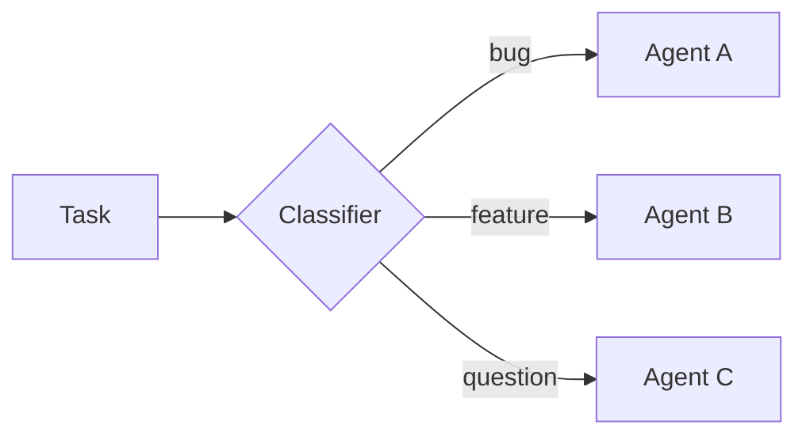
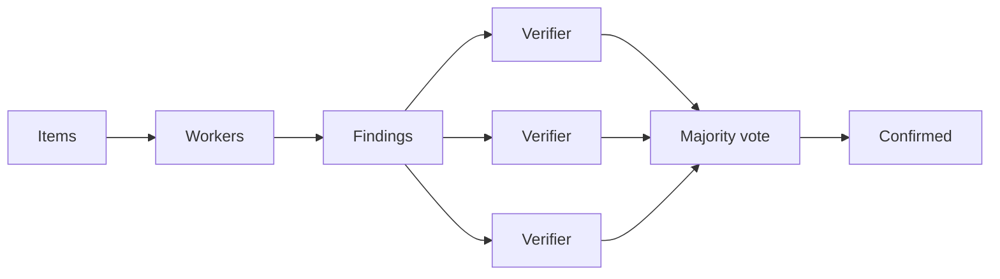
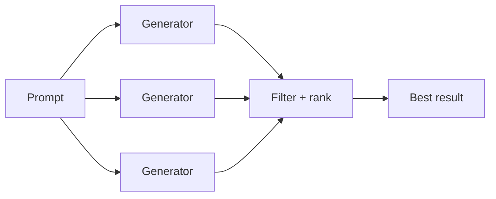
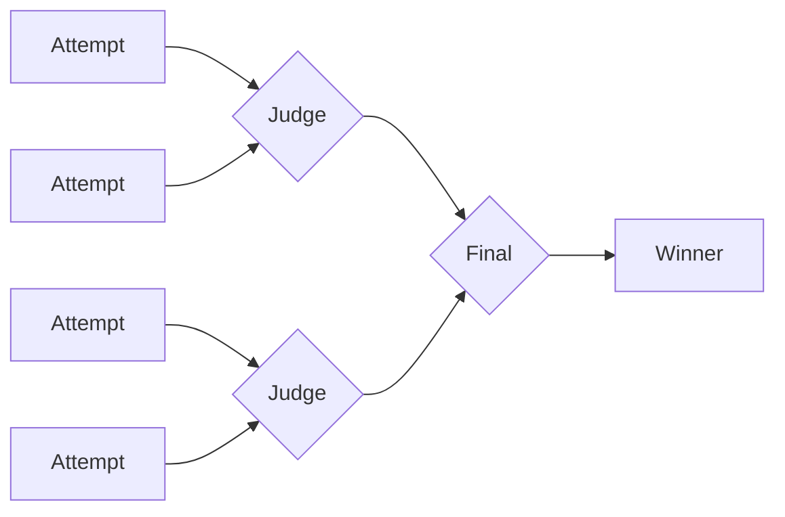
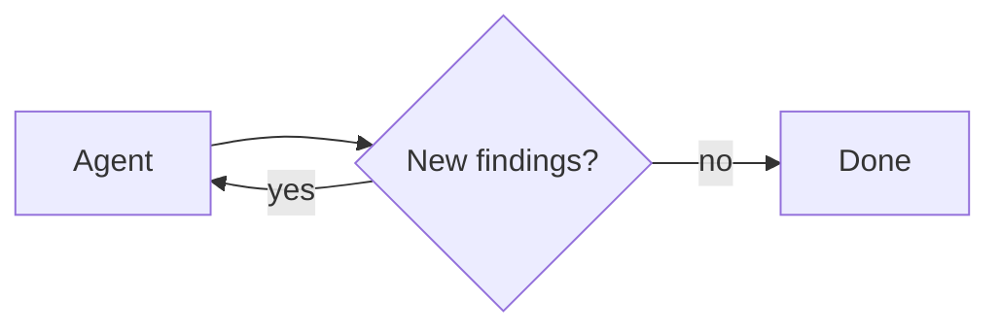

# 动态子代理（Dynamic subagents）

> 原文：Dynamic subagents
> 来源：https://docs.langchain.com/oss/javascript/deepagents/dynamic-subagents

---

动态子代理（Dynamic subagents）让 agent 可以从解释器代码中派发 [subagents](/oss/javascript/deepagents/subagents)。agent 无需让模型一次选择一次 subagent 调用，而是可以使用 JavaScript 循环、分支和并行批次，在已配置的 subagents 之间路由工作并综合结果。

当工作跨越许多独立单元、需要多个视角，或受益于递归分析时，请使用此模式。关于解释器的一般设置，请参阅[解释器（Interpreters）](/oss/javascript/deepagents/interpreters)。

> **警告**：动态子代理使用解释器运行时，它处于[**测试版（beta）**](/oss/javascript/versioning)。API 和生命周期行为可能在不同版本之间变化。

> **注意**：解释器需要 `@langchain/quickjs`。

## 快速开始

动态子代理需要[解释器（interpreter）](/oss/javascript/deepagents/interpreters) middleware。请先安装并接好解释器。内置的[通用子代理（general-purpose subagent）](/oss/javascript/deepagents/subagents#default-subagent)无需额外配置即可处理基本的扇出。

### Google

```ts
import { createDeepAgent } from "deepagents";
import { createCodeInterpreterMiddleware } from "@langchain/quickjs";

const agent = createDeepAgent({
  model: "google:gemini-3.6-flash",
  subagents: [{
    name: "reviewer",
    description: "Reviews code for security issues, citing lines and severity",
    systemPrompt: "You are a security-focused code reviewer. Report issues with line numbers and severity.",
  }],
  middleware: [createCodeInterpreterMiddleware()],
});
```

### OpenAI

```ts
import { createDeepAgent } from "deepagents";
import { createCodeInterpreterMiddleware } from "@langchain/quickjs";

const agent = createDeepAgent({
  model: "openai:gpt-5.5",
  subagents: [{
    name: "reviewer",
    description: "Reviews code for security issues, citing lines and severity",
    systemPrompt: "You are a security-focused code reviewer. Report issues with line numbers and severity.",
  }],
  middleware: [createCodeInterpreterMiddleware()],
});
```

### Anthropic

```ts
import { createDeepAgent } from "deepagents";
import { createCodeInterpreterMiddleware } from "@langchain/quickjs";

const agent = createDeepAgent({
  model: "anthropic:claude-sonnet-5",
  subagents: [{
    name: "reviewer",
    description: "Reviews code for security issues, citing lines and severity",
    systemPrompt: "You are a security-focused code reviewer. Report issues with line numbers and severity.",
  }],
  middleware: [createCodeInterpreterMiddleware()],
});
```

### OpenRouter

```ts
import { createDeepAgent } from "deepagents";
import { createCodeInterpreterMiddleware } from "@langchain/quickjs";

const agent = createDeepAgent({
  model: "openrouter:z-ai/glm-5.2",
  subagents: [{
    name: "reviewer",
    description: "Reviews code for security issues, citing lines and severity",
    systemPrompt: "You are a security-focused code reviewer. Report issues with line numbers and severity.",
  }],
  middleware: [createCodeInterpreterMiddleware()],
});
```

### Fireworks

```ts
import { createDeepAgent } from "deepagents";
import { createCodeInterpreterMiddleware } from "@langchain/quickjs";

const agent = createDeepAgent({
  model: "fireworks:accounts/fireworks/models/glm-5p2",
  subagents: [{
    name: "reviewer",
    description: "Reviews code for security issues, citing lines and severity",
    systemPrompt: "You are a security-focused code reviewer. Report issues with line numbers and severity.",
  }],
  middleware: [createCodeInterpreterMiddleware()],
});
```

### Baseten

```ts
import { createDeepAgent } from "deepagents";
import { createCodeInterpreterMiddleware } from "@langchain/quickjs";

const agent = createDeepAgent({
  model: "baseten:zai-org/GLM-5.2",
  subagents: [{
    name: "reviewer",
    description: "Reviews code for security issues, citing lines and severity",
    systemPrompt: "You are a security-focused code reviewer. Report issues with line numbers and severity.",
  }],
  middleware: [createCodeInterpreterMiddleware()],
});
```

### Ollama

```ts
import { createDeepAgent } from "deepagents";
import { createCodeInterpreterMiddleware } from "@langchain/quickjs";

const agent = createDeepAgent({
  model: "ollama:north-mini-code-1.0",
  subagents: [{
    name: "reviewer",
    description: "Reviews code for security issues, citing lines and severity",
    systemPrompt: "You are a security-focused code reviewer. Report issues with line numbers and severity.",
  }],
  middleware: [createCodeInterpreterMiddleware()],
});
```

关于安装步骤和解释器设置，请参阅[解释器（Interpreters）](/oss/javascript/deepagents/interpreters#quickstart)。

对于专门化工作，请配置带有各自名称、description 和 system prompt 的自定义 [subagents](/oss/javascript/deepagents/subagents)。subagents 的名称和 description 作为 agent 评估该选用哪个角色的信息。

要触发动态子代理，请在提示 agent 时使用 "workflow" 一词：

```ts
const result = await agent.invoke({
  messages: [{ role: "user", content: "Run a workflow that reviews every file in src/routes/ and summarizes the top risks." }],
});
```

> **提示**：**"workflow" 一词是一个有用的触发器。** 解释器 system prompt 将 "workflow" 视为一种信号，表示应通过解释器来组织工作，从代码中用 `task()` 派发 subagents，而不是一次一个由模型选择的工具调用那样逐个处理条目。将请求表述为 "workflow" 是一种刻意的杠杆，你可以拉动它以选择加入动态编排。对于单个、直接的委派，请改为平实地表述请求。

> **注意**：想将动态子代理与 `dcode`（LangChain 的终端编码 agent）一起使用？`dcode` 自带启用代码解释器，因此动态子代理开箱即用。关于设置和使用细节，请参阅 [dcode subagents 页面](/oss/deepagents/code/subagents)。

## 工作原理

当 agent 拥有 [subagents](/oss/javascript/deepagents/subagents) 和解释器 middleware 时，解释器会暴露一个内置的 `task()` 全局函数，用于从代码中派发 subagents。跨越许多独立单元的任务（审查目录中的每个文件、对一批工单进行分诊）会变成一个扇出工作的循环，因此它会确定性地运行，而不是一次一个由模型选择的工具调用。

Subagent 编排还支持递归语言模型（recursive language model，RLM）工作流，即[递归语言模型论文](https://arxiv.org/abs/2512.24601)中描述的方法：将工作集保存在解释器变量中，选取切片，用 `task()` 调用 subagents，并综合结果。

许多编排工作流将动态子代理与[编程式工具调用（programmatic tool calling，PTC）](/oss/javascript/deepagents/interpreters#programmatic-tool-calling-ptc)结合使用：从解释器代码中使用 `tools.*` 来发现或过滤输入，然后用 `task()` 派发 subagents。PTC 默认关闭；请在解释器 middleware 上用显式 allowlist 启用它。

`task()` 是通向 subagent 执行的能力桥接，类似于用于工具的 PTC。关于隔离默认值、审批边界和 middleware 选项，请参阅[安全（Security）](/oss/javascript/deepagents/interpreters#security)和[配置（Configuration）](/oss/javascript/deepagents/interpreters#configuration)。

`task()` 接受以下输入：

* `description`：给 subagent 的 prompt
* `subagentType`：要运行哪个已配置的 subagent
* `responseSchema`（可选）：结构化输出

一次 `task()` 会运行完整的 agentic 循环，并解析为 subagent 的结果：

```ts
const review = await task({
  description: "Review src/auth/login.ts for auth issues. Cite line numbers.",
  subagentType: "reviewer",
  responseSchema: {
    type: "object",
    properties: {
      issues: { type: "array", items: { type: "object", properties: {
        file: { type: "string" }, line: { type: "number" },
        severity: { type: "string" }, description: { type: "string" },
      }}},
    },
  },
});

// With responseSchema, the result is already a typed value, so no JSON.parse is needed.
const critical = review.issues.filter((issue) => issue.severity === "high");
```

当你传入 `responseSchema` 时，解析出的值已经是带类型的 JavaScript 对象；只有当 subagent 有意返回了一个 JSON 字符串时，才需要调用 `JSON.parse`。

## 模式

agent 会根据任务的形态来选择策略；这些策略源自它如何编写解释器代码，而非来自配置，且你提供的 subagents 决定了它能做什么。每种模式都共享相同的编排方法：把工作保存在 JS 变量中，用 `task()` 派发 subagents，并在代码中组合结果。下面的图示展示了常见形态，每种都附有一个可运行的示例。

### 分类并执行

先对条目进行分类，然后根据分类将每个条目交给专门化的 subagent 处理。这让你能够在不同条目需要不同专业知识的情况下处理混合输入。



**用例：** 分诊支持工单、错误日志、用户反馈，或任何需要根据类型进行不同处理的一批条目。

#### 示例：分类并执行

**你配置的内容**

##### Google

```ts
import { createDeepAgent } from "deepagents";
import { createCodeInterpreterMiddleware } from "@langchain/quickjs";

const agent = createDeepAgent({
  model: "google:gemini-3.6-flash",
  subagents: [
    {
      name: "bug-fixer",
      description: "Investigates bug reports and provides reproduction steps",
      systemPrompt: "You are a bug triage specialist. Investigate each bug report and provide clear reproduction steps.",
    },
    {
      name: "feature-analyst",
      description: "Evaluates feature requests for feasibility and effort",
      systemPrompt: "You are a product analyst. Evaluate each feature request for technical feasibility, estimated effort, and potential impact.",
    },
    {
      name: "support-agent",
      description: "Answers user questions based on documentation",
      systemPrompt: "You are a support specialist. Answer user questions clearly based on the available documentation.",
    },
  ],
  middleware: [createCodeInterpreterMiddleware()],
});
```

##### OpenAI

```ts
import { createDeepAgent } from "deepagents";
import { createCodeInterpreterMiddleware } from "@langchain/quickjs";

const agent = createDeepAgent({
  model: "openai:gpt-5.5",
  subagents: [
    {
      name: "bug-fixer",
      description: "Investigates bug reports and provides reproduction steps",
      systemPrompt: "You are a bug triage specialist. Investigate each bug report and provide clear reproduction steps.",
    },
    {
      name: "feature-analyst",
      description: "Evaluates feature requests for feasibility and effort",
      systemPrompt: "You are a product analyst. Evaluate each feature request for technical feasibility, estimated effort, and potential impact.",
    },
    {
      name: "support-agent",
      description: "Answers user questions based on documentation",
      systemPrompt: "You are a support specialist. Answer user questions clearly based on the available documentation.",
    },
  ],
  middleware: [createCodeInterpreterMiddleware()],
});
```

##### Anthropic

```ts
import { createDeepAgent } from "deepagents";
import { createCodeInterpreterMiddleware } from "@langchain/quickjs";

const agent = createDeepAgent({
  model: "anthropic:claude-sonnet-5",
  subagents: [
    {
      name: "bug-fixer",
      description: "Investigates bug reports and provides reproduction steps",
      systemPrompt: "You are a bug triage specialist. Investigate each bug report and provide clear reproduction steps.",
    },
    {
      name: "feature-analyst",
      description: "Evaluates feature requests for feasibility and effort",
      systemPrompt: "You are a product analyst. Evaluate each feature request for technical feasibility, estimated effort, and potential impact.",
    },
    {
      name: "support-agent",
      description: "Answers user questions based on documentation",
      systemPrompt: "You are a support specialist. Answer user questions clearly based on the available documentation.",
    },
  ],
  middleware: [createCodeInterpreterMiddleware()],
});
```

##### OpenRouter

```ts
import { createDeepAgent } from "deepagents";
import { createCodeInterpreterMiddleware } from "@langchain/quickjs";

const agent = createDeepAgent({
  model: "openrouter:z-ai/glm-5.2",
  subagents: [
    {
      name: "bug-fixer",
      description: "Investigates bug reports and provides reproduction steps",
      systemPrompt: "You are a bug triage specialist. Investigate each bug report and provide clear reproduction steps.",
    },
    {
      name: "feature-analyst",
      description: "Evaluates feature requests for feasibility and effort",
      systemPrompt: "You are a product analyst. Evaluate each feature request for technical feasibility, estimated effort, and potential impact.",
    },
    {
      name: "support-agent",
      description: "Answers user questions based on documentation",
      systemPrompt: "You are a support specialist. Answer user questions clearly based on the available documentation.",
    },
  ],
  middleware: [createCodeInterpreterMiddleware()],
});
```

##### Fireworks

```ts
import { createDeepAgent } from "deepagents";
import { createCodeInterpreterMiddleware } from "@langchain/quickjs";

const agent = createDeepAgent({
  model: "fireworks:accounts/fireworks/models/glm-5p2",
  subagents: [
    {
      name: "bug-fixer",
      description: "Investigates bug reports and provides reproduction steps",
      systemPrompt: "You are a bug triage specialist. Investigate each bug report and provide clear reproduction steps.",
    },
    {
      name: "feature-analyst",
      description: "Evaluates feature requests for feasibility and effort",
      systemPrompt: "You are a product analyst. Evaluate each feature request for technical feasibility, estimated effort, and potential impact.",
    },
    {
      name: "support-agent",
      description: "Answers user questions based on documentation",
      systemPrompt: "You are a support specialist. Answer user questions clearly based on the available documentation.",
    },
  ],
  middleware: [createCodeInterpreterMiddleware()],
});
```

##### Baseten

```ts
import { createDeepAgent } from "deepagents";
import { createCodeInterpreterMiddleware } from "@langchain/quickjs";

const agent = createDeepAgent({
  model: "baseten:zai-org/GLM-5.2",
  subagents: [
    {
      name: "bug-fixer",
      description: "Investigates bug reports and provides reproduction steps",
      systemPrompt: "You are a bug triage specialist. Investigate each bug report and provide clear reproduction steps.",
    },
    {
      name: "feature-analyst",
      description: "Evaluates feature requests for feasibility and effort",
      systemPrompt: "You are a product analyst. Evaluate each feature request for technical feasibility, estimated effort, and potential impact.",
    },
    {
      name: "support-agent",
      description: "Answers user questions based on documentation",
      systemPrompt: "You are a support specialist. Answer user questions clearly based on the available documentation.",
    },
  ],
  middleware: [createCodeInterpreterMiddleware()],
});
```

##### Ollama

```ts
import { createDeepAgent } from "deepagents";
import { createCodeInterpreterMiddleware } from "@langchain/quickjs";

const agent = createDeepAgent({
  model: "ollama:north-mini-code-1.0",
  subagents: [
    {
      name: "bug-fixer",
      description: "Investigates bug reports and provides reproduction steps",
      systemPrompt: "You are a bug triage specialist. Investigate each bug report and provide clear reproduction steps.",
    },
    {
      name: "feature-analyst",
      description: "Evaluates feature requests for feasibility and effort",
      systemPrompt: "You are a product analyst. Evaluate each feature request for technical feasibility, estimated effort, and potential impact.",
    },
    {
      name: "support-agent",
      description: "Answers user questions based on documentation",
      systemPrompt: "You are a support specialist. Answer user questions clearly based on the available documentation.",
    },
  ],
  middleware: [createCodeInterpreterMiddleware()],
});
```

**agent 编写的代码**

```ts
// The agent has already classified each ticket; this routes every item to
// the right specialist and collects the handled results.
const SPECIALIST = { bug: "bug-fixer", feature: "feature-analyst", question: "support-agent" };

const handled = await Promise.all(
  tickets.map((ticket) =>
    task({
      description: `Handle this ${ticket.category}:\n${ticket.text}`,
      subagentType: SPECIALIST[ticket.category],
    }),
  ),
);
// ... group handled results by category into a single triage report
handled;
```

### 扇出并综合

agent 将同类型的工作并行派发到许多条目上，然后合并结果。


**用例：** 跨目录的代码审查、分析一批文档、处理日志文件、在许多服务上运行相同的检查。

从解释器代码中发现文件需要[编程式工具调用（programmatic tool calling，PTC）](/oss/javascript/deepagents/interpreters#programmatic-tool-calling-ptc)。请在解释器 middleware 的 PTC allowlist 中启用 `glob`。

#### 示例：扇出并综合

**你配置的内容**

##### Google

```ts
import { createDeepAgent } from "deepagents";
import { createCodeInterpreterMiddleware } from "@langchain/quickjs";

const agent = createDeepAgent({
  model: "google:gemini-3.6-flash",
  subagents: [{
    name: "reviewer",
    description: "Reviews code for security issues, citing lines and severity",
    systemPrompt: "You are a security-focused code reviewer. Read the file carefully and report any authentication or authorization issues with line numbers and severity.",
  }],
  middleware: [createCodeInterpreterMiddleware({ ptc: ["glob"] })],
});
```

##### OpenAI

```ts
import { createDeepAgent } from "deepagents";
import { createCodeInterpreterMiddleware } from "@langchain/quickjs";

const agent = createDeepAgent({
  model: "openai:gpt-5.5",
  subagents: [{
    name: "reviewer",
    description: "Reviews code for security issues, citing lines and severity",
    systemPrompt: "You are a security-focused code reviewer. Read the file carefully and report any authentication or authorization issues with line numbers and severity.",
  }],
  middleware: [createCodeInterpreterMiddleware({ ptc: ["glob"] })],
});
```

##### Anthropic

```ts
import { createDeepAgent } from "deepagents";
import { createCodeInterpreterMiddleware } from "@langchain/quickjs";

const agent = createDeepAgent({
  model: "anthropic:claude-sonnet-5",
  subagents: [{
    name: "reviewer",
    description: "Reviews code for security issues, citing lines and severity",
    systemPrompt: "You are a security-focused code reviewer. Read the file carefully and report any authentication or authorization issues with line numbers and severity.",
  }],
  middleware: [createCodeInterpreterMiddleware({ ptc: ["glob"] })],
});
```

##### OpenRouter

```ts
import { createDeepAgent } from "deepagents";
import { createCodeInterpreterMiddleware } from "@langchain/quickjs";

const agent = createDeepAgent({
  model: "openrouter:z-ai/glm-5.2",
  subagents: [{
    name: "reviewer",
    description: "Reviews code for security issues, citing lines and severity",
    systemPrompt: "You are a security-focused code reviewer. Read the file carefully and report any authentication or authorization issues with line numbers and severity.",
  }],
  middleware: [createCodeInterpreterMiddleware({ ptc: ["glob"] })],
});
```

##### Fireworks

```ts
import { createDeepAgent } from "deepagents";
import { createCodeInterpreterMiddleware } from "@langchain/quickjs";

const agent = createDeepAgent({
  model: "fireworks:accounts/fireworks/models/glm-5p2",
  subagents: [{
    name: "reviewer",
    description: "Reviews code for security issues, citing lines and severity",
    systemPrompt: "You are a security-focused code reviewer. Read the file carefully and report any authentication or authorization issues with line numbers and severity.",
  }],
  middleware: [createCodeInterpreterMiddleware({ ptc: ["glob"] })],
});
```

##### Baseten

```ts
import { createDeepAgent } from "deepagents";
import { createCodeInterpreterMiddleware } from "@langchain/quickjs";

const agent = createDeepAgent({
  model: "baseten:zai-org/GLM-5.2",
  subagents: [{
    name: "reviewer",
    description: "Reviews code for security issues, citing lines and severity",
    systemPrompt: "You are a security-focused code reviewer. Read the file carefully and report any authentication or authorization issues with line numbers and severity.",
  }],
  middleware: [createCodeInterpreterMiddleware({ ptc: ["glob"] })],
});
```

##### Ollama

```ts
import { createDeepAgent } from "deepagents";
import { createCodeInterpreterMiddleware } from "@langchain/quickjs";

const agent = createDeepAgent({
  model: "ollama:north-mini-code-1.0",
  subagents: [{
    name: "reviewer",
    description: "Reviews code for security issues, citing lines and severity",
    systemPrompt: "You are a security-focused code reviewer. Read the file carefully and report any authentication or authorization issues with line numbers and severity.",
  }],
  middleware: [createCodeInterpreterMiddleware({ ptc: ["glob"] })],
});
```

**agent 编写的代码**

```ts
// One reviewer per file, dispatched in parallel, then findings merged.
const files = (await tools.glob({ pattern: "src/routes/**/*.ts" }))
  .split("\n")
  .filter(Boolean);

const reviews = await Promise.all(
  files.map((file) =>
    task({
      description: `Review ${file} for authentication issues. Cite line numbers.`,
      subagentType: "reviewer",
      responseSchema: issuesSchema, // -> { issues: [{ file, line, severity }] }
    }),
  ),
);

const issues = reviews.flatMap((r) => r.issues);
// ... sort by severity, drop duplicates, summarize the top risks
issues;
```

### 对抗性验证

一种两遍（two-pass）模式。第一遍产生发现（findings）。第二遍将每个发现发送给独立的验证者，只有通过一致性检验的发现才会被保留。当置信度比速度更重要时，这会减少误报。



**用例：** 误报代价高昂的安全审计、合规检查、任何需要对发现具有高置信度的审查。

#### 示例：对抗性验证

**你配置的内容**

##### Google

```ts
import { createDeepAgent } from "deepagents";
import { createCodeInterpreterMiddleware } from "@langchain/quickjs";

const agent = createDeepAgent({
  model: "google:gemini-3.6-flash",
  subagents: [
    {
      name: "reviewer",
      description: "Finds potential security vulnerabilities in code",
      systemPrompt: "You are a security auditor. Find potential vulnerabilities and report each with file, line, and description.",
    },
    {
      name: "verifier",
      description: "Independently verifies whether a reported vulnerability is real",
      systemPrompt: "You are a security verification specialist. Given a reported vulnerability, independently verify whether it is exploitable. Be skeptical. Only confirm real issues.",
    },
  ],
  middleware: [createCodeInterpreterMiddleware()],
});
```

##### OpenAI

```ts
import { createDeepAgent } from "deepagents";
import { createCodeInterpreterMiddleware } from "@langchain/quickjs";

const agent = createDeepAgent({
  model: "openai:gpt-5.5",
  subagents: [
    {
      name: "reviewer",
      description: "Finds potential security vulnerabilities in code",
      systemPrompt: "You are a security auditor. Find potential vulnerabilities and report each with file, line, and description.",
    },
    {
      name: "verifier",
      description: "Independently verifies whether a reported vulnerability is real",
      systemPrompt: "You are a security verification specialist. Given a reported vulnerability, independently verify whether it is exploitable. Be skeptical. Only confirm real issues.",
    },
  ],
  middleware: [createCodeInterpreterMiddleware()],
});
```

##### Anthropic

```ts
import { createDeepAgent } from "deepagents";
import { createCodeInterpreterMiddleware } from "@langchain/quickjs";

const agent = createDeepAgent({
  model: "anthropic:claude-sonnet-5",
  subagents: [
    {
      name: "reviewer",
      description: "Finds potential security vulnerabilities in code",
      systemPrompt: "You are a security auditor. Find potential vulnerabilities and report each with file, line, and description.",
    },
    {
      name: "verifier",
      description: "Independently verifies whether a reported vulnerability is real",
      systemPrompt: "You are a security verification specialist. Given a reported vulnerability, independently verify whether it is exploitable. Be skeptical. Only confirm real issues.",
    },
  ],
  middleware: [createCodeInterpreterMiddleware()],
});
```

##### OpenRouter

```ts
import { createDeepAgent } from "deepagents";
import { createCodeInterpreterMiddleware } from "@langchain/quickjs";

const agent = createDeepAgent({
  model: "openrouter:z-ai/glm-5.2",
  subagents: [
    {
      name: "reviewer",
      description: "Finds potential security vulnerabilities in code",
      systemPrompt: "You are a security auditor. Find potential vulnerabilities and report each with file, line, and description.",
    },
    {
      name: "verifier",
      description: "Independently verifies whether a reported vulnerability is real",
      systemPrompt: "You are a security verification specialist. Given a reported vulnerability, independently verify whether it is exploitable. Be skeptical. Only confirm real issues.",
    },
  ],
  middleware: [createCodeInterpreterMiddleware()],
});
```

##### Fireworks

```ts
import { createDeepAgent } from "deepagents";
import { createCodeInterpreterMiddleware } from "@langchain/quickjs";

const agent = createDeepAgent({
  model: "fireworks:accounts/fireworks/models/glm-5p2",
  subagents: [
    {
      name: "reviewer",
      description: "Finds potential security vulnerabilities in code",
      systemPrompt: "You are a security auditor. Find potential vulnerabilities and report each with file, line, and description.",
    },
    {
      name: "verifier",
      description: "Independently verifies whether a reported vulnerability is real",
      systemPrompt: "You are a security verification specialist. Given a reported vulnerability, independently verify whether it is exploitable. Be skeptical. Only confirm real issues.",
    },
  ],
  middleware: [createCodeInterpreterMiddleware()],
});
```

##### Baseten

```ts
import { createDeepAgent } from "deepagents";
import { createCodeInterpreterMiddleware } from "@langchain/quickjs";

const agent = createDeepAgent({
  model: "baseten:zai-org/GLM-5.2",
  subagents: [
    {
      name: "reviewer",
      description: "Finds potential security vulnerabilities in code",
      systemPrompt: "You are a security auditor. Find potential vulnerabilities and report each with file, line, and description.",
    },
    {
      name: "verifier",
      description: "Independently verifies whether a reported vulnerability is real",
      systemPrompt: "You are a security verification specialist. Given a reported vulnerability, independently verify whether it is exploitable. Be skeptical. Only confirm real issues.",
    },
  ],
  middleware: [createCodeInterpreterMiddleware()],
});
```

##### Ollama

```ts
import { createDeepAgent } from "deepagents";
import { createCodeInterpreterMiddleware } from "@langchain/quickjs";

const agent = createDeepAgent({
  model: "ollama:north-mini-code-1.0",
  subagents: [
    {
      name: "reviewer",
      description: "Finds potential security vulnerabilities in code",
      systemPrompt: "You are a security auditor. Find potential vulnerabilities and report each with file, line, and description.",
    },
    {
      name: "verifier",
      description: "Independently verifies whether a reported vulnerability is real",
      systemPrompt: "You are a security verification specialist. Given a reported vulnerability, independently verify whether it is exploitable. Be skeptical. Only confirm real issues.",
    },
  ],
  middleware: [createCodeInterpreterMiddleware()],
});
```

**agent 编写的代码**

```ts
// Pass 1: audit. Pass 2: verify each finding independently; keep only confirmed.
const { findings } = await task({
  description: "Audit the payments module for vulnerabilities.",
  subagentType: "reviewer",
  responseSchema: findingsSchema, // -> { findings: [{ id, file, line, description }] }
});

const verdicts = await Promise.all(
  findings.map((f) =>
    task({
      description: `Verify ${f.file}:${f.line} (${f.description}). Confirm or refute.`,
      subagentType: "verifier",
      responseSchema: verdictSchema, // -> { confirmed: boolean }
    }),
  ),
);

const confirmed = findings.filter((_, i) => verdicts[i]?.confirmed);
// ... report only the confirmed vulnerabilities
confirmed;
```

### 生成并过滤

多个 subagents 为同一问题生成独立的解决方案。agent 在代码中比较、评分并过滤结果，只保留最好的。



**用例：** 架构提案、重构策略、内容变体，以及任何在定稿前探索多种选项能带来更好结果的任务。

#### 示例：生成并过滤

**你配置的内容**

##### Google

```ts
import { createDeepAgent } from "deepagents";
import { createCodeInterpreterMiddleware } from "@langchain/quickjs";

const agent = createDeepAgent({
  model: "google:gemini-3.6-flash",
  subagents: [{
    name: "architect",
    description: "Proposes a database schema design with tradeoff analysis",
    systemPrompt: "You are a database architect. Propose a schema design for the given requirements. Include tradeoffs, migration considerations, and a clear rationale.",
  }],
  middleware: [createCodeInterpreterMiddleware()],
});
```

##### OpenAI

```ts
import { createDeepAgent } from "deepagents";
import { createCodeInterpreterMiddleware } from "@langchain/quickjs";

const agent = createDeepAgent({
  model: "openai:gpt-5.5",
  subagents: [{
    name: "architect",
    description: "Proposes a database schema design with tradeoff analysis",
    systemPrompt: "You are a database architect. Propose a schema design for the given requirements. Include tradeoffs, migration considerations, and a clear rationale.",
  }],
  middleware: [createCodeInterpreterMiddleware()],
});
```

##### Anthropic

```ts
import { createDeepAgent } from "deepagents";
import { createCodeInterpreterMiddleware } from "@langchain/quickjs";

const agent = createDeepAgent({
  model: "anthropic:claude-sonnet-5",
  subagents: [{
    name: "architect",
    description: "Proposes a database schema design with tradeoff analysis",
    systemPrompt: "You are a database architect. Propose a schema design for the given requirements. Include tradeoffs, migration considerations, and a clear rationale.",
  }],
  middleware: [createCodeInterpreterMiddleware()],
});
```

##### OpenRouter

```ts
import { createDeepAgent } from "deepagents";
import { createCodeInterpreterMiddleware } from "@langchain/quickjs";

const agent = createDeepAgent({
  model: "openrouter:z-ai/glm-5.2",
  subagents: [{
    name: "architect",
    description: "Proposes a database schema design with tradeoff analysis",
    systemPrompt: "You are a database architect. Propose a schema design for the given requirements. Include tradeoffs, migration considerations, and a clear rationale.",
  }],
  middleware: [createCodeInterpreterMiddleware()],
});
```

##### Fireworks

```ts
import { createDeepAgent } from "deepagents";
import { createCodeInterpreterMiddleware } from "@langchain/quickjs";

const agent = createDeepAgent({
  model: "fireworks:accounts/fireworks/models/glm-5p2",
  subagents: [{
    name: "architect",
    description: "Proposes a database schema design with tradeoff analysis",
    systemPrompt: "You are a database architect. Propose a schema design for the given requirements. Include tradeoffs, migration considerations, and a clear rationale.",
  }],
  middleware: [createCodeInterpreterMiddleware()],
});
```

##### Baseten

```ts
import { createDeepAgent } from "deepagents";
import { createCodeInterpreterMiddleware } from "@langchain/quickjs";

const agent = createDeepAgent({
  model: "baseten:zai-org/GLM-5.2",
  subagents: [{
    name: "architect",
    description: "Proposes a database schema design with tradeoff analysis",
    systemPrompt: "You are a database architect. Propose a schema design for the given requirements. Include tradeoffs, migration considerations, and a clear rationale.",
  }],
  middleware: [createCodeInterpreterMiddleware()],
});
```

##### Ollama

```ts
import { createDeepAgent } from "deepagents";
import { createCodeInterpreterMiddleware } from "@langchain/quickjs";

const agent = createDeepAgent({
  model: "ollama:north-mini-code-1.0",
  subagents: [{
    name: "architect",
    description: "Proposes a database schema design with tradeoff analysis",
    systemPrompt: "You are a database architect. Propose a schema design for the given requirements. Include tradeoffs, migration considerations, and a clear rationale.",
  }],
  middleware: [createCodeInterpreterMiddleware()],
});
```

**agent 编写的代码**

```ts
// Generate independent proposals in parallel, then score and keep the best.
const proposals = await Promise.all(
  [1, 2, 3].map((n) =>
    task({
      description: `Approach ${n}: redesign the orders schema, with tradeoffs.`,
      subagentType: "architect",
      responseSchema: designSchema, // -> { design, tradeoffs }
    }),
  ),
);

// ... score each proposal against the requirements
const best = proposals.sort((a, b) => score(b) - score(a))[0];
best;
```

### 锦标赛

变体由裁判 subagent 进行两两对决，胜者通过淘汰赛轮次晋级。



**用例：** 主观标准下的优化、风格选择、在相互竞争的实现之间做选择。

#### 示例：锦标赛

**你配置的内容**

##### Google

```ts
import { createDeepAgent } from "deepagents";
import { createCodeInterpreterMiddleware } from "@langchain/quickjs";

const agent = createDeepAgent({
  model: "google:gemini-3.6-flash",
  subagents: [
    {
      name: "writer",
      description: "Rewrites a function with a focus on readability and clarity",
      systemPrompt: "You are an expert programmer focused on clean code. Rewrite the given function to maximize readability. Explain your choices.",
    },
    {
      name: "judge",
      description: "Compares two code implementations and picks the more readable one",
      systemPrompt: "You are a code quality judge. Compare two implementations and pick the more readable one. Justify your choice with specific criteria.",
    },
  ],
  middleware: [createCodeInterpreterMiddleware()],
});
```

##### OpenAI

```ts
import { createDeepAgent } from "deepagents";
import { createCodeInterpreterMiddleware } from "@langchain/quickjs";

const agent = createDeepAgent({
  model: "openai:gpt-5.5",
  subagents: [
    {
      name: "writer",
      description: "Rewrites a function with a focus on readability and clarity",
      systemPrompt: "You are an expert programmer focused on clean code. Rewrite the given function to maximize readability. Explain your choices.",
    },
    {
      name: "judge",
      description: "Compares two code implementations and picks the more readable one",
      systemPrompt: "You are a code quality judge. Compare two implementations and pick the more readable one. Justify your choice with specific criteria.",
    },
  ],
  middleware: [createCodeInterpreterMiddleware()],
});
```

##### Anthropic

```ts
import { createDeepAgent } from "deepagents";
import { createCodeInterpreterMiddleware } from "@langchain/quickjs";

const agent = createDeepAgent({
  model: "anthropic:claude-sonnet-5",
  subagents: [
    {
      name: "writer",
      description: "Rewrites a function with a focus on readability and clarity",
      systemPrompt: "You are an expert programmer focused on clean code. Rewrite the given function to maximize readability. Explain your choices.",
    },
    {
      name: "judge",
      description: "Compares two code implementations and picks the more readable one",
      systemPrompt: "You are a code quality judge. Compare two implementations and pick the more readable one. Justify your choice with specific criteria.",
    },
  ],
  middleware: [createCodeInterpreterMiddleware()],
});
```

##### OpenRouter

```ts
import { createDeepAgent } from "deepagents";
import { createCodeInterpreterMiddleware } from "@langchain/quickjs";

const agent = createDeepAgent({
  model: "openrouter:z-ai/glm-5.2",
  subagents: [
    {
      name: "writer",
      description: "Rewrites a function with a focus on readability and clarity",
      systemPrompt: "You are an expert programmer focused on clean code. Rewrite the given function to maximize readability. Explain your choices.",
    },
    {
      name: "judge",
      description: "Compares two code implementations and picks the more readable one",
      systemPrompt: "You are a code quality judge. Compare two implementations and pick the more readable one. Justify your choice with specific criteria.",
    },
  ],
  middleware: [createCodeInterpreterMiddleware()],
});
```

##### Fireworks

```ts
import { createDeepAgent } from "deepagents";
import { createCodeInterpreterMiddleware } from "@langchain/quickjs";

const agent = createDeepAgent({
  model: "fireworks:accounts/fireworks/models/glm-5p2",
  subagents: [
    {
      name: "writer",
      description: "Rewrites a function with a focus on readability and clarity",
      systemPrompt: "You are an expert programmer focused on clean code. Rewrite the given function to maximize readability. Explain your choices.",
    },
    {
      name: "judge",
      description: "Compares two code implementations and picks the more readable one",
      systemPrompt: "You are a code quality judge. Compare two implementations and pick the more readable one. Justify your choice with specific criteria.",
    },
  ],
  middleware: [createCodeInterpreterMiddleware()],
});
```

##### Baseten

```ts
import { createDeepAgent } from "deepagents";
import { createCodeInterpreterMiddleware } from "@langchain/quickjs";

const agent = createDeepAgent({
  model: "baseten:zai-org/GLM-5.2",
  subagents: [
    {
      name: "writer",
      description: "Rewrites a function with a focus on readability and clarity",
      systemPrompt: "You are an expert programmer focused on clean code. Rewrite the given function to maximize readability. Explain your choices.",
    },
    {
      name: "judge",
      description: "Compares two code implementations and picks the more readable one",
      systemPrompt: "You are a code quality judge. Compare two implementations and pick the more readable one. Justify your choice with specific criteria.",
    },
  ],
  middleware: [createCodeInterpreterMiddleware()],
});
```

##### Ollama

```ts
import { createDeepAgent } from "deepagents";
import { createCodeInterpreterMiddleware } from "@langchain/quickjs";

const agent = createDeepAgent({
  model: "ollama:north-mini-code-1.0",
  subagents: [
    {
      name: "writer",
      description: "Rewrites a function with a focus on readability and clarity",
      systemPrompt: "You are an expert programmer focused on clean code. Rewrite the given function to maximize readability. Explain your choices.",
    },
    {
      name: "judge",
      description: "Compares two code implementations and picks the more readable one",
      systemPrompt: "You are a code quality judge. Compare two implementations and pick the more readable one. Justify your choice with specific criteria.",
    },
  ],
  middleware: [createCodeInterpreterMiddleware()],
});
```

**agent 编写的代码**

```ts
// Generate variants, then judge pairwise until a single winner remains.
let bracket = await Promise.all(
  [1, 2, 3, 4, 5].map((n) =>
    task({ description: `Rewrite processOrder for readability (variant ${n}).`, subagentType: "writer" }),
  ),
);

while (bracket.length > 1) {
  const winners = [];
  for (let i = 0; i < bracket.length; i += 2) {
    if (bracket[i + 1] === undefined) { winners.push(bracket[i]); break; }
    const { winner } = await task({
      description: `Pick the more readable:\n\nA:\n${bracket[i]}\n\nB:\n${bracket[i + 1]}`,
      subagentType: "judge",
      responseSchema: pickSchema, // -> { winner: "A" | "B" }
    });
    winners.push(winner === "A" ? bracket[i] : bracket[i + 1]);
  }
  bracket = winners;
}
bracket[0]; // the winning rewrite
```

### 循环直至完成

agent 运行一个发现循环，针对已找到的结果去重，直到不再出现新结果。当工作范围事先未知时很有用。



**用例：** 穷尽式搜索、死代码检测、依赖审计，以及任何你希望得到完整性而非固定数量结果的扫描。

#### 示例：循环直至完成

**你配置的内容**

##### Google

```ts
import { createDeepAgent } from "deepagents";
import { createCodeInterpreterMiddleware } from "@langchain/quickjs";

const agent = createDeepAgent({
  model: "google:gemini-3.6-flash",
  subagents: [{
    name: "analyzer",
    description: "Analyzes code for unused exports, functions, and dead code paths",
    systemPrompt: "You are a code analyst specializing in dead code detection. Find unused exports, unreachable functions, and orphaned modules. Report each with file path and evidence.",
  }],
  middleware: [createCodeInterpreterMiddleware()],
});
```

##### OpenAI

```ts
import { createDeepAgent } from "deepagents";
import { createCodeInterpreterMiddleware } from "@langchain/quickjs";

const agent = createDeepAgent({
  model: "openai:gpt-5.5",
  subagents: [{
    name: "analyzer",
    description: "Analyzes code for unused exports, functions, and dead code paths",
    systemPrompt: "You are a code analyst specializing in dead code detection. Find unused exports, unreachable functions, and orphaned modules. Report each with file path and evidence.",
  }],
  middleware: [createCodeInterpreterMiddleware()],
});
```

##### Anthropic

```ts
import { createDeepAgent } from "deepagents";
import { createCodeInterpreterMiddleware } from "@langchain/quickjs";

const agent = createDeepAgent({
  model: "anthropic:claude-sonnet-5",
  subagents: [{
    name: "analyzer",
    description: "Analyzes code for unused exports, functions, and dead code paths",
    systemPrompt: "You are a code analyst specializing in dead code detection. Find unused exports, unreachable functions, and orphaned modules. Report each with file path and evidence.",
  }],
  middleware: [createCodeInterpreterMiddleware()],
});
```

##### OpenRouter

```ts
import { createDeepAgent } from "deepagents";
import { createCodeInterpreterMiddleware } from "@langchain/quickjs";

const agent = createDeepAgent({
  model: "openrouter:z-ai/glm-5.2",
  subagents: [{
    name: "analyzer",
    description: "Analyzes code for unused exports, functions, and dead code paths",
    systemPrompt: "You are a code analyst specializing in dead code detection. Find unused exports, unreachable functions, and orphaned modules. Report each with file path and evidence.",
  }],
  middleware: [createCodeInterpreterMiddleware()],
});
```

##### Fireworks

```ts
import { createDeepAgent } from "deepagents";
import { createCodeInterpreterMiddleware } from "@langchain/quickjs";

const agent = createDeepAgent({
  model: "fireworks:accounts/fireworks/models/glm-5p2",
  subagents: [{
    name: "analyzer",
    description: "Analyzes code for unused exports, functions, and dead code paths",
    systemPrompt: "You are a code analyst specializing in dead code detection. Find unused exports, unreachable functions, and orphaned modules. Report each with file path and evidence.",
  }],
  middleware: [createCodeInterpreterMiddleware()],
});
```

##### Baseten

```ts
import { createDeepAgent } from "deepagents";
import { createCodeInterpreterMiddleware } from "@langchain/quickjs";

const agent = createDeepAgent({
  model: "baseten:zai-org/GLM-5.2",
  subagents: [{
    name: "analyzer",
    description: "Analyzes code for unused exports, functions, and dead code paths",
    systemPrompt: "You are a code analyst specializing in dead code detection. Find unused exports, unreachable functions, and orphaned modules. Report each with file path and evidence.",
  }],
  middleware: [createCodeInterpreterMiddleware()],
});
```

##### Ollama

```ts
import { createDeepAgent } from "deepagents";
import { createCodeInterpreterMiddleware } from "@langchain/quickjs";

const agent = createDeepAgent({
  model: "ollama:north-mini-code-1.0",
  subagents: [{
    name: "analyzer",
    description: "Analyzes code for unused exports, functions, and dead code paths",
    systemPrompt: "You are a code analyst specializing in dead code detection. Find unused exports, unreachable functions, and orphaned modules. Report each with file path and evidence.",
  }],
  middleware: [createCodeInterpreterMiddleware()],
});
```

**agent 编写的代码**

```ts
// Keep dispatching rounds, deduping against what's found, until a round adds nothing.
const seen = new Set();
const found = [];

while (true) {
  const { items } = await task({
    description: `Find dead code. Already found: ${[...seen].join(", ") || "(none)"}.`,
    subagentType: "analyzer",
    responseSchema: itemsSchema, // -> { items: [{ id, file }] }
  });
  const fresh = items.filter((i) => !seen.has(i.id));
  if (fresh.length === 0) break; // converged: nothing new
  for (const i of fresh) { seen.add(i.id); found.push(i); }
}
found;
```

> **警告**：`task()` 是从一个已经在运行的 `eval` 调用内部派发的。它不经过常规的工具调用路径，因此父 agent 上的 `interruptOn` 审批工作流不会在每次派发时强制执行。如果你需要在 subagent 编排运行之前获得批准，请对 `eval` 工具本身加以管控。

## 禁用动态子代理

只要 agent 拥有 subagents，subagent 派发就默认开启。如果你希望 subagents 仅通过常规的 `task` 工具路径可用，请禁用它。关于其他 middleware 选项，请参阅解释器页面上的[配置（Configuration）](/oss/javascript/deepagents/interpreters#configuration)。

### Google

```ts
import { createDeepAgent } from "deepagents";
import { createCodeInterpreterMiddleware } from "@langchain/quickjs";

const agent = createDeepAgent({
  model: "google:gemini-3.6-flash",
  subagents: [{ name: "reviewer", description: "Reviews code", systemPrompt: "Review code." }],
  middleware: [createCodeInterpreterMiddleware({ subagents: false })],
});
```

### OpenAI

```ts
import { createDeepAgent } from "deepagents";
import { createCodeInterpreterMiddleware } from "@langchain/quickjs";

const agent = createDeepAgent({
  model: "openai:gpt-5.5",
  subagents: [{ name: "reviewer", description: "Reviews code", systemPrompt: "Review code." }],
  middleware: [createCodeInterpreterMiddleware({ subagents: false })],
});
```

### Anthropic

```ts
import { createDeepAgent } from "deepagents";
import { createCodeInterpreterMiddleware } from "@langchain/quickjs";

const agent = createDeepAgent({
  model: "anthropic:claude-sonnet-5",
  subagents: [{ name: "reviewer", description: "Reviews code", systemPrompt: "Review code." }],
  middleware: [createCodeInterpreterMiddleware({ subagents: false })],
});
```

### OpenRouter

```ts
import { createDeepAgent } from "deepagents";
import { createCodeInterpreterMiddleware } from "@langchain/quickjs";

const agent = createDeepAgent({
  model: "openrouter:z-ai/glm-5.2",
  subagents: [{ name: "reviewer", description: "Reviews code", systemPrompt: "Review code." }],
  middleware: [createCodeInterpreterMiddleware({ subagents: false })],
});
```

### Fireworks

```ts
import { createDeepAgent } from "deepagents";
import { createCodeInterpreterMiddleware } from "@langchain/quickjs";

const agent = createDeepAgent({
  model: "fireworks:accounts/fireworks/models/glm-5p2",
  subagents: [{ name: "reviewer", description: "Reviews code", systemPrompt: "Review code." }],
  middleware: [createCodeInterpreterMiddleware({ subagents: false })],
});
```

### Baseten

```ts
import { createDeepAgent } from "deepagents";
import { createCodeInterpreterMiddleware } from "@langchain/quickjs";

const agent = createDeepAgent({
  model: "baseten:zai-org/GLM-5.2",
  subagents: [{ name: "reviewer", description: "Reviews code", systemPrompt: "Review code." }],
  middleware: [createCodeInterpreterMiddleware({ subagents: false })],
});
```

### Ollama

```ts
import { createDeepAgent } from "deepagents";
import { createCodeInterpreterMiddleware } from "@langchain/quickjs";

const agent = createDeepAgent({
  model: "ollama:north-mini-code-1.0",
  subagents: [{ name: "reviewer", description: "Reviews code", systemPrompt: "Review code." }],
  middleware: [createCodeInterpreterMiddleware({ subagents: false })],
});
```

## 另请参阅

* [解释器（Interpreters）](/oss/javascript/deepagents/interpreters)：QuickJS 设置、编程式工具调用、持久化、安全和 middleware 配置
* [Subagents](/oss/javascript/deepagents/subagents)：配置 subagent 名称、description 和 system prompt
* [事件流（Event streaming）](/oss/javascript/deepagents/event-streaming)：从协调者和被委派的 subagents 流式获取更新
