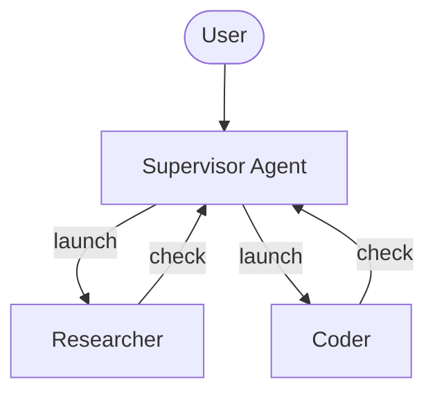
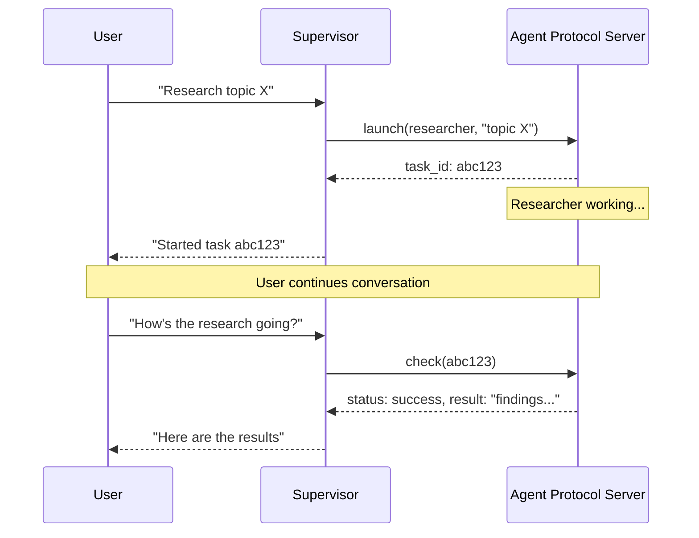

# Async subagents（异步子代理）

> 原文：Async subagents
> 来源：https://docs.langchain.com/oss/javascript/deepagents/async-subagents

---

> 启动在后台并发运行的子代理，让 supervisor 继续与用户交互

Async subagents 让 supervisor agent 能够启动那些会立即返回的后台任务，这样 supervisor 可以在 subagent 并发工作时继续与用户交互。supervisor 可以随时检查进度、发送后续指令或取消任务。

这建立在 [subagents](/oss/javascript/deepagents/subagents) 之上，后者以同步方式运行，会阻塞 supervisor 直到完成。当任务长时间运行、可并行化，或者需要中途 steering 时，请使用 async subagents。



> **注意**：Async subagents 可与任何实现了 [Agent Protocol](https://github.com/langchain-ai/agent-protocol) 的服务器通信。你可以使用 [LangSmith Deployments](/langsmith/deployment)，或自行托管任何兼容 Agent Protocol 的服务器。每个 subagent 都独立于 supervisor 运行，supervisor 通过 SDK 控制它们，来完成 launch、check、update 和 cancel。

## 何时使用 async subagents

| Dimension            | Sync subagents                                                  | Async subagents                                                   |
| -------------------- | --------------------------------------------------------------- | ----------------------------------------------------------------- |
| **Execution model**  | Supervisor 阻塞直到 subagent 完成                                | 立即返回 job ID；supervisor 继续运行                               |
| **Concurrency**      | 并行但会阻塞                                                     | 并行且非阻塞                                                       |
| **Mid-task updates** | 不支持                                                          | 通过 `update_async_task` 发送后续指令                              |
| **Cancellation**     | 不支持                                                          | 通过 `cancel_async_task` 取消正在运行的任务                        |
| **Statefulness**     | 无状态——调用之间没有持久化状态                                    | 有状态——在自身的 thread 上跨多次交互维护状态                        |
| **Best for**         | agent 应当等待结果后再继续的任务                                  | 在聊天中以交互方式管理的长时间运行、复杂任务                        |

## 配置 async subagents

将 async subagents 定义为一个 [`AsyncSubAgent`](https://reference.langchain.com/javascript/deepagents/agent/createDeepAgent) spec 列表，每个 spec 指向一个 Agent Protocol 服务器：

#### Google

```ts
import { createDeepAgent, type AsyncSubAgent } from "deepagents";

const asyncSubagents: AsyncSubAgent[] = [
  {
    name: "researcher",
    description: "Research agent for information gathering and synthesis",
    graphId: "researcher",
    // No url → ASGI transport (co-deployed in the same deployment)
  },
  {
    name: "coder",
    description: "Coding agent for code generation and review",
    graphId: "coder",
    // url: "https://coder-deployment.langsmith.dev"  // Optional: HTTP transport for remote
  },
];

const agent = createDeepAgent({
  model: "google:gemini-3.6-flash",
  subagents: [...asyncSubagents],
});
```

#### OpenAI

```ts
import { createDeepAgent, type AsyncSubAgent } from "deepagents";

const asyncSubagents: AsyncSubAgent[] = [
  {
    name: "researcher",
    description: "Research agent for information gathering and synthesis",
    graphId: "researcher",
    // No url → ASGI transport (co-deployed in the same deployment)
  },
  {
    name: "coder",
    description: "Coding agent for code generation and review",
    graphId: "coder",
    // url: "https://coder-deployment.langsmith.dev"  // Optional: HTTP transport for remote
  },
];

const agent = createDeepAgent({
  model: "openai:gpt-5.5",
  subagents: [...asyncSubagents],
});
```

#### Anthropic

```ts
import { createDeepAgent, type AsyncSubAgent } from "deepagents";

const asyncSubagents: AsyncSubAgent[] = [
  {
    name: "researcher",
    description: "Research agent for information gathering and synthesis",
    graphId: "researcher",
    // No url → ASGI transport (co-deployed in the same deployment)
  },
  {
    name: "coder",
    description: "Coding agent for code generation and review",
    graphId: "coder",
    // url: "https://coder-deployment.langsmith.dev"  // Optional: HTTP transport for remote
  },
];

const agent = createDeepAgent({
  model: "anthropic:claude-sonnet-5",
  subagents: [...asyncSubagents],
});
```

#### OpenRouter

```ts
import { createDeepAgent, type AsyncSubAgent } from "deepagents";

const asyncSubagents: AsyncSubAgent[] = [
  {
    name: "researcher",
    description: "Research agent for information gathering and synthesis",
    graphId: "researcher",
    // No url → ASGI transport (co-deployed in the same deployment)
  },
  {
    name: "coder",
    description: "Coding agent for code generation and review",
    graphId: "coder",
    // url: "https://coder-deployment.langsmith.dev"  // Optional: HTTP transport for remote
  },
];

const agent = createDeepAgent({
  model: "openrouter:z-ai/glm-5.2",
  subagents: [...asyncSubagents],
});
```

#### Fireworks

```ts
import { createDeepAgent, type AsyncSubAgent } from "deepagents";

const asyncSubagents: AsyncSubAgent[] = [
  {
    name: "researcher",
    description: "Research agent for information gathering and synthesis",
    graphId: "researcher",
    // No url → ASGI transport (co-deployed in the same deployment)
  },
  {
    name: "coder",
    description: "Coding agent for code generation and review",
    graphId: "coder",
    // url: "https://coder-deployment.langsmith.dev"  // Optional: HTTP transport for remote
  },
];

const agent = createDeepAgent({
  model: "fireworks:accounts/fireworks/models/glm-5p2",
  subagents: [...asyncSubagents],
});
```

#### Baseten

```ts
import { createDeepAgent, type AsyncSubAgent } from "deepagents";

const asyncSubagents: AsyncSubAgent[] = [
  {
    name: "researcher",
    description: "Research agent for information gathering and synthesis",
    graphId: "researcher",
    // No url → ASGI transport (co-deployed in the same deployment)
  },
  {
    name: "coder",
    description: "Coding agent for code generation and review",
    graphId: "coder",
    // url: "https://coder-deployment.langsmith.dev"  // Optional: HTTP transport for remote
  },
];

const agent = createDeepAgent({
  model: "baseten:zai-org/GLM-5.2",
  subagents: [...asyncSubagents],
});
```

#### Ollama

```ts
import { createDeepAgent, type AsyncSubAgent } from "deepagents";

const asyncSubagents: AsyncSubAgent[] = [
  {
    name: "researcher",
    description: "Research agent for information gathering and synthesis",
    graphId: "researcher",
    // No url → ASGI transport (co-deployed in the same deployment)
  },
  {
    name: "coder",
    description: "Coding agent for code generation and review",
    graphId: "coder",
    // url: "https://coder-deployment.langsmith.dev"  // Optional: HTTP transport for remote
  },
];

const agent = createDeepAgent({
  model: "ollama:north-mini-code-1.0",
  subagents: [...asyncSubagents],
});
```

| Field         | Type                     | Description                                                                                                                                                     |
| ------------- | ------------------------ | --------------------------------------------------------------------------------------------------------------------------------------------------------------- |
| `name`        | `string`                 | 必填。唯一标识符。supervisor 在启动任务时使用它。                                                                                                                |
| `description` | `string`                 | 必填。该 subagent 做什么。supervisor 用它来决定委派给哪个 agent。                                                                                                 |
| `graphId`     | `string`                 | 必填。Agent Protocol 服务器上的 graph ID（或 assistant ID）。对于基于 LangGraph 的部署，它必须与 `langgraph.json` 中注册的 graph 匹配。                             |
| `url`         | `string`                 | 可选。省略时使用 ASGI transport（进程内）。设置时使用 HTTP transport 连接到远程 Agent Protocol 服务器。                                                            |
| `headers`     | `Record<string, string>` | 可选。发往远程服务器的请求的附加 headers。用于对自托管 Agent Protocol 服务器进行自定义认证。                                                                       |

对于基于 LangGraph 的部署，若采用 co-deployed 设置，请将所有 graph 注册在同一个 `langgraph.json` 中：

```json
{
  "graphs": {
    "supervisor": "./src/supervisor.py:graph",
    "researcher": "./src/researcher.py:graph",
    "coder": "./src/coder.py:graph"
  }
}
```

## 使用 async subagent 工具

当配置了 async subagents 时，[Deep Agents stack](/oss/javascript/deepagents/customization#deep-agents-stack) 中会包含 [`AsyncSubAgentMiddleware`](https://reference.langchain.com/javascript/deepagents/agent/createDeepAgent)，它给 supervisor 提供五个工具：

| Tool                | Purpose                                   | Returns                       |
| ------------------- | ----------------------------------------- | ----------------------------- |
| `start_async_task`  | 启动一个新的后台任务                        | Task ID（立即返回）            |
| `check_async_task`  | 获取任务的当前状态和结果                    | Status + result（若已完成）    |
| `update_async_task` | 向正在运行的任务发送新指令                  | Confirmation + 更新后的状态    |
| `cancel_async_task` | 停止正在运行的任务                          | Confirmation                  |
| `list_async_tasks`  | 列出所有被跟踪的任务及其实时状态            | 所有任务的摘要                 |

supervisor 的 LLM 像调用任何其他工具一样调用这些工具。middleware 会自动处理 thread 创建、run 管理和状态持久化。

### 理解生命周期

一次典型的交互遵循以下顺序：



* **Launch** 在服务器上创建一个新 thread，以任务描述作为输入启动一个 run，并返回 thread ID 作为 task ID。supervisor 向用户报告这个 ID，但不会轮询其完成情况。
* **Check** 获取当前 run 的状态。如果 run 成功，它会检索 thread state 以提取 subagent 的最终输出。如果仍在运行，则向用户报告这一点。
* **Update** 在同一个 thread 上使用 interrupt multitask 策略创建一个新 run。前一个 run 被中断，subagent 带着完整的对话历史外加新指令重新启动。task ID 保持不变。
* **Cancel** 在服务器上调用 `runs.cancel()`，并将任务标记为 `"cancelled"`。
* **List** 遍历所有被跟踪的任务。对于非终态任务，它会并行地从服务器获取实时状态。终态状态（`success`、`error`、`cancelled`）则从缓存中返回。

## 理解状态管理

任务元数据存储在 supervisor graph 上一个专用的 state channel（`asyncTasks`）中，与消息历史分开。这一点至关重要，因为 deep agents 会在上下文窗口填满时[压缩它们的消息历史](/oss/javascript/deepagents/context-engineering#summarization)。如果 task ID 只存在于 tool messages 中，它们就会在压缩过程中丢失。这个专用 channel 确保 supervisor 始终能通过 `list_async_tasks` 回忆它的任务，即使在多轮摘要之后也是如此。

每个被跟踪的任务记录 task ID、agent name、thread ID、run ID、status 以及时间戳（`createdAt`、`checkedAt`、`updatedAt`）。

## 选择 transport

### ASGI transport（co-deployed）

当 subagent spec 省略 `url` 字段时，LangGraph SDK 使用 ASGI transport——SDK 调用通过进程内函数调用路由，而不是 HTTP。对于基于 LangGraph 的部署，这要求两个 graph 都注册在同一个 `langgraph.json` 中。

ASGI transport 消除了网络延迟，并且不需要额外的 auth 配置。subagent 仍然作为拥有自己状态的独立 thread 运行。这是推荐的默认方式。

### HTTP transport（远程）

添加 `url` 字段即可切换到 HTTP transport，此时 SDK 调用会通过网络发往远程 Agent Protocol 服务器：

```typescript
{
  name: "researcher",
  description: "Research agent",
  graphId: "researcher",
  url: "https://my-research-deployment.langsmith.dev",
}
```

对于 LangGraph 部署，认证由 LangGraph SDK 使用环境变量中的 `LANGSMITH_API_KEY`（或 `LANGGRAPH_API_KEY`）处理。自托管 Agent Protocol 服务器可能使用不同的认证机制。

当 subagents 需要独立扩展、不同的资源规格，或者由不同团队维护时，请使用 HTTP transport。

## 选择部署拓扑

### 单一部署

单一部署意味着所有 agent 都使用 ASGI transport co-deployed 在同一台服务器上。对于基于 LangGraph 的部署，将所有 graph 注册在一个 `langgraph.json` 中。这是推荐的起点——只需管理一台服务器，agent 之间零网络延迟。

### 拆分部署

supervisor 在一台服务器上，subagents 通过 HTTP transport 在另一台上。当 subagents 需要不同的计算规格或独立扩展时使用。

### 混合部署

在混合部署中，部分 subagents 通过 ASGI co-deployed，其他则通过 HTTP 远程：

```ts
import type { AsyncSubAgent } from "deepagents";

const asyncSubagents: AsyncSubAgent[] = [
  {
    name: "researcher",
    description: "Research agent",
    graphId: "researcher",
    // No url → ASGI (co-deployed)
  },
  {
    name: "coder",
    description: "Coding agent",
    graphId: "coder",
    url: "https://coder-deployment.langsmith.dev",
    // url present → HTTP (remote)
  },
];
```

## 最佳实践

### 为本地开发调整 worker pool 大小

在本地使用 `langgraph dev` 运行时，请增大 worker pool 以容纳并发的 subagent runs。每个活跃 run 占用一个 worker slot。一个带有 3 个并发 subagent 任务的 supervisor 需要 4 个 slot（1 个 supervisor + 3 个 subagents）。配置不足会导致 launch 排队。

```bash
langgraph dev --n-jobs-per-worker 10
```

### 编写清晰的 subagent 描述

supervisor 使用描述来决定启动哪个 subagent。要具体且以行动为导向：

#### Good

```typescript
// Good
{
  name: "researcher",
  description: "Conducts in-depth research using web search. Use for questions requiring multiple searches and synthesis.",
  graphId: "researcher",
}
```

#### Bad

```typescript
// Bad
{
  name: "helper",
  description: "helps with stuff",
  graphId: "helper",
}
```

### 使用 thread ID 进行追踪

当使用基于 LangGraph 的部署时，每一次 async subagent run 都是一个标准的 LangGraph run，在 LangSmith 中完全可见。supervisor 的 trace 显示了 `launch`、`check`、`update`、`cancel` 和 `list` 的 tool calls。每个 subagent run 都作为单独的 trace 出现，通过 thread ID 关联。使用 thread ID（即 task ID）来将 supervisor 的编排 trace 与 subagent 的执行 trace 关联起来。

## 故障排查

### supervisor 在 launch 后立即轮询

**Problem**：supervisor 在启动后立即循环调用 `check`，把异步执行变成了阻塞。

**Solution**：middleware 会注入 system prompt 规则来防止这一点。如果轮询仍然存在，请在你的 supervisor 的 system prompt 中强化该行为：

```ts
import { createDeepAgent } from "deepagents";

const agent = createDeepAgent({
  model: "google:gemini-3.6-flash",
  systemPrompt: `...your instructions...

    After launching an async subagent, ALWAYS return control to the user.
    Never call check_async_task immediately after launch.`,
  subagents: [...asyncSubagents],
});
```

### supervisor 报告过时的状态

**Problem**：supervisor 引用对话历史中较早的任务状态，而不是进行一次新的 `check` 调用。

**Solution**：middleware prompt 会指示模型“对话历史中的任务状态始终是过时的”。如果仍然发生，请添加明确指令，要求在报告状态前始终调用 `check` 或 `list`。

### Task ID 查找失败

**Problem**：supervisor 截断或重新格式化了 task ID，导致 `check` 或 `cancel` 失败。

**Solution**：middleware prompt 会指示模型始终使用完整的 task ID。如果截断仍然存在，这通常是模型特有的问题——尝试换一个模型，或在你的 system prompt 中添加“always show the full task\_id, never truncate or abbreviate it”。

### Subagent launches 排队而非运行

**Problem**：启动 subagent 时挂起，或需要很长时间才能启动。

**Solution**：worker pool 很可能已耗尽。使用 `--n-jobs-per-worker` 增大 pool 大小。参见 [为本地开发调整 worker pool 大小](#为本地开发调整-worker-pool-大小)。

## 参考实现

[async-deep-agents](https://github.com/langchain-ai/async-deep-agents) 仓库包含了可部署到 LangSmith Deployments 的 Python 和 TypeScript 可运行示例。它演示了一个带有 researcher 和 coder subagents 的 supervisor，这些子代理作为后台任务运行。
