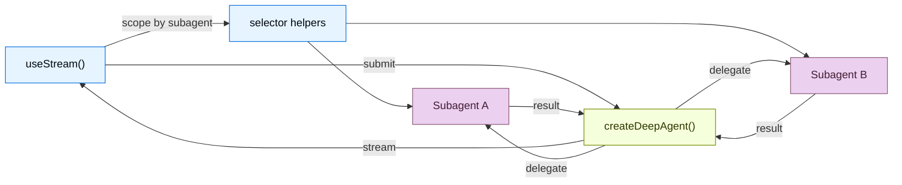

# 前端总览

> 原文：Overview
> 来源：https://docs.langchain.com/oss/javascript/deepagents/frontend/overview

---

> 构建能够展示 Deep Agents 实时 subagent 数据流、任务进度和 sandbox 的 UI

构建能够实时可视化 deep agent 工作流的前端。这些模式展示了如何为使用 `createDeepAgent` 创建的 agent 渲染 subagent 进度、任务规划、流式内容以及类 IDE 的 sandbox 体验。

当 UI 让任务委派变得可见时，deep agents 才最有用。LangChain SDKs 不再展示单个不透明的 assistant 气泡，而是暴露 coordinator、subagent 发现、自定义状态以及基于 sandbox 的产物，这样用户就可以查看一个长时间运行的任务是如何被分解和完成的。

> **注意**：这些模式使用 v1 前端 SDK 包。如果你使用的是更早的版本，请参阅 [React](https://github.com/langchain-ai/langgraphjs/blob/main/libs/sdk-react/docs/v1-migration.md)、[Vue](https://github.com/langchain-ai/langgraphjs/blob/main/libs/sdk-vue/docs/v1-migration.md)、[Svelte](https://github.com/langchain-ai/langgraphjs/blob/main/libs/sdk-svelte/docs/v1-migration.md) 和 [Angular](https://github.com/langchain-ai/langgraphjs/blob/main/libs/sdk-angular/docs/v1-migration.md) 的迁移指南。

## 架构

Deep Agents 采用 coordinator-worker 架构。主 agent 规划任务并委派给专门的 subagents，每个 subagent 独立运行。在前端，v1 stream handle 在 root stream 上展示 coordinator 消息，并暴露 subagent 发现快照，用于按范围查看 subagent。



```ts
import { createDeepAgent } from "deepagents";

const agent = createDeepAgent({
  tools: [getWeather],
  systemPrompt: "You are a helpful assistant",
  subagents: [
    {
      name: "researcher",
      description: "Research assistant",
      systemPrompt: "You are a research assistant.",
    },
  ],
});
```

在前端，使用 [`useStream`](https://reference.langchain.com/javascript/langchain-react/index/useStream) 连接，方式与 `createAgent` 相同。传入一个[类型参数](/oss/javascript/langchain/frontend/overview)以获得类型安全的 stream state。Deep agent 模式使用 `stream.subagents`、诸如 `useMessages(stream, subagent)` 的 selector helpers，以及诸如 `stream.values.todos` 的自定义 state 值来渲染特定于 subagent 的 UI。

```ts
import { useStream } from "@langchain/react";

function App() {
  const stream = useStream<typeof agent>({
    apiUrl: "http://localhost:2024",
    assistantId: "agent",
  });

  // Deep agent state beyond messages
  const todos = stream.values?.todos;
  const subagents = [...stream.subagents.values()];
}
```

## SDK 暴露了什么

Deep agent UIs 通常需要的不仅仅是最终答案。前端 SDK 为你提供了针对用户所关心的 run 各个部分的结构化投影：

| Projection         | Use it for                                                                                                 |
| ------------------ | ---------------------------------------------------------------------------------------------------------- |
| `stream.messages`  | coordinator 对话和最终综合结果。                                                                            |
| `stream.subagents` | 对专门 worker 的实时发现，包括状态和任务元数据。                                                            |
| `stream.values`    | 共享状态，例如 todos、plans、report sections、sandbox metadata，或你的 agent 写入的任何自定义 key。         |
| Tool-call state    | 将 filesystem、search、browser 或 domain tools 渲染为带进度和结果的卡片。                                    |
| Interrupts         | 在不丢失 run state 的情况下，暂停被委派的工作以等待用户审批或缺失的输入。                                     |

这让你能够构建出比起普通的聊天记录，更接近 IDE、任务看板或工作流监视器的界面。

## 模式

> **Subagent streaming**（[链接](/oss/javascript/deepagents/frontend/subagent-streaming)）：展示带有流式内容、进度跟踪和可折叠卡片的专门 subagents。

> **Todo list**（[链接](/oss/javascript/deepagents/frontend/todo-list)）：当 agent 选择启用任务规划时，用实时 todo 列表跟踪进度。

> **Sandbox**（[链接](/oss/javascript/deepagents/frontend/sandbox)）：构建一个类 IDE 的 UI，带有由 sandbox 支持的文件浏览器、代码查看器和 diff 面板。

## 相关模式

[LangChain frontend patterns](/oss/javascript/langchain/frontend/overview)，包括 markdown messages、tool calling 和 human-in-the-loop，也都可以用于 deep agents。Deep Agents 构建在同一个 LangGraph runtime 之上，因此 `useStream` 提供相同的核心 API。

关于更底层的 graph 可视化，请参阅 [LangGraph frontend patterns](/oss/javascript/langgraph/frontend/overview)。它们展示了如何将 graph nodes 和 state keys 直接映射到 UI 组件。
