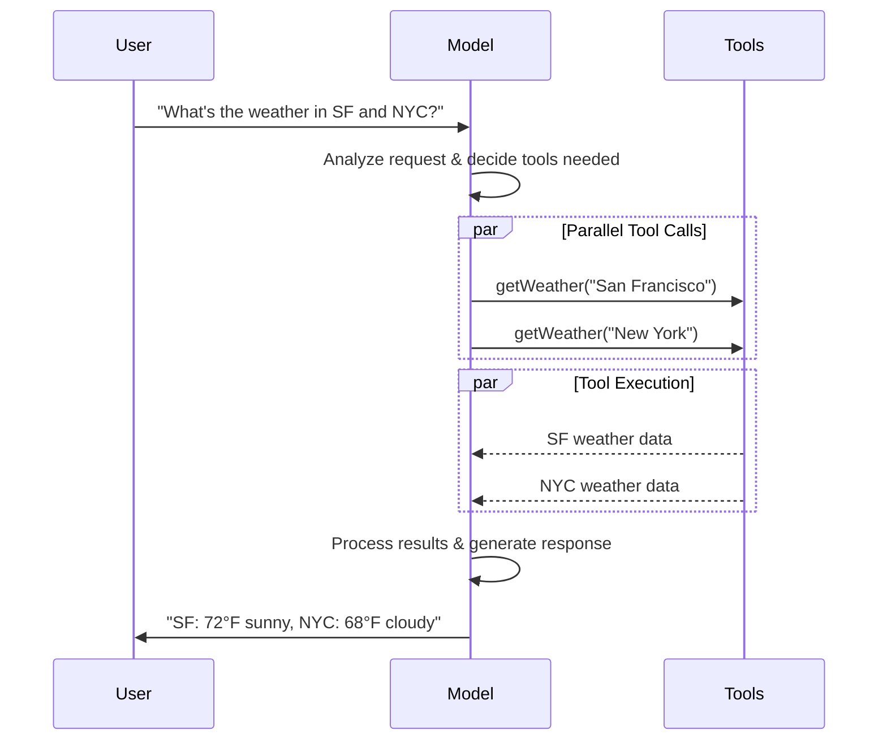

# Models（模型）

> 原文：https://docs.langchain.com/oss/javascript/langchain/models
> LangChain (TypeScript) 官方文档中文整理

[LLM](https://en.wikipedia.org/wiki/Large_language_model)（大语言模型）是强大的 AI 工具，能够像人类一样理解并生成文本。它们足够通用，无需针对每个任务进行专门训练，就能编写内容、翻译语言、进行摘要和回答问题。

除了文本生成之外，许多模型还支持：

* [工具调用](#tool-calling) - 调用外部工具（如数据库查询或 API 调用），并在响应中使用其结果。
* [结构化输出](#structured-output) - 将模型的响应约束为遵循已定义的格式。
* [多模态](#multimodal) - 处理并返回文本以外的数据，例如图像、音频和视频。
* [推理](#reasoning) - 模型执行多步推理以得出结论。

模型是[智能体](/oss/javascript/langchain/agents)的推理引擎。它们驱动智能体的决策过程，决定调用哪些工具、如何解读结果，以及何时给出最终答案。

你所选模型的质量和能力会直接影响智能体的基线可靠性和性能。不同的模型擅长不同的任务——有些更擅长遵循复杂指令，有些更擅长结构化推理，还有一些支持更大的上下文窗口以处理更多信息。

LangChain 的标准模型接口让你可以访问许多不同的 provider 集成，从而轻松地试验和切换模型，找到最适合你用例的那一个。

有关特定 provider 的集成信息和能力，请参阅该 provider 的[聊天模型页面](/oss/javascript/integrations/chat)。

> 【提示】[LangSmith](/langsmith/observability) 会追踪每一次模型调用，因此你可以比较 provider、检查工具路由并调试失败。按照[追踪快速入门](/langsmith/trace-with-langchain)进行设置。
>
> 我们还建议你设置 [LangSmith Engine](/langsmith/engine)，它会监控你的 trace、检测问题并提出修复建议。

## 基础用法

模型可以通过两种方式使用：

1. **配合智能体** - 在创建[智能体](/oss/javascript/langchain/agents#model)时可以动态指定模型。
2. **独立使用** - 可以在智能体循环之外直接调用模型，用于文本生成、分类或抽取等任务，而无需智能体框架。

同一套模型接口在两种场景下都适用，这让你可以灵活地从简单起步，并在需要时扩展到更复杂的基于智能体的工作流。

### 初始化模型

在 LangChain 中开始使用独立模型最简单的方式，是使用 `initChatModel` 从你选择的[聊天模型 provider](/oss/javascript/integrations/chat) 初始化一个模型（示例如下）：

#### OpenAI

👉 阅读 [OpenAI 聊天模型集成文档](/oss/javascript/integrations/chat/openai/)

**npm**

```bash
npm install @langchain/openai
```

**pnpm**

```bash
pnpm install @langchain/openai
```

**yarn**

```bash
yarn add @langchain/openai
```

**bun**

```bash
bun add @langchain/openai
```

**initChatModel**

```typescript
import { initChatModel } from "langchain";

process.env.OPENAI_API_KEY = "your-api-key";

const model = await initChatModel("gpt-5.5");
```

**Model Class**

```typescript
import { ChatOpenAI } from "@langchain/openai";

const model = new ChatOpenAI({
  model: "gpt-5.5",
  apiKey: "your-api-key"
});
```

#### Anthropic

👉 阅读 [Anthropic 聊天模型集成文档](/oss/javascript/integrations/chat/anthropic/)

**npm**

```bash
npm install @langchain/anthropic
```

**pnpm**

```bash
pnpm install @langchain/anthropic
```

**yarn**

```bash
yarn add @langchain/anthropic
```

**pnpm**

```bash
pnpm add @langchain/anthropic
```

**initChatModel**

```typescript
import { initChatModel } from "langchain";

process.env.ANTHROPIC_API_KEY = "your-api-key";

const model = await initChatModel("claude-sonnet-4-6");
```

**Model Class**

```typescript
import { ChatAnthropic } from "@langchain/anthropic";

const model = new ChatAnthropic({
  model: "claude-sonnet-4-6",
  apiKey: "your-api-key"
});
```

#### Azure

👉 阅读 [Azure 聊天模型集成文档](/oss/javascript/integrations/chat/azure/)

**npm**

```bash
npm install @langchain/azure
```

**pnpm**

```bash
pnpm install @langchain/azure
```

**yarn**

```bash
yarn add @langchain/azure
```

**bun**

```bash
bun add @langchain/azure
```

**initChatModel**

```typescript
import { initChatModel } from "langchain";

process.env.AZURE_OPENAI_API_KEY = "your-api-key";
process.env.AZURE_OPENAI_ENDPOINT = "your-endpoint";
process.env.OPENAI_API_VERSION = "your-api-version";

const model = await initChatModel("azure_openai:gpt-5.5");
```

**Model Class**

```typescript
import { AzureChatOpenAI } from "@langchain/openai";

const model = new AzureChatOpenAI({
  model: "gpt-5.5",
  azureOpenAIApiKey: "your-api-key",
  azureOpenAIApiEndpoint: "your-endpoint",
  azureOpenAIApiVersion: "your-api-version"
});
```

#### Google Gemini

👉 阅读 [Google GenAI 聊天模型集成文档](/oss/javascript/integrations/chat/google_generative_ai/)

**npm**

```bash
npm install @langchain/google-genai
```

**pnpm**

```bash
pnpm install @langchain/google-genai
```

**yarn**

```bash
yarn add @langchain/google-genai
```

**bun**

```bash
bun add @langchain/google-genai
```

**initChatModel**

```typescript
import { initChatModel } from "langchain";

process.env.GOOGLE_API_KEY = "your-api-key";

const model = await initChatModel("google-genai:gemini-3.7-flash");
```

**Model Class**

```typescript
import { ChatGoogleGenerativeAI } from "@langchain/google-genai";

const model = new ChatGoogleGenerativeAI({
  model: "gemini-3.7-flash",
  apiKey: "your-api-key"
});
```

#### Bedrock Converse

👉 阅读 [AWS Bedrock 聊天模型集成文档](/oss/javascript/integrations/chat/bedrock_converse/)

**npm**

```bash
npm install @langchain/aws
```

**pnpm**

```bash
pnpm install @langchain/aws
```

**yarn**

```bash
yarn add @langchain/aws
```

**bun**

```bash
bun add @langchain/aws
```

**initChatModel**

```typescript
import { initChatModel } from "langchain";

// Follow the steps here to configure your credentials:
// https://docs.aws.amazon.com/bedrock/latest/userguide/getting-started.html

const model = await initChatModel("bedrock:gpt-5.5");
```

**Model Class**

```typescript
import { ChatBedrockConverse } from "@langchain/aws";

// Follow the steps here to configure your credentials:
// https://docs.aws.amazon.com/bedrock/latest/userguide/getting-started.html

const model = new ChatBedrockConverse({
  model: "gpt-5.5",
  region: "us-east-2"
});
```

```typescript
const response = await model.invoke("Why do parrots talk?");
```

更多细节（包括如何传递模型[参数](#parameters)）请参阅 [`initChatModel`](https://reference.langchain.com/javascript/langchain/chat_models/universal/initChatModel)。

### 支持的 provider 与模型

LangChain 通过专门的集成包支持所有主流模型 provider。每个 provider 包都实现相同的标准接口，因此你无需重写应用逻辑就能切换 provider。新的模型名称可以立即使用——无需更新 LangChain——因为 provider 包会把模型名称直接传递给 provider 的 API。

浏览[受支持 provider 的完整列表](/oss/javascript/integrations/providers/overview)，或查看 [Provider 与模型](/oss/javascript/concepts/providers-and-models)，了解 provider、包和模型名称在 LangChain 中如何协同工作的概念性概述。

### 关键方法

- [Invoke](#invoke)：模型以消息作为输入，在生成完整响应后输出消息。
- [Stream](#stream)：调用模型，但实时流式输出生成的内容。
- [Batch](#batch)：批量向模型发送多个请求，以提高处理效率。

> 【信息】除了聊天模型之外，LangChain 还支持其他相关技术，例如嵌入模型和向量存储。详情请参阅[集成页面](/oss/javascript/integrations/providers/overview)。

## 参数

聊天模型接受可用于配置其行为的参数。受支持的完整参数集因模型和 provider 而异，但标准参数包括：

- `model`（string，必填）：你要在某个 provider 上使用的具体模型的名称或标识符。你也可以使用 `'{model_provider}:{model}'` 格式在单个参数中同时指定模型及其 provider，例如 `'openai:o1'`。
- `apiKey`（string）：向模型 provider 进行身份验证所需的密钥。通常在你注册获取模型访问权限时签发。通常通过设置环境变量来获取。
- `temperature`（number）：控制模型输出的随机性。数值越高，响应越有创造性；数值越低，响应越确定。
- `maxTokens`（number）：限制响应中的 token 总数，从而有效控制输出的长度。
- `timeout`（number）：在取消请求之前，等待模型响应的最长时间（以秒为单位）。
- `maxRetries`（number，默认 `6`）：当请求因网络超时或速率限制等问题失败时，系统重新发送请求的最大尝试次数。重试使用带抖动的指数退避。网络错误、速率限制（429）和服务器错误（5xx）会自动重试。诸如 401（未授权）或 404 之类的客户端错误不会重试。对于不可靠网络上的长时间运行的[智能体](/oss/javascript/deepagents/overview)任务，可考虑将其提高到 10–15。
  在支持该功能的 provider 上，[模型重试中间件](/oss/javascript/langchain/middleware/built-in#model-retry)会接管它所包装调用的重试，此处的值对其不适用。

使用 `initChatModel` 时，将这些参数作为内联参数传入：

```typescript
const model = await initChatModel(
    "claude-sonnet-4-6",
    { temperature: 0.7, timeout: 30, maxTokens: 1000, maxRetries: 6 }
)
```

### 连接韧性

LangChain 聊天模型会自动以指数退避重试失败的 API 请求。默认情况下，模型会对网络错误、速率限制（429）和服务器错误（5xx）最多重试 **6 次**。诸如 401（未授权）或 404 之类的客户端错误不会重试。

你可以在创建模型时调整 `maxRetries` 和 `timeout`，然后将该实例传给 `createAgent`、`createDeepAgent`，或独立调用它：

```typescript
import { ChatAnthropic } from "@langchain/anthropic";

const model = new ChatAnthropic({
  model: "google_genai:gemini-3.6-flash",
  maxRetries: 10, // Increase for unreliable networks (default: 6)
  timeout: 120_000, // Milliseconds; increase for slow connections
});
```

> 【提示】对于不可靠网络上的长时间运行的智能体图，可考虑更高的 `max_retries`（例如 10–15）以及一个[检查点保存器（checkpointer）](/oss/javascript/langgraph/persistence)，以便在失败时保留进度。

> 【信息】每个聊天模型集成都可能带有用于控制 provider 特定功能的额外参数。
>
> 例如，[`ChatOpenAI`](https://reference.langchain.com/javascript/langchain-openai/ChatOpenAI) 有 `use_responses_api`，用于指定使用 OpenAI Responses API 还是 Completions API。
>
> 要查找给定聊天模型支持的所有参数，请前往[聊天模型集成](/oss/javascript/integrations/chat)页面。

***

## 调用

必须调用聊天模型才能生成输出。有三种主要的调用方法，各自适用于不同的用例。

### Invoke

调用模型最直接的方式是使用 [`invoke()`](https://reference.langchain.com/javascript/classes/_langchain_core.language_models_chat_models.BaseChatModel.html#invoke)，传入单条消息或一组消息。

```typescript
const response = await model.invoke("Why do parrots have colorful feathers?");
console.log(response);
```

可以向聊天模型提供一组消息，用以表示对话历史。每条消息都有一个角色（role），模型用它来指示对话中消息的发送者。

有关角色、类型和内容的更多细节，请参阅[消息](/oss/javascript/langchain/messages)指南。

```typescript
const conversation = [
  { role: "system", content: "You are a helpful assistant that translates English to French." },
  { role: "user", content: "Translate: I love programming." },
  { role: "assistant", content: "J'adore la programmation." },
  { role: "user", content: "Translate: I love building applications." },
];

const response = await model.invoke(conversation);
console.log(response);  // AIMessage("J'adore créer des applications.")
```

```typescript
import { HumanMessage, AIMessage, SystemMessage } from "langchain";

const conversation = [
  new SystemMessage("You are a helpful assistant that translates English to French."),
  new HumanMessage("Translate: I love programming."),
  new AIMessage("J'adore la programmation."),
  new HumanMessage("Translate: I love building applications."),
];

const response = await model.invoke(conversation);
console.log(response);  // AIMessage("J'adore créer des applications.")
```

> 【信息】如果你的调用返回类型是字符串，请确保你使用的是聊天模型而不是 LLM。旧式的文本补全 LLM 会直接返回字符串。LangChain 聊天模型以 "Chat" 为前缀，例如 [`ChatOpenAI`](https://reference.langchain.com/javascript/langchain-openai/ChatOpenAI)（/oss/integrations/chat/openai）。

### Stream

大多数模型可以在生成输出内容的同时进行流式传输。通过逐步显示输出，流式传输能显著改善用户体验，尤其是对于较长的响应。

调用 [`stream()`](https://reference.langchain.com/javascript/classes/_langchain_core.language_models_chat_models.BaseChatModel.html#stream) 会返回一个迭代器，它会在输出分块产生时逐个产出。你可以使用循环实时处理每个分块：

**基础文本流式输出**

```typescript
const stream = await model.stream("Why do parrots have colorful feathers?");
for await (const chunk of stream) {
  console.log(chunk.text)
}
```

**流式输出工具调用、推理及其他内容**

```typescript
const stream = await model.stream("What color is the sky?");
for await (const chunk of stream) {
  for (const block of chunk.contentBlocks) {
    if (block.type === "reasoning") {
      console.log(`Reasoning: ${block.reasoning}`);
    } else if (block.type === "tool_call_chunk") {
      console.log(`Tool call chunk: ${block}`);
    } else if (block.type === "text") {
      console.log(block.text);
    } else {
      ...
    }
  }
}
```

与 [`invoke()`](#invoke) 在模型生成完整响应后返回单个 [`AIMessage`](https://reference.langchain.com/javascript/langchain-core/messages/AIMessage) 不同，`stream()` 会返回多个 [`AIMessageChunk`](https://reference.langchain.com/javascript/langchain-core/messages/AIMessageChunk) 对象，每个对象包含输出文本的一部分。重要的是，流中的每个分块都被设计为可以通过求和汇总成一条完整消息：

```typescript
let full: AIMessageChunk | null = null;
for await (const chunk of stream) {
  full = full ? full.concat(chunk) : chunk;
  console.log(full.text);
}

// The
// The sky
// The sky is
// The sky is typically
// The sky is typically blue
// ...

console.log(full.contentBlocks);
// [{"type": "text", "text": "The sky is typically blue..."}]
```

得到的消息可以与通过 [`invoke()`](#invoke) 生成的消息同等对待——例如，它可以被聚合进消息历史，并作为对话上下文传回给模型。

> 【警告】流式传输只有在程序中的所有步骤都知道如何处理分块流时才能工作。例如，一个不支持流式传输的应用，就是那种需要先把整个输出存储在内存中才能处理的应用。

#### 高级流式主题

##### 流式事件

LangChain 聊天模型也可以使用 `streamEvents()` 流式传输语义事件。

这简化了基于事件类型和其他元数据的过滤，并会在后台聚合完整消息。示例如下。

```typescript
const stream = await model.streamEvents("Hello");
for await (const event of stream) {
    if (event.event === "on_chat_model_start") {
        console.log(`Input: ${event.data.input}`);
    }
    if (event.event === "on_chat_model_stream") {
        console.log(`Token: ${event.data.chunk.text}`);
    }
    if (event.event === "on_chat_model_end") {
        console.log(`Full message: ${event.data.output.text}`);
    }
}
```

```txt
Input: Hello
Token: Hi
Token:  there
Token: !
Token:  How
Token:  can
Token:  I
...
Full message: Hi there! How can I help today?
```

有关事件类型和其他细节，请参阅 [`streamEvents()`](https://reference.langchain.com/javascript/classes/_langchain_core.language_models_chat_models.BaseChatModel.html#streamEvents) 参考文档。

##### "自动流式"聊天模型

LangChain 简化了聊天模型的流式传输：在某些情况下，即使你没有显式调用流式方法，它也会自动启用流式模式。当你使用非流式的 invoke 方法，但仍希望流式传输整个应用（包括聊天模型的中间结果）时，这尤其有用。

例如，在 [LangGraph 智能体](/oss/javascript/langchain/agents)中，你可以在节点内调用 `model.invoke()`，但如果运行在流式模式下，LangChain 会自动委托给流式传输。

**工作原理**

当你 `invoke()` 一个聊天模型时，如果 LangChain 检测到你正在尝试流式传输整个应用，它会自动切换到内部的流式模式。对于使用 invoke 的代码而言，调用结果保持不变；然而，在聊天模型进行流式传输时，LangChain 会负责在 LangChain 的回调系统中触发 [`on_llm_new_token`](https://reference.langchain.com/javascript/interfaces/_langchain_core.callbacks_base.BaseCallbackHandlerMethods.html#onLlmNewToken) 事件。

回调事件让 LangGraph 的 `stream()` 和 `streamEvents()` 能够实时呈现聊天模型的输出。

### Batch

将一组相互独立的请求批量发送给模型，可以显著提升性能并降低成本，因为处理可以并行进行：

```typescript
const responses = await model.batch([
  "Why do parrots have colorful feathers?",
  "How do airplanes fly?",
  "What is quantum computing?",
  "Why do parrots have colorful feathers?",
  "How do airplanes fly?",
  "What is quantum computing?",
]);
for (const response of responses) {
  console.log(response);
}
```

> 【提示】使用 `batch()` 处理大量输入时，你可能需要控制并行调用的最大数量。可以通过在 [`RunnableConfig`](https://reference.langchain.com/javascript/langchain-core/runnables/RunnableConfig) 字典中设置 `maxConcurrency` 属性来实现。
>
> ```typescript
> model.batch(
>   listOfInputs,
>   {
>     maxConcurrency: 5,  // Limit to 5 parallel calls
>   }
> )
> ```
>
> 有关受支持属性的完整列表，请参阅 [`RunnableConfig`](https://reference.langchain.com/javascript/langchain-core/runnables/RunnableConfig) 参考文档。

有关批处理的更多细节，请参阅[参考文档](https://reference.langchain.com/javascript/classes/_langchain_core.language_models_chat_models.BaseChatModel.html#batch)。

***

## 工具调用

模型可以请求调用执行任务的工具，例如从数据库获取数据、搜索网络或运行代码。工具由以下两部分配对组成：

1. 一个 schema，包括工具名称、描述和/或参数定义（通常是 JSON schema）
2. 一个用于执行的函数或协程

> 【提示】你可能会听到“函数调用（function calling）”这个术语。我们将其与“工具调用（tool calling）”互换使用。

以下是用户与模型之间基本的工具调用流程：



要让你定义的工具可供模型使用，必须使用 [`bindTools`](https://reference.langchain.com/javascript/classes/_langchain_core.language_models_chat_models.BaseChatModel.html#bindTools) 将它们绑定。在后续调用中，模型可以按需选择调用任何已绑定的工具。

一些模型 provider 提供可以通过模型或调用参数启用的内置工具（例如服务端执行的工具，如网络搜索和代码解释器）（例如 [`ChatOpenAI`](/oss/javascript/integrations/chat/openai)、[`ChatAnthropic`](/oss/javascript/integrations/chat/anthropic)）。详情请查看相应的 [provider 参考](/oss/javascript/integrations/providers/overview)。

> 【提示】有关创建工具的细节和其他选项，请参阅[工具指南](/oss/javascript/langchain/tools)。

```typescript
import { tool } from "langchain";
import * as z from "zod";
import { ChatOpenAI } from "@langchain/openai";

const getWeather = tool(
  (input) => `It's sunny in ${input.location}.`,
  {
    name: "get_weather",
    description: "Get the weather at a location.",
    schema: z.object({
      location: z.string().describe("The location to get the weather for"),
    }),
  },
);

const model = new ChatOpenAI({ model: "gpt-5.5" });
const modelWithTools = model.bindTools([getWeather]);

const response = await modelWithTools.invoke("What's the weather like in Boston?");
const toolCalls = response.tool_calls || [];
for (const tool_call of toolCalls) {
  // View tool calls made by the model
  console.log(`Tool: ${tool_call.name}`);
  console.log(`Args: ${tool_call.args}`);
}
```

绑定用户自定义工具时，模型的响应会包含一个执行工具的**请求**。当你脱离[智能体](/oss/javascript/langchain/agents)单独使用模型时，需要由你执行所请求的工具，并将结果返回给模型，供其后续推理使用。当使用[智能体](/oss/javascript/langchain/agents)时，智能体循环会为你处理工具执行循环。

下面，我们展示一些使用工具调用的常见方式。

#### 工具执行循环

当模型返回工具调用时，你需要执行这些工具并将结果传回给模型。这会形成一个对话循环，模型可以利用工具结果生成最终响应。LangChain 包含了[智能体](/oss/javascript/langchain/agents)抽象来为你处理这种编排。

以下是一个简单示例：

```typescript
// Bind (potentially multiple) tools to the model
const modelWithTools = model.bindTools([get_weather])

// Step 1: Model generates tool calls
const messages = [{"role": "user", "content": "What's the weather in Boston?"}]
const ai_msg = await modelWithTools.invoke(messages)
messages.push(ai_msg)

// Step 2: Execute tools and collect results
for (const tool_call of ai_msg.tool_calls) {
    // Execute the tool with the generated arguments
    const tool_result = await get_weather.invoke(tool_call)
    messages.push(tool_result)
}

// Step 3: Pass results back to model for final response
const final_response = await modelWithTools.invoke(messages)
console.log(final_response.text)
// "The current weather in Boston is 72°F and sunny."
```

工具返回的每条 [`ToolMessage`](https://reference.langchain.com/javascript/langchain-core/messages/ToolMessage) 都包含一个与原始工具调用匹配的 `tool_call_id`，帮助模型将结果与请求关联起来。

#### 强制工具调用

默认情况下，模型可以根据用户输入自由选择使用哪个已绑定的工具。但是，你可能希望强制选择一个工具，确保模型使用某个特定工具或给定列表中的**任意**工具：

**强制使用任意工具**

```typescript
const modelWithTools = model.bindTools([tool_1], { toolChoice: "any" })
```

**强制使用特定工具**

```typescript
const modelWithTools = model.bindTools([tool_1], { toolChoice: "tool_1" })
```

#### 并行工具调用

许多模型在适当的情况下支持并行调用多个工具。这使模型能够同时从不同来源收集信息。

```typescript
const modelWithTools = model.bind_tools([get_weather])

const response = await modelWithTools.invoke(
    "What's the weather in Boston and Tokyo?"
)


// The model may generate multiple tool calls
console.log(response.tool_calls)
// [
//   { name: 'get_weather', args: { location: 'Boston' }, id: 'call_1' },
//   { name: 'get_weather', args: { location: 'Tokyo' }, id: 'call_2' }
// ]


// Execute all tools (can be done in parallel with async)
const results = []
for (const tool_call of response.tool_calls || []) {
    if (tool_call.name === 'get_weather') {
        const result = await get_weather.invoke(tool_call)
        results.push(result)
    }
}
```

模型会根据所请求操作的独立性，智能判断何时适合并行执行。

> 【提示】大多数支持工具调用的模型默认启用并行工具调用。一些模型（包括 [OpenAI](/oss/javascript/integrations/chat/openai) 和 [Anthropic](/oss/javascript/integrations/chat/anthropic)）允许你禁用此功能。要做到这一点，请设置 `parallel_tool_calls=False`：
>
> ```python
> model.bind_tools([get_weather], parallel_tool_calls=False)
> ```

#### 流式工具调用

在流式传输响应时，工具调用会通过 [`ToolCallChunk`](https://reference.langchain.com/javascript/langchain-core/messages/ContentBlock/Tools/ToolCallChunk) 逐步构建。这让你可以在工具调用生成时就看到它们，而无需等待完整响应。

```typescript
const stream = await modelWithTools.stream(
    "What's the weather in Boston and Tokyo?"
)
for await (const chunk of stream) {
    // Tool call chunks arrive progressively
    if (chunk.tool_call_chunks) {
        for (const tool_chunk of chunk.tool_call_chunks) {
        console.log(`Tool: ${tool_chunk.get('name', '')}`)
        console.log(`Args: ${tool_chunk.get('args', '')}`)
        }
    }
}

// Output:
// Tool: get_weather
// Args:
// Tool:
// Args: {"loc
// Tool:
// Args: ation": "BOS"}
// Tool: get_time
// Args:
// Tool:
// Args: {"timezone": "Tokyo"}
```

你可以累积分块以构建完整的工具调用：

```typescript
let full: AIMessageChunk | null = null
const stream = await modelWithTools.stream("What's the weather in Boston?")
for await (const chunk of stream) {
    full = full ? full.concat(chunk) : chunk
    console.log(full.contentBlocks)
}
```

***

## 结构化输出

可以要求模型以匹配给定 schema 的格式提供响应。这有助于确保输出易于解析并可用于后续处理。LangChain 支持多种 schema 类型和强制结构化输出的方法。

> 【提示】要了解结构化输出，请参阅[结构化输出](/oss/javascript/langchain/structured-output)。

#### Zod

[zod schema](https://zod.dev/) 是定义输出 schema 的首选方式。请注意，当提供 zod schema 时，模型输出还会使用 zod 的 parse 方法依据该 schema 进行校验。

```typescript
import * as z from "zod";

const Movie = z.object({
  title: z.string().describe("The title of the movie"),
  year: z.number().describe("The year the movie was released"),
  director: z.string().describe("The director of the movie"),
  rating: z.number().describe("The movie's rating out of 10"),
});

const modelWithStructure = model.withStructuredOutput(Movie);

const response = await modelWithStructure.invoke("Provide details about the movie Inception");
console.log(response);
// {
//   title: "Inception",
//   year: 2010,
//   director: "Christopher Nolan",
//   rating: 8.8,
// }
```

#### JSON Schema

为了获得最大控制力或互操作性，你可以提供原始的 JSON Schema。

```typescript
const jsonSchema = {
  "title": "Movie",
  "description": "A movie with details",
  "type": "object",
  "properties": {
    "title": {
      "type": "string",
      "description": "The title of the movie",
    },
    "year": {
      "type": "integer",
      "description": "The year the movie was released",
    },
    "director": {
      "type": "string",
      "description": "The director of the movie",
    },
    "rating": {
      "type": "number",
      "description": "The movie's rating out of 10",
    },
  },
  "required": ["title", "year", "director", "rating"],
}

const modelWithStructure = model.withStructuredOutput(
  jsonSchema,
  { method: "jsonSchema" },
)

const response = await modelWithStructure.invoke("Provide details about the movie Inception")
console.log(response)  // {'title': 'Inception', 'year': 2010, ...}
```

#### Standard Schema

任何实现了 [Standard Schema](https://standardschema.dev/) 规范的库所提供的 schema 也都受支持。Standard Schema 对象会在运行时通过 schema 的 `~standard.validate()` 方法进行校验。

```typescript
import * as v from "valibot";
import { toStandardJsonSchema } from "@valibot/to-json-schema";

const Movie = toStandardJsonSchema(
  v.object({
    title: v.pipe(v.string(), v.description("The title of the movie")),
    year: v.pipe(v.number(), v.description("The year the movie was released")),
    director: v.pipe(v.string(), v.description("The director of the movie")),
    rating: v.pipe(v.number(), v.description("The movie's rating out of 10")),
  })
);

const modelWithStructure = model.withStructuredOutput(Movie);

const response = await modelWithStructure.invoke("Provide details about the movie Inception");
console.log(response);
// {
//   title: "Inception",
//   year: 2010,
//   director: "Christopher Nolan",
//   rating: 8.8,
// }
```

> 【提示】**结构化输出的关键注意事项：**
>
> * **Method 参数**：一些 provider 支持不同的方法（`'jsonSchema'`、`'functionCalling'`、`'jsonMode'`）
> * **Include raw**：使用 [`includeRaw: true`](https://reference.langchain.com/javascript/classes/_langchain_core.language_models_chat_models.BaseChatModel.html#withStructuredOutput) 可以同时获得解析后的输出和原始的 [`AIMessage`](https://reference.langchain.com/javascript/langchain-core/messages/AIMessage)
> * **校验**：Zod 和 Standard Schema 对象提供自动校验，而 JSON Schema 需要手动校验
> * **Standard Schema**：任何实现了 [Standard Schema](https://standardschema.dev/) 规范的 schema 库都受支持，并会在运行时进行校验
>
> 有关支持的方法和配置选项，请参阅你的 [provider 集成页面](/oss/javascript/integrations/providers/overview)。

#### 示例：在解析结构的同时输出消息

将原始的 [`AIMessage`](https://reference.langchain.com/javascript/langchain-core/messages/AIMessage) 对象与解析后的表示一起返回，可能很有用，这样可以访问响应元数据，例如 [token 数量](#token-usage)。为此，请在调用 [`with_structured_output`](https://reference.langchain.com/javascript/classes/_langchain_core.language_models_chat_models.BaseChatModel.html#withStructuredOutput) 时设置 [`include_raw=True`](https://reference.langchain.com/javascript/classes/_langchain_core.language_models_chat_models.BaseChatModel.html#withStructuredOutput)：

```typescript
import * as z from "zod";

const Movie = z.object({
  title: z.string().describe("The title of the movie"),
  year: z.number().describe("The year the movie was released"),
  director: z.string().describe("The director of the movie"),
  rating: z.number().describe("The movie's rating out of 10"),
  title: z.string().describe("The title of the movie"),
  year: z.number().describe("The year the movie was released"),
  director: z.string().describe("The director of the movie"),
  rating: z.number().describe("The movie's rating out of 10"),
});

const modelWithStructure = model.withStructuredOutput(Movie, { includeRaw: true });

const response = await modelWithStructure.invoke("Provide details about the movie Inception");
console.log(response);
// {
//   raw: AIMessage { ... },
//   parsed: { title: "Inception", ... }
// }
```

#### 示例：嵌套结构

Schema 可以嵌套：

```typescript
import * as z from "zod";

const Actor = z.object({
  name: z.string(),
  role: z.string(),
});

const MovieDetails = z.object({
  title: z.string(),
  year: z.number(),
  cast: z.array(Actor),
  genres: z.array(z.string()),
  budget: z.number().nullable().describe("Budget in millions USD"),
});

const modelWithStructure = model.withStructuredOutput(MovieDetails);
```

***

## 高级主题

### 模型档案

> 【信息】模型档案（Model profiles）需要 `langchain>=1.1`。

LangChain 聊天模型可以通过 `profile` 属性暴露一个包含受支持特性和能力的字典：

```typescript
model.profile;
// {
//   maxInputTokens: 400000,
//   imageInputs: true,
//   reasoningOutput: true,
//   toolCalling: true,
//   ...
// }
```

完整的字段集合请参阅 [API 参考](https://reference.langchain.com/javascript/langchain-core/language_models/profile/ModelProfile)。

大部分模型档案数据由 [models.dev](https://github.com/sst/models.dev) 项目提供支持，这是一个提供模型能力数据的开源项目。这些数据为配合 LangChain 使用而附加了额外字段。随着上游项目演进，这些附加内容会保持与之对齐。

模型档案数据让应用可以动态地适配模型能力。例如：

1. [摘要中间件](/oss/javascript/langchain/middleware/built-in#summarization)可以根据模型的上下文窗口大小触发摘要。
2. `createAgent` 中的[结构化输出](/oss/javascript/langchain/structured-output)策略可以被自动推断（例如，通过检查是否支持原生结构化输出特性）。
3. 可以根据支持的[模态](#multimodal)和最大输入 token 数来限制模型输入。
4. [Deep Agents Code](/oss/deepagents/code) 会将[交互式模型切换器](/oss/deepagents/code/providers#which-models-appear-in-the-switcher)过滤为档案中报告支持 `tool_calling` 且支持文本 I/O 的模型，并在选择器详情视图中显示上下文窗口大小和能力标志。

#### 修改档案数据

当模型档案数据缺失、过时或不正确时，可以对其进行修改。

**方案 1（快速修复）**

你可以用任何有效的 profile 实例化聊天模型：

```typescript
const customProfile = {
maxInputTokens: 100_000,
toolCalling: true,
structuredOutput: true,
// ...
};
const model = initChatModel("...", { profile: customProfile });
```

**方案 2（在上游修复数据）**

数据的主要来源是 [models.dev](https://models.dev/) 项目。这些数据会与 LangChain [集成包](/oss/javascript/integrations/providers/overview)中的额外字段和覆盖项合并，并随这些包一起发布。

模型档案数据可以通过以下流程更新：

1. （如有需要）通过向 [models.dev 的 GitHub 仓库](https://github.com/sst/models.dev)提交 pull request，更新 [models.dev](https://models.dev/) 上的源数据。
2. （如有需要）通过向 LangChain [集成包](/oss/javascript/integrations/providers/overview)提交 pull request，更新 `langchain-<package>/profiles.toml` 中的额外字段和覆盖项。

> 【警告】模型档案是 beta 特性。档案的格式可能会发生变化。

### 多模态

某些模型可以处理并返回非文本数据，例如图像、音频和视频。你可以通过提供[内容块](/oss/javascript/langchain/messages#message-content)将非文本数据传给模型。

> 【提示】所有具备底层多模态能力的 LangChain 聊天模型都支持：
>
> 1. 跨 provider 标准格式的数据（参见[我们的消息指南](/oss/javascript/langchain/messages)）
> 2. OpenAI [chat completions](https://platform.openai.com/docs/api-reference/chat) 格式
> 3. 该特定 provider 原生的任何格式（例如，Anthropic 模型接受 Anthropic 原生格式）

详情请参阅消息指南的[多模态部分](/oss/javascript/langchain/messages#multimodal)。

[某些模型](https://models.dev/)可以在其响应中返回多模态数据。如果被要求这样做，得到的 [`AIMessage`](https://reference.langchain.com/javascript/langchain-core/messages/AIMessage) 将带有包含多模态类型的内容块。

```typescript
const response = await model.invoke("Create a picture of a cat");
console.log(response.contentBlocks);
// [
//   { type: "text", text: "Here's a picture of a cat" },
//   { type: "image", data: "...", mimeType: "image/jpeg" },
// ]
```

有关特定 provider 的详情，请参阅[集成页面](/oss/javascript/integrations/providers/overview)。

### 推理

许多模型能够执行多步推理以得出结论。这涉及将复杂问题分解为更小、更易管理的步骤。

**如果底层模型支持**，你可以呈现这一推理过程，以便更好地理解模型是如何得出最终答案的。

**流式输出推理内容**

```typescript
const stream = model.stream("Why do parrots have colorful feathers?");
for await (const chunk of stream) {
    const reasoningSteps = chunk.contentBlocks.filter(b => b.type === "reasoning");
    console.log(reasoningSteps.length > 0 ? reasoningSteps : chunk.text);
}
```

**完整输出推理内容**

```typescript
const response = await model.invoke("Why do parrots have colorful feathers?");
const reasoningSteps = response.contentBlocks.filter(b => b.type === "reasoning");
console.log(reasoningSteps.map(step => step.reasoning).join(" "));
```

取决于模型，你有时可以指定它应投入的推理努力程度。类似地，你也可以要求模型完全关闭推理。这可能表现为分类式的推理“层级”（例如 `'low'` 或 `'high'`），或整数形式的 token 预算。

详情请参阅你所用聊天模型的[集成页面](/oss/javascript/integrations/providers/overview)或[参考文档](https://reference.langchain.com/python/integrations/)。

### 本地模型

LangChain 支持在你自己的硬件上本地运行模型。这在数据隐私至关重要、你想调用自定义模型，或者想避免使用基于云的模型所产生的成本时很有用。

[Ollama](/oss/javascript/integrations/chat/ollama) 是在本地运行聊天模型和嵌入模型最简单的方式之一。

### 提示词缓存

许多 provider 提供提示词缓存特性，以减少重复处理相同 token 时的延迟和成本。你可以在三个层面启用缓存：

* **隐式 provider 缓存：** 如果请求命中缓存，provider 会自动将成本节省传递给你，无需任何配置。例如：[OpenAI](/oss/javascript/integrations/chat/openai) 和 [Gemini](/oss/javascript/integrations/chat/google_generative_ai)。
* **provider 级显式控制：** provider 允许你手动指定缓存点，以获得更强的控制力或保证成本节省。这些行为与底层 provider/API 行为一致。例如：
  * [`ChatOpenAI`](https://reference.langchain.com/javascript/langchain-openai/ChatOpenAI)（通过 `prompt_cache_key`）
  * Anthropic 内容块的 [`cache_control`](/oss/javascript/integrations/chat/anthropic#prompt-caching)
  * [Gemini](https://reference.langchain.com/python/integrations/langchain_google_genai/)。

> 【警告】提示词缓存通常只在超过最低输入 token 阈值时才会启用。详情请参阅 [provider 页面](/oss/javascript/integrations/chat)。

缓存使用情况会反映在模型响应的[用量元数据](/oss/javascript/langchain/messages#token-usage)中。

### 服务端工具使用

一些 provider 支持服务端的[工具调用](#tool-calling)循环：模型可以在单个对话轮次中与网络搜索、代码解释器和其他工具交互，并分析结果。

如果模型在服务端调用工具，响应消息的内容将包含代表该工具调用与结果的内容。访问响应的[内容块](/oss/javascript/langchain/messages#standard-content-blocks)会以 provider 无关的格式返回服务端工具调用和结果：

```typescript
import { initChatModel } from "langchain";

const model = await initChatModel("gpt-5.4-mini");
const modelWithTools = model.bindTools([{ type: "web_search" }])

const message = await modelWithTools.invoke("What was a positive news story from today?");
console.log(message.contentBlocks);
```

这代表单个对话轮次；与客户端[工具调用](#tool-calling)不同，这里没有需要传入的关联 [ToolMessage](/oss/javascript/langchain/messages#tool-message) 对象。

有关可用工具和使用细节，请参阅你所用 provider 的[集成页面](/oss/javascript/integrations/chat)。

### Base URL 与代理设置

你可以为实现了 OpenAI Chat Completions API 的 provider 配置自定义 base URL。

> 【警告】`model_provider="openai"`（或直接使用 `ChatOpenAI`）面向的是官方 OpenAI API 规范。来自路由器和代理的 provider 特定字段可能不会被提取或保留。
>
> 对于 OpenRouter 和 LiteLLM，请优先使用专门的集成：
>
> * [通过 `ChatOpenRouter` 使用 OpenRouter](/oss/javascript/integrations/chat/openrouter)（`langchain-openrouter`）
> * [通过 `ChatLiteLLM` / `ChatLiteLLMRouter` 使用 LiteLLM](/oss/javascript/integrations/chat)（`langchain-litellm`）

#### 自定义 base URL

许多模型 provider 提供 OpenAI 兼容的 API（例如 [Together AI](https://www.together.ai/)、[vLLM](https://github.com/vllm-project/vllm)）。你可以通过指定合适的 `base_url` 参数，对这些 provider 使用 `initChatModel`：

```python
model = initChatModel(
    "MODEL_NAME",
    {
        modelProvider: "openai",
        baseUrl: "BASE_URL",
        apiKey: "YOUR_API_KEY",
    }
)
```

> 【提示】使用直接实例化聊天模型类时，参数名称可能因 provider 而异。详情请查看相应的[参考文档](/oss/javascript/integrations/providers/overview)。

### 对数概率

某些模型可以被配置为在初始化模型时通过设置 `logprobs` 参数来返回 token 级别的对数概率，表示给定 token 的可能性：

```typescript
const model = new ChatOpenAI({
    model: "gpt-5.5",
    logprobs: true,
});

const responseMessage = await model.invoke("Why do parrots talk?");

responseMessage.response_metadata.logprobs.content.slice(0, 5);
```

### Token 用量

许多模型 provider 会在调用响应中返回 token 用量信息。当可用时，这些信息会包含在相应模型产生的 [`AIMessage`](https://reference.langchain.com/javascript/langchain-core/messages/AIMessage) 对象上。更多细节请参阅[消息](/oss/javascript/langchain/messages)指南。

### 调用配置

调用模型时，你可以通过 `config` 参数使用 [`RunnableConfig`](https://reference.langchain.com/javascript/langchain-core/runnables/RunnableConfig) 对象传入额外配置。这为执行行为、回调和元数据追踪提供了运行时控制。

常见的配置选项包括：

```typescript
const response = await model.invoke(
    "Tell me a joke",
    {
        runName: "joke_generation",      // Custom name for this run
        tags: ["humor", "demo"],          // Tags for categorization
        metadata: {"user_id": "123"},     // Custom metadata
        callbacks: [my_callback_handler], // Callback handlers
    }
)
```

这些配置值在以下场景中特别有用：

* 使用 [LangSmith](/langsmith/observability) 追踪进行调试
* 实现自定义日志或监控
* 控制生产环境中的资源使用
* 在复杂流水线中追踪调用

#### 关键配置属性

- `runName`（string）：在日志和 trace 中标识这一特定的调用。不会被子调用继承。
- `tags`（string[]）：被所有子调用继承的标签，用于在调试工具中过滤和组织。
- `metadata`（object）：用于追踪额外上下文的自定义键值对，会被所有子调用继承。
- `maxConcurrency`（number）：控制使用 `batch()` 时并行调用的最大数量。
- `callbacks`（CallbackHandler[]）：用于在执行期间监控和响应事件的处理程序。
- `recursion_limit`（number）：链的最大递归深度，用于防止复杂流水线中的无限循环。

> 【提示】有关所有受支持属性，请参阅完整的 [`RunnableConfig`](https://reference.langchain.com/javascript/langchain-core/runnables/RunnableConfig) 参考文档。

### 动态模型选择

动态模型会在运行时根据当前的 state 和上下文进行选择。这可以实现复杂的路由逻辑和成本优化。

要使用动态模型，请创建带有 `wrapModelCall` 的中间件，在请求中修改模型：

```ts
import { ChatOpenAI } from "@langchain/openai";
import { createAgent, createMiddleware } from "langchain";

const basicModel = new ChatOpenAI({ model: "gpt-5.4-mini" });
const advancedModel = new ChatOpenAI({ model: "gpt-5.5" });

const dynamicModelSelection = createMiddleware({
  name: "DynamicModelSelection",
  wrapModelCall: (request, handler) => {
    // Choose model based on conversation complexity
    const messageCount = request.messages.length;

    return handler({
        ...request,
        model: messageCount > 10 ? advancedModel : basicModel,
    });
  },
});

const agent = createAgent({
  model: "gpt-5.4-mini", // Base model (used when messageCount ≤ 10)
  tools: [],
  middleware: [dynamicModelSelection],
});
```

有关中间件和高级模式的更多细节，请参阅[中间件文档](/oss/javascript/langchain/middleware)。

> 【提示】有关模型配置的细节，请参阅[模型](/oss/javascript/langchain/models)。有关动态模型选择的模式，请参阅[中间件中的动态模型](/oss/javascript/langchain/middleware#dynamic-model)。

---

> 【信息】将这些文档连接到 Claude、VSCode 等，通过 MCP 获得实时答案：[连接这些文档](/use-these-docs)。
>
> 在 GitHub 上[编辑此页面](https://github.com/langchain-ai/docs/edit/main/src/oss/langchain/models.mdx)或[提交 issue](https://github.com/langchain-ai/docs/issues/new/choose)。


