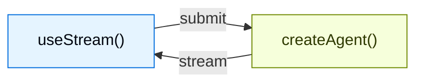

# 概览

> 原文：https://docs.langchain.com/oss/javascript/langchain/frontend/overview
> LangChain (TypeScript) 官方文档中文整理

> 使用来自 LangChain 智能体的实时流构建生成式 UI

为用 `createAgent` 创建的智能体构建丰富、可交互的前端。这些模式涵盖了从基础的消息渲染到高级工作流的全部内容，例如人在环路批准、排队提交、可持久化流的重新加入（durable stream rejoin）以及时间旅行调试。

LangChain 前端 SDK 是为**智能体应用**而构建的，而不仅仅是逐 token 流式输出的聊天机器人。渲染消息的同一个 hook 还暴露了智能体的可持久化线程状态、工具调用生命周期、中断（interrupt）、检查点历史以及自定义状态值，因此你的 UI 可以成为长时间运行的智能体工作的控制平面。

> 【提示】这些模式使用 v1 前端 SDK 包。如果你使用的是更早的版本，请参阅迁移指南：[React](https://github.com/langchain-ai/langgraphjs/blob/main/libs/sdk-react/docs/v1-migration.md)、[Vue](https://github.com/langchain-ai/langgraphjs/blob/main/libs/sdk-vue/docs/v1-migration.md)、[Svelte](https://github.com/langchain-ai/langgraphjs/blob/main/libs/sdk-svelte/docs/v1-migration.md) 和 [Angular](https://github.com/langchain-ai/langgraphjs/blob/main/libs/sdk-angular/docs/v1-migration.md)。

## 架构

每种模式都遵循相同的架构：`createAgent` 后端通过 SDK 流 API 将状态流式传输到前端。



在后端，`createAgent` 会生成一个已编译的 LangGraph 图，它暴露了流式 API。在前端，流句柄（stream handle）连接到该 API，并提供响应式状态——消息、工具调用、中断、值和线程元数据——你可以用任意框架来渲染它们。

## 为什么要使用 LangChain 前端 SDK？

大多数 AI UI 库只是帮你把流式文本追加到聊天记录中。LangChain 的 SDK 暴露了生产级智能体所需的更丰富的运行时语义：

| 能力                            | 它在你的 UI 中能实现什么                                                                                                         |
| ------------------------------- | -------------------------------------------------------------------------------------------------------------------------------- |
| **可持久化线程（Durable threads）** | 重新加载页面、切换设备或重新加入一次运行，而不会丢失对话状态。                                                                  |
| **带类型的智能体状态**          | 渲染任意状态键，而不仅仅是消息：待办事项、管道输出、引用、沙箱文件、指标或自定义业务对象。                                     |
| **工具调用生命周期**            | 将待处理、已完成和失败的工具调用显示为专用的 UI 卡片，而不是原始 JSON。                                                         |
| **中断（Interrupts）**          | 暂停执行以进行人工批准、编辑或补充缺失信息，然后从智能体停止的确切位置恢复。                                                   |
| **检查点（Checkpoints）**       | 基于持久化的状态快照构建编辑、重试、分支、审计和时间旅行流程。                                                                  |
| **嵌套执行**                    | 可视化深度智能体、子智能体和图节点，而不必把所有内容都压平成一条难以阅读的流。                                                  |
| **框架原生响应式**              | 在 React、Vue、Svelte 或 Angular 中使用相同的协议，同时保持符合各自习惯的 hooks、composables、stores 或 signals。               |

这些原语让你可以设计出这样的 UI：用户能够在智能体工作进行的当下检查、引导、暂停、恢复和分叉它的工作。

#### agent.ts

```ts
import { createAgent } from "langchain";
import { MemorySaver } from "@langchain/langgraph";

const agent = createAgent({
  model: "openai:gpt-5.5",
  tools: [getWeather, searchWeb],
  checkpointer: new MemorySaver(),
});
```

#### Chat.tsx

```tsx
import { useStream } from "@langchain/react";
import type { agent } from "./agent";

function Chat() {
  const stream = useStream<typeof agent>({
    apiUrl: "http://localhost:2024",
    assistantId: "agent",
  });

  return (
    <div>
      {stream.messages.map((msg) => (
        <Message key={msg.id} message={msg} />
      ))}
    </div>
  );
}
```

React、Vue 和 Svelte 使用 `useStream`。Angular 使用 `injectStream`：

```ts
import { useStream } from "@langchain/react";      // React
import { useStream } from "@langchain/vue";        // Vue
import { useStream } from "@langchain/svelte";     // Svelte
import { injectStream } from "@langchain/angular"; // Angular
```

## 类型推断

向 [`useStream`](https://reference.langchain.com/javascript/langchain-react/index/useStream)（或 Angular 中的 [`injectStream`](https://reference.langchain.com/javascript/langchain-angular/injectStream)）传入一个类型参数，即可对 `stream.messages`、`stream.toolCalls`、`stream.interrupt`、`stream.values` 以及其他响应式状态进行类型安全的访问。

导入你的智能体，并将 `typeof myAgent` 作为类型参数传入。TypeScript 会从已编译的图推断出状态 schema：

```ts
import type { myAgent } from "./agent";

const stream = useStream<typeof myAgent>({
  apiUrl: "http://localhost:2024",
  assistantId: "agent",
});
```

自定义状态键会自动被推断，无需手写 interface。

## 模式

### 渲染消息与输出

* **Markdown 消息** —— 解析并渲染流式 markdown，具备正确的格式和代码高亮：`/oss/javascript/langchain/frontend/markdown-messages`
* **结构化输出** —— 将带类型的智能体响应渲染为自定义 UI 组件，而不是纯文本：`/oss/javascript/langchain/frontend/structured-output`
* **推理 token** —— 在可折叠的块中显示模型的思考过程：`/oss/javascript/langchain/frontend/reasoning-tokens`
* **生成式 UI** —— 渲染智能体生成的界面，覆盖从受控到声明式再到开放式的一整个谱系：`/oss/javascript/langchain/frontend/generative-ui-overview`

### 显示智能体动作

* **工具调用** —— 将工具调用显示为丰富、类型安全的 UI 卡片，带有加载和错误状态：`/oss/javascript/langchain/frontend/tool-calling`
* **无头工具（Headless tools）** —— 在客户端运行浏览器和设备 API，同时在智能体上保留带类型的工具 schema：`/oss/javascript/langchain/frontend/headless-tools`
* **人在环路** —— 暂停智能体以进行人工审核，支持批准、拒绝和编辑工作流：`/oss/javascript/langchain/frontend/human-in-the-loop`

### 管理对话

* **分支式聊天** —— 编辑消息、重新生成响应，并在对话分支之间导航：`/oss/javascript/langchain/frontend/branching-chat`
* **消息队列** —— 在智能体顺序处理消息的同时排队多条消息：`/oss/javascript/langchain/frontend/message-queues`

### 高级流式传输

* **加入与重新加入流** —— 与正在运行的智能体流断开并重新连接，而不会丢失进度：`/oss/javascript/langchain/frontend/join-rejoin`
* **时间旅行** —— 检查、导航并恢复对话历史中的任意检查点：`/oss/javascript/langchain/frontend/time-travel`

## 选择前端模式

从你的应用需要回答的 UX 问题出发：

| 如果用户需要……                              | 从以下内容开始                                                                                                                                                                              |
| ------------------------------------------- | ------------------------------------------------------------------------------------------------------------------------------------------------------------------------------------------- |
| 理解智能体正在做什么                        | [工具调用](/oss/javascript/langchain/frontend/tool-calling) 和 [推理 token](/oss/javascript/langchain/frontend/reasoning-tokens)                                                             |
| 安全地批准敏感操作                          | [人在环路](/oss/javascript/langchain/frontend/human-in-the-loop)                                                                                                                            |
| 在一次运行处于活动状态时发送工作            | [消息队列](/oss/javascript/langchain/frontend/message-queues)                                                                                                                               |
| 离开后再回到长时间运行的工作                | [加入与重新加入流](/oss/javascript/langchain/frontend/join-rejoin)                                                                                                                          |
| 从更早的一轮进行编辑或重试                  | [分支式聊天](/oss/javascript/langchain/frontend/branching-chat) 和 [时间旅行](/oss/javascript/langchain/frontend/time-travel)                                                               |
| 将状态渲染为应用而非聊天                    | [结构化输出](/oss/javascript/langchain/frontend/structured-output)、[生成式 UI](/oss/javascript/langchain/frontend/generative-ui-overview) 和 [Deep Agents 前端模式](/oss/javascript/deepagents/frontend/overview) |

## 集成

流 API 与 UI 无关。你可以将它与任何组件库或生成式 UI 框架一起使用。组件库可以负责展示层，而 LangChain 的 SDK 在底层负责智能体运行时状态、可恢复性、中断和检查点语义。

* **AI Elements** —— 用于 AI 聊天的可组合 shadcn/ui 组件：`Conversation`、`Message`、`Tool`、`Reasoning`：`/oss/javascript/langchain/frontend/integrations/ai-elements`
* **assistant-ui** —— 无头 React 框架，内置线程管理、分支和附件支持：`/oss/javascript/langchain/frontend/integrations/assistant-ui`
* **OpenUI** —— 使用 openui-lang 组件 DSL 的生成式 UI 库，用于数据丰富的报告和仪表板：`/oss/javascript/langchain/frontend/integrations/openui`

---

> 【信息】[通过 MCP 将这些文档连接到](/use-these-docs) Claude、VSCode 等，以获得实时答案。

> 【信息】[在 GitHub 上编辑此页面](https://github.com/langchain-ai/docs/edit/main/src/oss/langchain/frontend/overview.mdx) 或 [提交 issue](https://github.com/langchain-ai/docs/issues/new/choose)。
