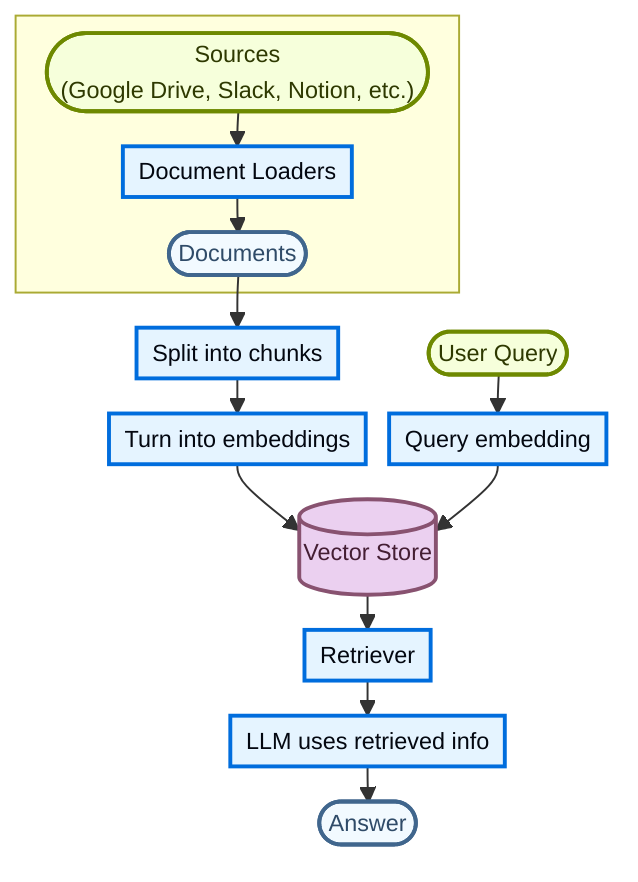
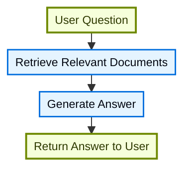
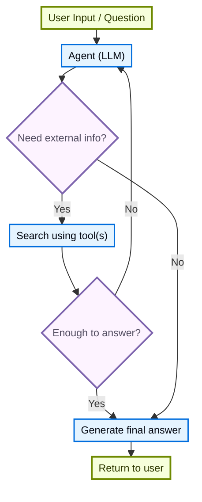
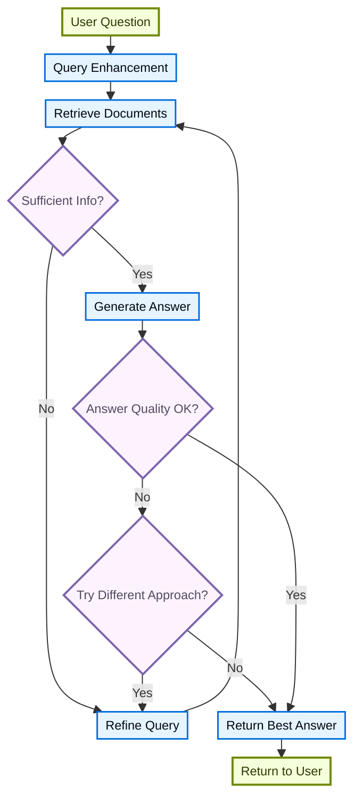

# 检索（Retrieval）

> 原文：https://docs.langchain.com/oss/javascript/deepagents/retrieval
> LangChain (TypeScript) 官方文档中文整理

大型语言模型（LLM）非常强大，但存在两个关键局限：

* **上下文有限**：它们无法一次性摄入整个语料库。
* **知识静态**：它们的训练数据冻结在某个时间点。

检索（Retrieval）通过在查询时获取相关的外部知识来解决这些问题。这是 **检索增强生成（Retrieval-Augmented Generation，RAG）** 的基础，用特定于上下文的信息来增强 LLM 的回答。

## 构建知识库

**知识库（knowledge base）** 是检索期间使用的一个文档或结构化数据仓库。

如果你需要自定义知识库，可以使用 LangChain 的文档加载器（document loaders）和向量存储（vector stores），从你自己的数据构建一个。

> 【提示】如果你已经有知识库（例如 SQL 数据库、文档数据库、CRM 或内部文档系统），你**无需**重建它。你可以：
>
> * 在 Agentic RAG 中把它作为智能体的**工具**连接起来。
> * 查询它，并将检索到的内容作为上下文提供给 LLM [（2 步 RAG）](#2-step-rag)。

更多信息，请参阅以下教程，构建一个可搜索的知识库和最小化的 RAG 工作流：

**[教程：语义搜索](https://docs.langchain.com/oss/javascript/langchain/knowledge-base)**

了解如何使用 LangChain 的文档加载器、嵌入（embeddings）和向量存储，从你自己的数据创建一个可搜索的知识库。在本教程中，你将构建一个基于 PDF 的搜索引擎，从而能够检索与查询相关的段落。你还将在这个引擎之上实现一个最小化的 RAG 工作流，看看外部知识如何被整合到 LLM 的推理中。

### 从检索到 RAG

检索允许 LLM 在运行时访问相关上下文。但大多数真实世界的应用会更进一步：它们**将检索与生成整合**，以产生有依据、能感知上下文的回答。

这就是 **检索增强生成（RAG）** 的核心思想。检索流水线成为更广泛系统的基础，该系统将搜索与生成结合起来。

### 检索流水线

一个典型的检索工作流如下：



每个组件都是模块化的：你可以替换加载器、分割器（splitters）、嵌入或向量存储，而无需重写应用的逻辑。

### 构建模块

**[文档加载器（Document loaders）](https://docs.langchain.com/oss/javascript/integrations/document_loaders)**

从外部来源（Google Drive、Slack、Notion 等）摄入数据，返回标准化的 [`Document`](https://reference.langchain.com/javascript/langchain-core/documents/Document) 对象。

**[嵌入模型（Embedding models）](https://docs.langchain.com/oss/javascript/integrations/embeddings)**

嵌入模型将文本转换为一组数字向量，使得含义相近的文本在该向量空间中彼此靠近。

**[向量存储（Vector stores）](https://docs.langchain.com/oss/javascript/integrations/vectorstores/)**

用于存储和搜索嵌入的专用数据库。

**[检索器（Retrievers）](https://docs.langchain.com/oss/javascript/integrations/retrievers/)**

检索器是一个接口，给定一个非结构化查询，返回相应的文档。

## RAG 架构

RAG 可以根据你的系统需求，以多种方式实现。下面各节我们逐一概述每种类型。

| 架构 | 描述 | 控制力 | 灵活性 | 延迟 | 示例用例 |
| --- | --- | --- | --- | --- | --- |
| **2 步 RAG（2-Step RAG）** | 检索总是发生在生成之前。简单且可预测 | ✅ 高 | ❌ 低 | ⚡ 快 | FAQ、文档机器人 |
| **Agentic RAG** | 由 LLM 驱动的智能体在推理过程中决定*何时*以及*如何*检索 | ❌ 低 | ✅ 高 | ⏳ 可变 | 可访问多个工具的研究助手 |
| **混合（Hybrid）** | 结合两种方法的特点，并带有验证步骤 | ⚖️ 中等 | ⚖️ 中等 | ⏳ 可变 | 带质量验证的领域特定问答 |

> 【信息】**延迟**：在 **2 步 RAG** 中，延迟通常更**可预测**，因为 LLM 调用的最大次数是已知且有上限的。这种可预测性假设 LLM 推理时间是主导因素。然而，真实世界的延迟还可能受到检索步骤性能的影响，例如 API 响应时间、网络延迟或数据库查询，这些会因所使用的工具和基础设施而有所不同。

### 2 步 RAG

在 **2 步 RAG** 中，检索步骤总是在生成步骤之前执行。这种架构直接且可预测，适合许多应用场景——在这些场景中，检索相关文档是生成回答的明确前提。



<br />

**[教程：语义搜索](https://docs.langchain.com/oss/javascript/langchain/knowledge-base)**

使用文档加载器、嵌入和向量存储构建一个可搜索的知识库，然后在其之上运行一个最小化的“先检索后生成”RAG 工作流。

**[教程：评估一个 RAG 应用](https://docs.langchain.com/langsmith/evaluate-rag-tutorial)**

构建一个简单的“先检索后生成”RAG 应用，并使用 LangSmith 衡量答案的正确性、相关性、有据性（groundedness）和检索质量。

### Agentic RAG

**Agentic 检索增强生成（Agentic RAG）** 将检索增强生成的优势与基于智能体的推理相结合。智能体（由 LLM 驱动）不再在回答之前检索文档，而是逐步推理，并在交互过程中决定**何时**以及**如何**检索信息。

> 【提示】智能体要启用 RAG 行为，唯一需要的是能够访问一个或多个可以获取外部知识的**工具**，例如文档加载器、Web API 或数据库查询。



```typescript
import { tool, createAgent } from "langchain";

const fetchUrl = tool(
    (url: string) => {
        return `Fetched content from ${url}`;
    },
    { name: "fetch_url", description: "Fetch text content from a URL" }
);

const agent = createAgent({
    model: "claude-sonnet-4-6",
    tools: [fetchUrl],
    systemPrompt,
});
```

<details>
<summary><strong>扩展示例：面向 LangGraph 的 llms.txt 的 Agentic RAG</strong></summary>

这个示例实现了一个 **Agentic RAG 系统**，用来帮助用户查询 LangGraph 文档。该智能体首先加载 [llms.txt](https://llmstxt.org/)，其中列出了可用的文档 URL，然后可以根据用户的问题，动态使用 `fetch_documentation` 工具来检索并处理相关内容。

```typescript
import { tool, createAgent, HumanMessage } from "langchain";
import * as z from "zod";

const ALLOWED_DOMAINS = ["https://langchain-ai.github.io/"];
const LLMS_TXT = "https://langchain-ai.github.io/langgraph/llms.txt";

const fetchDocumentation = tool(
  async (input) => {
    if (!ALLOWED_DOMAINS.some((domain) => input.url.startsWith(domain))) {
      return `Error: URL not allowed. Must start with one of: ${ALLOWED_DOMAINS.join(", ")}`;
    }
    const response = await fetch(input.url);
    if (!response.ok) {
      throw new Error(`HTTP error! status: ${response.status}`);
    }
    return response.text();
  },
  {
    name: "fetch_documentation",
    description: "Fetch and convert documentation from a URL",
    schema: z.object({
      url: z.string().describe("The URL of the documentation to fetch"),
    }),
  }
);

const llmsTxtResponse = await fetch(LLMS_TXT);
const llmsTxtContent = await llmsTxtResponse.text();

const systemPrompt = `
You are an expert TypeScript developer and technical assistant.
Your primary role is to help users with questions about LangGraph and related tools.

Instructions:

1. If a user asks a question you're unsure about—or one that likely involves API usage,
   behavior, or configuration—you MUST use the \`fetch_documentation\` tool to consult the relevant docs.
2. When citing documentation, summarize clearly and include relevant context from the content.
3. Do not use any URLs outside of the allowed domain.
4. If a documentation fetch fails, tell the user and proceed with your best expert understanding.

You can access official documentation from the following approved sources:

${llmsTxtContent}

You MUST consult the documentation to get up to date documentation
before answering a user's question about LangGraph.

Your answers should be clear, concise, and technically accurate.
`;

const tools = [fetchDocumentation];

const agent = createAgent({
  model: "claude-sonnet-4-6"
  tools,
  systemPrompt,
  name: "Agentic RAG",
});

const response = await agent.invoke({
  messages: [
    new HumanMessage(
      "Write a short example of a langgraph agent using the " +
      "prebuilt create react agent. the agent should be able " +
      "to look up stock pricing information."
    ),
  ],
});

console.log(response.messages.at(-1)?.content);
```

</details>

**[教程：使用 Deep Agents 的 RAG](https://docs.langchain.com/oss/javascript/deepagents/rag)**

构建一个文档问答智能体，它在查询时检索相关片段，将它们卸载到文件系统，并把分析委托给子智能体。

### 混合 RAG

混合 RAG 结合了 2 步 RAG 和 Agentic RAG 两者的特点。它引入了中间步骤，例如查询预处理、检索验证和生成后检查。这类系统比固定流水线提供更大的灵活性，同时仍对执行保持一定的控制。

典型组件包括：

* **查询增强（Query enhancement）**：修改输入问题以提高检索质量。这可能涉及重写不清晰的查询、生成多个变体，或用额外上下文扩展查询。
* **检索验证（Retrieval validation）**：评估检索到的文档是否相关且充分。如果不是，系统可以改进查询并重新检索。
* **答案验证（Answer validation）**：检查生成的答案在准确性、完整性以及与源内容的一致性方面是否达标。如有需要，系统可以重新生成或修订答案。

这种架构通常支持在这些步骤之间进行多次迭代：



这种架构适用于：

* 查询模糊或描述不明确的应用
* 需要验证或质量控制步骤的系统
* 涉及多个来源或迭代改进的工作流

**[教程：带自我纠正的 Agentic RAG](https://docs.langchain.com/oss/javascript/langgraph/agentic-rag)**

一个 **混合 RAG** 的示例，它将智能体式推理与检索及自我纠正结合起来。

***

> [通过 MCP 将这些文档连接到](https://docs.langchain.com/use-these-docs) Claude、VSCode 等，以获得实时答案。
>
> [在 GitHub 上编辑此页面](https://github.com/langchain-ai/docs/edit/main/src/oss/deepagents/retrieval.mdx) 或 [提交 issue](https://github.com/langchain-ai/docs/issues/new/choose)。
